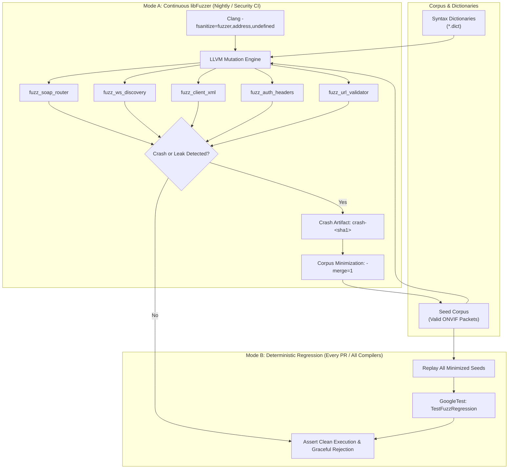

# Implementation Plan: P4 Phase 3 – Continuous Fuzz Testing via LLVM libFuzzer

**Scope:** `libs/Onvif/fuzzing/` (harnesses `fuzz_soap_router.cpp`, `fuzz_ws_discovery.cpp`, `fuzz_client_xml.cpp`, `fuzz_auth_headers.cpp`, `fuzz_url_validator.cpp`, seed corpora `corpus/`, dictionaries `dict/`, standalone test driver `TestFuzzRegression.cpp`, CMake build definitions, and `.github/workflows/fuzzing.yml`)  
**Standard Baseline:** MISRA C++:2023, SEI CERT C++ (ERR55-CPP, INT31-C, STR37-C, FLP34-C, MEM50-CPP), LLVM libFuzzer Standard, OSS-Fuzz Architecture, Project Rules in [`.agents/rules/`](../.agents/rules/)  
**Reference Documents:** [`docs/onvif_p4_verification_plan.md`](onvif_p4_verification_plan.md) (§5 Phase 3), [`docs/onvif_review.md`](onvif_review.md) (§3 Findings C1–C7, §6 Test Assessment, §8 Roadmap P4), [`docs/onvif_p4_phase1_test_decomposition_plan.md`](onvif_p4_phase1_test_decomposition_plan.md), [`docs/onvif_p4_phase2_negative_security_plan.md`](onvif_p4_phase2_negative_security_plan.md)

---

## 1. Executive Summary & Threat Analysis

In [`docs/onvif_p4_verification_plan.md`](onvif_p4_verification_plan.md), **Phase 3** introduces automated, coverage-guided continuous fuzz testing via LLVM `libFuzzer` combined with AddressSanitizer (ASan) and UndefinedBehaviorSanitizer (UBSan).

While Phase P0 introduced network-level security controls (token-bucket rate limiting, AES-256-GCM vault, SSRF validation, replay cache) and Phase 2 established negative protocol fault verification, the internal deserializers, state machines, and header parsers have never been subjected to coverage-guided mutation fuzzing. Network parsers that ingest untrusted byte streams from the network or remote cameras remain vulnerable to edge-case bugs:

1. **SOAP XML Routing & Deserialization (`fuzz_soap_router`):**
   - Untrusted HTTP request bodies pass directly to `pugi::xml_document` and `SoapRouter::dispatch`.
   - Threat vectors include XML entity expansions (Billion Laughs / quadratic blowup), deep element nesting exceeding call stack limits, hostile namespace prefixes, unescaped entity sequences, and malformed UTF-8/control characters triggering memory exhaustion or parser crashes.
2. **WS-Discovery Multicast Ingress (`fuzz_ws_discovery`):**
   - UDP datagrams arriving on multicast port 3702 are unauthenticated and processed before identity validation.
   - Hostile payloads can exploit XML parsing anomalies in `WsDiscoveryValidator::validateProbe` or `OnvifDiscovery::parseProbeMatches`, corrupt RelatesTo UUID buffers, or bypass self-loop and reflection checks.
3. **Remote Camera Response Deserialization (`fuzz_client_xml`):**
   - When the Pelco-D Controller operates as an ONVIF client interacting with third-party IP cameras, it ingests arbitrary SOAP responses via `OnvifClient::parseCapabilitiesResponse`, `parseProfilesResponse`, `parsePtzStatusResponse`, `parseEventMessageResp`, and `parseImagingSettingsResp`.
   - A rogue or compromised camera can supply malformed payloads, integer overflow triggers, or cyclic structures designed to compromise the controller client.
4. **Credential & Authorization Header Tokenizers (`fuzz_auth_headers`):**
   - HTTP `Authorization: Digest ...` headers and SOAP `<wsse:Security>` header blocks contain complex key-value pairs, hex/base64 blobs, and timestamps processed in `UsernameTokenValidator` and `DigestValidator`.
   - Malformed base64 encodings, non-null-terminated strings, missing delimiters, duplicate fields, or corrupted nonce lengths can cause buffer over-reads or unhandled exceptions.
5. **SSRF Notification URL Parsing (`fuzz_url_validator`):**
   - `NotificationUrlValidator::validateUrl` inspects `wsnt:ConsumerReference` URLs for SSRF attacks.
   - Attack vectors include unusual URI schemes, hex/octal IP encodings (`0177.0.0.1`), mixed IPv4-mapped IPv6 literals (`[::ffff:127.0.0.1]`), userinfo smuggling (`user:pass@host`), and invalid port delimiters designed to bypass filter rules.

```
+-----------------------------------------------------------------------------------------------------------------------+
|                                    PHASE 3 FUZZ TESTING REMEDIATION MATRIX                                            |
+----------------------+------------------------------------+-------------------------------------------+---------------+
| Target Component     | Attack Surface / Untrusted Input   | Vulnerabilities Targeted                  | Target Status |
+----------------------+------------------------------------+-------------------------------------------+---------------+
| SoapRouter &         | Raw HTTP body byte streams over    | XML bomb / quadratic expansion, stack     | Harness       |
| XmlUtils             | TCP port 8080 (SOAP requests)      | exhaustion, namespace aliasing, bad UTF-8 | Designed      |
+----------------------+------------------------------------+-------------------------------------------+---------------+
| WsDiscoveryValidator | Raw UDP multicast datagrams over   | Parser heap-use-after-free, unhandled     | Harness       |
| & Discovery Parser   | port 3702 (Probe & ProbeMatches)   | exception in noexcept path, buffer read   | Designed      |
+----------------------+------------------------------------+-------------------------------------------+---------------+
| OnvifClient Response | Raw HTTP response bodies received  | Schema mismatch crashes, integer wrap in  | Harness       |
| Deserializers        | from external ONVIF cameras        | vector sizing, unhandled null optional    | Designed      |
+----------------------+------------------------------------+-------------------------------------------+---------------+
| UsernameToken &      | Authorization headers & Security   | Base64 decoder over-read, delimiter       | Harness       |
| DigestValidator      | XML header blocks                  | state machine hang, integer conversion UB | Designed      |
+----------------------+------------------------------------+-------------------------------------------+---------------+
| NotificationUrl-     | ConsumerReference URL strings      | SSRF filter bypass, IP parser confusion,  | Harness       |
| Validator            | in Event Subscribe & Renew         | path normalization failure, port overflow | Designed      |
+----------------------+------------------------------------+-------------------------------------------+---------------+
| CI Regression        | Cross-platform CTest execution     | Standalone seed corpus replay without     | Runner        |
| Driver               | on Linux & Windows (MSVC/GCC)      | requiring Clang libFuzzer engine          | Designed      |
+----------------------+------------------------------------+-------------------------------------------+---------------+
```

---

## 2. Architecture & Design Specifications

### 2.1 Target Directory Layout

All fuzz testing artifacts, harnesses, dictionaries, seed corpora, and build targets reside under `libs/Onvif/fuzzing/`:

```
libs/Onvif/fuzzing/
├── CMakeLists.txt                      # Fuzz targets & standalone test registrations
├── README.md                           # Fuzzing execution and reproduction manual
├── dict/                               # Syntax dictionaries for guided mutations
│   ├── xml.dict                        # XML tags, attributes, entities, delimiters
│   ├── soap.dict                       # SOAP 1.2 envelope, fault codes, namespaces
│   ├── wsd.dict                        # WS-Discovery action URIs, Probe/Match tags
│   ├── auth.dict                       # Digest tokens, realm, nonce, qop keywords
│   └── url.dict                        # URI schemes, IPv6 brackets, control chars
├── corpus/                             # Minimized seed corpora
│   ├── soap_router/                    # Valid TDS, TRT, TPTZ, TEV, TIM requests
│   ├── ws_discovery/                   # Valid Probe & ProbeMatches UDP datagrams
│   ├── client_xml/                     # Valid camera responses for all services
│   ├── auth_headers/                   # Valid UsernameToken & RFC 7616 Digest headers
│   └── url_validator/                  # Valid & edge-case URL strings
├── harnesses/                          # LLVM libFuzzer entrypoints
│   ├── fuzz_soap_router.cpp            # SOAP XML dispatch fuzz harness
│   ├── fuzz_ws_discovery.cpp           # UDP WS-Discovery datagram fuzz harness
│   ├── fuzz_client_xml.cpp             # Client response parser fuzz harness
│   ├── fuzz_auth_headers.cpp           # WS-Security & HTTP Digest fuzz harness
│   └── fuzz_url_validator.cpp          # SSRF URL validator fuzz harness
└── standalone/                         # Dual-mode execution engine
    ├── FuzzStandaloneMain.cpp          # Standalone runner for deterministic replay
    └── TestFuzzRegression.cpp          # GoogleTest fixture executing all corpora
```

### 2.2 Fuzzing Architecture & Execution Pipeline

The fuzzing architecture operates in two complementary modes:
1. **Coverage-Guided Continuous Fuzzing Mode (Clang + libFuzzer + ASan + UBSan):**
   - Active during continuous security testing and nightly CI workflows.
   - Mutates inputs using LLVM coverage feedback and custom dictionaries.
   - Detects buffer overflows, memory leaks, uninitialized memory, undefined behavior, and unhandled exceptions.
2. **Deterministic Seed Corpus Regression Mode (GoogleTest / CTest on all compilers):**
   - Active on standard developer builds and MSVC/GCC CI pipelines where libFuzzer runtime is unavailable.
   - Replays every sample in `libs/Onvif/fuzzing/corpus/` as a deterministic regression test.
   - Ensures that any bug discovered by fuzzing is permanently cataloged as a seed test case and can never regress.

```
+---------------------------------------------------------------------------------------------------+
|                                 PHASE 3 FUZZING EXECUTION ARCHITECTURE                            |
+---------------------------------------------------------------------------------------------------+
|                                                                                                   |
|   [ Source Repositories & Dictionaries ]                                                          |
|      ├── libs/Onvif/fuzzing/dict/*.dict                                                           |
|      └── libs/Onvif/fuzzing/corpus/* (Seed inputs)                                                |
|                     │                                                                             |
|                     ├───► [ Mode A: Coverage-Guided libFuzzer (Clang) ]                           |
|                     │        │                                                                    |
|                     │        ├──► Clang -fsanitize=fuzzer,address,undefined                       |
|                     │        ├──► Corpus Mutation Engine + Dictionary Injection                   |
|                     │        ├──► LLVMFuzzerTestOneInput() Target Harness                         |
|                     │        │      ├── fuzz_soap_router                                          |
|                     │        │      ├── fuzz_ws_discovery                                         |
|                     │        │      ├── fuzz_client_xml                                           |
|                     │        │      ├── fuzz_auth_headers                                         |
|                     │        │      └── fuzz_url_validator                                        |
|                     │        │                                                                    |
|                     │        ▼ (On Crash / Hang / ASan Trigger)                                   |
|                     │     Artifact Generation: crash-<sha1>, leak-<sha1>, timeout-<sha1>          |
|                     │     Triaged & Minimized via `fuzzer -merge=1` ──► Promoted to Seed Corpus   |
|                     │                                                                             |
|                     └───► [ Mode B: Deterministic Regression Runner (MSVC / GCC / Clang) ]        |
|                              │                                                                    |
|                              ├──► Standard CMake Build: `ctest -R TestFuzzRegression`             |
|                              ├──► Iterates over all files in libs/Onvif/fuzzing/corpus/*          |
|                              ├──► Executes harness functions with zero libFuzzer dependencies     |
|                              └──► Verifies: Zero crashes, zero hangs, safe error status returned  |
|                                                                                                   |
+---------------------------------------------------------------------------------------------------+
```

#### Mermaid Diagram: Fuzzing Pipeline & Corpus Lifecycle



---

## 3. Fuzz Target Harness Specifications

### 3.1 Harness 1: SOAP Router & XML Dispatch (`fuzz_soap_router.cpp`)

- **Component Under Test:** `Onvif::SoapRouter`, `Onvif::Xml::sanitizeXml`, `Onvif::XmlUtils`, `pugi::xml_document`.
- **Target Signature:** `extern "C" int LLVMFuzzerTestOneInput(const std::uint8_t* data, std::size_t size)`
- **Input Constraints:** Maximum size $65{,}536$ bytes ($64\text{ KB}$) to bound parsing time.
- **Invariants Tested:**
  - `pugi::xml_document::load_buffer` must never crash, buffer overflow, or leak memory on arbitrary byte sequences.
  - `SoapRouter::extractOpKey` and `SoapRouter::dispatch` must never throw uncaught exceptions.
  - Deeply nested XML elements ($> 100$ levels) must be gracefully rejected without stack exhaustion.
  - Control characters in XML tag names or values must be safely sanitized or rejected.

```cpp
/// @file fuzz_soap_router.cpp
/// @brief libFuzzer harness for ONVIF SOAP operation routing and XML document parsing.

#include <cstddef>
#include <cstdint>
#include <memory>
#include <string>
#include <string_view>

#include <pugixml.hpp>

#include "AccessPolicy.h"
#include "OnvifAuthTypes.h"
#include "OnvifTypes.h"
#include "SoapRouter.h"
#include "XmlUtils.h"

namespace {

constexpr std::size_t kMaxPayloadBytes { 65536U };

[[nodiscard]] Onvif::SoapRouter createFuzzRouter()
{
    Onvif::SoapRouter router;
    // Register mock operations for major services
    router.registerRoute(
        "http://www.onvif.org/ver10/device/wsdl", "GetDeviceInformation",
        Onvif::AccessClass::ReadSystem,
        [](const Onvif::SoapContext&) {
            return Onvif::SoapHandlerResult::ok("<GetDeviceInformationResponse/>");
        });
    router.registerRoute(
        "http://www.onvif.org/ver10/media/wsdl", "GetProfiles",
        Onvif::AccessClass::ReadMedia,
        [](const Onvif::SoapContext&) {
            return Onvif::SoapHandlerResult::ok("<GetProfilesResponse/>");
        });
    router.registerRoute(
        "http://www.onvif.org/ver20/ptz/wsdl", "ContinuousMove",
        Onvif::AccessClass::Actuate,
        [](const Onvif::SoapContext&) {
            return Onvif::SoapHandlerResult::ok("<ContinuousMoveResponse/>");
        });
    return router;
}

} // namespace

extern "C" int LLVMFuzzerTestOneInput(const std::uint8_t* data, std::size_t size)
{
    if (data == nullptr || size == 0U || size > kMaxPayloadBytes) {
        return 0;
    }

    const std::string_view payload(reinterpret_cast<const char*>(data), size);

    // 1. Test XmlUtils sanitization
    static_cast<void>(Onvif::Xml::sanitizeXml(payload));

    // 2. Test pugixml load
    pugi::xml_document doc;
    const pugi::xml_parse_result result = doc.load_buffer(
        data, size, pugi::parse_default | pugi::parse_fragment, pugi::encoding_utf8);

    if (!result) {
        return 0; // Malformed XML rejected cleanly
    }

    // 3. Locate Body element and dispatch
    const pugi::xml_node envelope = doc.document_element();
    pugi::xml_node body = Onvif::Xml::findNodeWithSuffix(envelope, "Body");
    if (!body) {
        body = envelope;
    }

    const pugi::xml_node reqNode = body.first_child();
    if (!reqNode) {
        return 0;
    }

    static const Onvif::SoapRouter router = createFuzzRouter();

    Onvif::SoapContext ctx { };
    ctx.reqNode = reqNode;
    ctx.peerAddress = "127.0.0.1";
    ctx.requestUrl = "/onvif/device_service";
    ctx.principal.authenticated = true;
    ctx.principal.userLevel = Onvif::UserLevel::Administrator;

    // Dispatch operation
    static_cast<void>(router.dispatch(reqNode, ctx, "http://www.onvif.org/ver10/device/wsdl"));

    return 0;
}
```

---

### 3.2 Harness 2: WS-Discovery Multicast Datagrams (`fuzz_ws_discovery.cpp`)

- **Component Under Test:** `Onvif::WsDiscoveryValidator`, `Onvif::OnvifDiscovery::parseProbeMatches`.
- **Target Signature:** `extern "C" int LLVMFuzzerTestOneInput(const std::uint8_t* data, std::size_t size)`
- **Input Constraints:** Maximum size $8{,}192$ bytes ($8\text{ KB}$), representing standard UDP multicast datagram boundaries (MTU limits).
- **Invariants Tested:**
  - `WsDiscoveryValidator::validateProbe` is marked `noexcept` and MUST NEVER throw exceptions or terminate the application (CERT ERR55-CPP).
  - Malformed XML probes, invalid namespaces, missing `<Header>`, missing `<Action>`, or corrupt UUIDs must yield `isValidProbe == false` without memory leaks.
  - Reflection attacks (source port 3702) and self-loop UUIDs must be safely filtered.
  - `OnvifDiscovery::parseProbeMatches` must handle arbitrary camera responses without memory corruptions.

```cpp
/// @file fuzz_ws_discovery.cpp
/// @brief libFuzzer harness for WS-Discovery UDP multicast datagram parsing and validation.

#include <cstddef>
#include <cstdint>
#include <string>
#include <vector>

#include <pugixml.hpp>

#include "OnvifDiscovery.h"
#include "WsDiscoveryValidator.h"

namespace {
constexpr std::size_t kMaxDatagramBytes { 8192U };
const std::string kLocalServiceUuid { "urn:uuid:12345678-1234-1234-1234-123456789abc" };
const std::vector<std::string> kActiveScopes {
    "onvif://www.onvif.org/type/video_encoder",
    "onvif://www.onvif.org/type/ptz",
    "onvif://www.onvif.org/hardware/PelcoD"
};
} // namespace

extern "C" int LLVMFuzzerTestOneInput(const std::uint8_t* data, std::size_t size)
{
    if (data == nullptr || size < 2U || size > kMaxDatagramBytes) {
        return 0;
    }

    // Extract synthetic sender port from first 2 bytes
    const std::uint16_t senderPort = static_cast<std::uint16_t>(
        (static_cast<std::uint16_t>(data[0]) << 8U) | static_cast<std::uint16_t>(data[1]));

    const std::uint8_t* xmlData = data + 2U;
    const std::size_t xmlSize = size - 2U;

    pugi::xml_document doc;
    const pugi::xml_parse_result result = doc.load_buffer(
        xmlData, xmlSize, pugi::parse_default, pugi::encoding_utf8);

    if (result) {
        // Exercise WsDiscoveryValidator (marked noexcept)
        static_cast<void>(Onvif::WsDiscoveryValidator::validateProbe(
            doc, senderPort, kLocalServiceUuid, true, kActiveScopes));

        static_cast<void>(Onvif::WsDiscoveryValidator::matchesScopes(doc, kActiveScopes));
        static_cast<void>(Onvif::WsDiscoveryValidator::matchesTypes(doc));
    }

    // Exercise OnvifDiscovery::parseProbeMatches with raw string
    const std::string rawPayload(reinterpret_cast<const char*>(xmlData), xmlSize);
    static_cast<void>(Onvif::OnvifDiscovery::parseProbeMatches(rawPayload, "192.168.1.100"));

    return 0;
}
```

---

### 3.3 Harness 3: Client Response Deserialization (`fuzz_client_xml.cpp`)

- **Component Under Test:** `Onvif::OnvifClient` static response parsers (`parseCapabilitiesResponse`, `parseDeviceInformationResp`, `parseProfilesResponse`, `parseProfileResponse`, `parseVideoEncoderConfigsResp`, `parseVideoEncoderOptionsResp`, `parseStreamUriResponse`, `parseSnapshotUriResponse`, `parsePtzStatusResponse`, `parsePresetsResponse`, `parsePresetToursResponse`, `parseNodesResponse`, `parseConfigurationsResponse`).
- **Target Signature:** `extern "C" int LLVMFuzzerTestOneInput(const std::uint8_t* data, std::size_t size)`
- **Input Constraints:** Maximum size $65{,}536$ bytes ($64\text{ KB}$). First byte selects target parser; remaining bytes serve as XML payload.
- **Invariants Tested:**
  - Deserializers must never crash on corrupt or truncated XML responses.
  - IEEE 754 specials (`NaN`, `+Inf`, `-Inf`, large exponents) inside `<PanTilt x="..." y="..."/>` or `<Zoom x="..."/>` must be clamped safely without undefined behavior (CERT FLP34-C).
  - Out-of-range integer values must be bounded without wrapping or integer truncation (SEI CERT INT31-C).
  - Missing mandatory XML children must yield `std::nullopt` or empty vectors rather than null-pointer dereferences.

```cpp
/// @file fuzz_client_xml.cpp
/// @brief libFuzzer harness for OnvifClient XML response deserializers across all services.

#include <cstddef>
#include <cstdint>
#include <string>

#include "OnvifClient.h"

namespace {
constexpr std::size_t kMaxResponseBytes { 65536U };
} // namespace

extern "C" int LLVMFuzzerTestOneInput(const std::uint8_t* data, std::size_t size)
{
    if (data == nullptr || size < 2U || size > kMaxResponseBytes) {
        return 0;
    }

    // First byte selects parser domain
    const std::uint8_t selector = data[0];
    const std::string xml(reinterpret_cast<const char*>(data + 1U), size - 1U);

    switch (selector % 12U) {
    case 0U:
        static_cast<void>(Onvif::OnvifClient::parseCapabilitiesResponse(xml));
        break;
    case 1U:
        static_cast<void>(Onvif::OnvifClient::parseDeviceInformationResp(xml));
        break;
    case 2U:
        static_cast<void>(Onvif::OnvifClient::parseProfilesResponse(xml));
        break;
    case 3U:
        static_cast<void>(Onvif::OnvifClient::parseProfileResponse(xml));
        break;
    case 4U:
        static_cast<void>(Onvif::OnvifClient::parseVideoEncoderConfigsResp(xml));
        break;
    case 5U:
        static_cast<void>(Onvif::OnvifClient::parseVideoEncoderOptionsResp(xml));
        break;
    case 6U:
        static_cast<void>(Onvif::OnvifClient::parseStreamUriResponse(xml));
        break;
    case 7U:
        static_cast<void>(Onvif::OnvifClient::parseSnapshotUriResponse(xml));
        break;
    case 8U:
        static_cast<void>(Onvif::OnvifClient::parsePtzStatusResponse(xml));
        break;
    case 9U:
        static_cast<void>(Onvif::OnvifClient::parsePresetsResponse(xml));
        break;
    case 10U:
        static_cast<void>(Onvif::OnvifClient::parsePresetToursResponse(xml));
        break;
    case 11U:
        static_cast<void>(Onvif::OnvifClient::parseConfigurationsResponse(xml));
        break;
    default:
        break;
    }

    return 0;
}
```

---

### 3.4 Harness 4: Authorization Header & Security Parsers (`fuzz_auth_headers.cpp`)

- **Component Under Test:** `Onvif::UsernameTokenValidator`, `Onvif::DigestValidator`, `Onvif::findSecurityHeader`, `Onvif::parseAuthorizationHeader`.
- **Target Signature:** `extern "C" int LLVMFuzzerTestOneInput(const std::uint8_t* data, std::size_t size)`
- **Input Constraints:** Maximum size $8{,}192$ bytes ($8\text{ KB}$).
- **Invariants Tested:**
  - `DigestValidator::validate` must handle arbitrary, malformed, truncated, or hostile `Authorization` headers without buffer over-read or crash.
  - Base64 decoders for `Nonce` and `PasswordDigest` must reject invalid padding, non-base64 characters, and corrupt lengths cleanly without throwing unhandled exceptions.
  - Malformed ISO 8601 timestamps in `wsu:Created` must not cause date-time parsing exceptions or integer overflows.
  - Parameter values containing unescaped quotes, null bytes (`\0`), or unterminated strings must be safely handled.

```cpp
/// @file fuzz_auth_headers.cpp
/// @brief libFuzzer harness for WS-Security UsernameToken and HTTP Digest authorization headers.

#include <cstddef>
#include <cstdint>
#include <chrono>
#include <memory>
#include <string>
#include <string_view>

#include <pugixml.hpp>

#include "CredentialStore.h"
#include "HttpDigest.h"
#include "NonceCache.h"
#include "OnvifAuthTypes.h"
#include "UsernameToken.h"

namespace {

constexpr std::size_t kMaxHeaderBytes { 8192U };

struct AuthFixture {
    std::shared_ptr<Onvif::CredentialStore> store;
    std::shared_ptr<Onvif::NonceCache> cache;
    std::unique_ptr<Onvif::UsernameTokenValidator> userValidator;
    std::unique_ptr<Onvif::DigestValidator> digestValidator;

    AuthFixture()
    {
        store = std::make_shared<Onvif::CredentialStore>();
        store->addUser("admin", "AdminPass123!", Onvif::UserLevel::Administrator);
        store->addUser("operator", "OperatorPass123!", Onvif::UserLevel::Operator);

        cache = std::make_shared<Onvif::NonceCache>(std::chrono::seconds(300));

        Onvif::OnvifAuthConfig cfg { };
        cfg.realm = "PelcoD-ONVIF";
        cfg.maxClockSkew = std::chrono::seconds(300);
        cfg.allowPasswordText = false;

        userValidator = std::make_unique<Onvif::UsernameTokenValidator>(store, cache, cfg);
        digestValidator = std::make_unique<Onvif::DigestValidator>(store, cache, cfg);
    }
};

const AuthFixture& getFixture()
{
    static const AuthFixture fixture;
    return fixture;
}

} // namespace

extern "C" int LLVMFuzzerTestOneInput(const std::uint8_t* data, std::size_t size)
{
    if (data == nullptr || size == 0U || size > kMaxHeaderBytes) {
        return 0;
    }

    const auto& fixture = getFixture();
    const auto now = std::chrono::system_clock::now();
    const std::string_view input(reinterpret_cast<const char*>(data), size);

    // 1. Fuzz HTTP Digest Validator
    static_cast<void>(fixture.digestValidator->validate(
        input, "POST", "/onvif/device_service", now));

    // 2. Fuzz WS-Security XML Parser
    pugi::xml_document doc;
    if (doc.load_buffer(data, size, pugi::parse_default, pugi::encoding_utf8)) {
        const pugi::xml_node secHeader = Onvif::findSecurityHeader(doc);
        if (secHeader) {
            static_cast<void>(fixture.userValidator->validate(secHeader, now));
        }
    }

    return 0;
}
```

---

### 3.5 Harness 5: SSRF Notification URL Validator (`fuzz_url_validator.cpp`)

- **Component Under Test:** `Onvif::NotificationUrlValidator::validateUrl`, `isLoopbackHost`.
- **Target Signature:** `extern "C" int LLVMFuzzerTestOneInput(const std::uint8_t* data, std::size_t size)`
- **Input Constraints:** Maximum size $4{,}096$ bytes ($4\text{ KB}$).
- **Invariants Tested:**
  - Any URL string (valid, invalid, malformed, or maliciously constructed) must return a valid `UrlCheckResult` without crashes or memory corruption.
  - Filter evasion attempts (octal/hex IP representations, mixed IPv6 literals `[::ffff:127.0.0.1]`, multiple `@` characters in userinfo, percent-encoded control characters) must never result in false positives marking malicious URLs as `UrlCheckStatus::Valid`.
  - Non-ASCII characters and null bytes within the string must not cause buffer over-reads or assertion failures.

```cpp
/// @file fuzz_url_validator.cpp
/// @brief libFuzzer harness for SSRF Notification URL validation.

#include <cstddef>
#include <cstdint>
#include <string_view>

#include "NotificationUrlValidator.h"
#include "OnvifServerTypes.h"

namespace {
constexpr std::size_t kMaxUrlBytes { 4096U };

[[nodiscard]] Onvif::NotificationConfig createFuzzConfig()
{
    Onvif::NotificationConfig cfg { };
    cfg.allowLoopback = false;
    cfg.allowPrivateSubnets = false;
    cfg.allowSensitivePorts = false;
    cfg.whitelistedHosts = { "notifications.internal.domain", "192.168.1.200" };
    cfg.blacklistedHosts = { "malicious.internal.domain" };
    return cfg;
}
} // namespace

extern "C" int LLVMFuzzerTestOneInput(const std::uint8_t* data, std::size_t size)
{
    if (data == nullptr || size == 0U || size > kMaxUrlBytes) {
        return 0;
    }

    const std::string_view candidateUrl(reinterpret_cast<const char*>(data), size);
    static const Onvif::NotificationConfig config = createFuzzConfig();

    // Validate with loopback disabled
    const Onvif::UrlCheckResult res1 = Onvif::NotificationUrlValidator::validateUrl(
        candidateUrl, config, false);
    static_cast<void>(res1.isValid());

    // Validate with server bound to loopback
    const Onvif::UrlCheckResult res2 = Onvif::NotificationUrlValidator::validateUrl(
        candidateUrl, config, true);
    static_cast<void>(res2.isValid());

    // Test standalone host classifier
    static_cast<void>(Onvif::NotificationUrlValidator::isLoopbackHost(candidateUrl));

    return 0;
}
```

---

## 4. Dictionaries & Seed Corpora Engineering

### 4.1 Fuzzing Syntax Dictionaries (`dict/`)

Coverage-guided mutation engines achieve orders-of-magnitude faster exploration when primed with protocol keywords and structural delimiters. Five dedicated dictionaries will be placed under `libs/Onvif/fuzzing/dict/`:

1. **`xml.dict`:** XML syntax tokens (`<?xml`, `version="1.0"`, `encoding="UTF-8"`, `<!--`, `-->`, `<![CDATA[`, `]]>`, `xmlns:`, `&amp;`, `&lt;`, `&gt;`, `&quot;`, `&apos;`, `/>`, `</`).
2. **`soap.dict`:** SOAP 1.2 envelope tags and namespaces:
   - `"http://www.w3.org/2003/05/soap-envelope"`
   - `"<Envelope"`, `"<Header"`, `"<Body"`, `"<Fault"`, `"<Code"`, `"<Reason"`, `"<Subcode"`
   - `"http://www.onvif.org/ver10/device/wsdl"`
   - `"http://www.onvif.org/ver10/media/wsdl"`
   - `"http://www.onvif.org/ver20/ptz/wsdl"`
   - `"http://www.onvif.org/ver10/events/wsdl"`
   - `"http://www.onvif.org/ver20/imaging/wsdl"`
3. **`wsd.dict`:** WS-Discovery tokens:
   - `"http://schemas.xmlsoap.org/ws/2005/04/discovery"`
   - `"http://schemas.xmlsoap.org/ws/2005/04/discovery/Probe"`
   - `"http://schemas.xmlsoap.org/ws/2005/04/discovery/ProbeMatches"`
   - `"<Probe"`, `"<ProbeMatch"`, `"<Types"`, `"<Scopes"`, `"<XAddrs"`
   - `"wsa:MessageID"`, `"wsa:RelatesTo"`, `"wsa:To"`, `"wsa:Action"`
4. **`auth.dict`:** WS-Security & Digest tokens:
   - `"Digest "`, `"username="`, `"realm="`, `"nonce="`, `"uri="`, `"response="`, `"qop=auth"`
   - `"nc="`, `"cnonce="`, `"algorithm=SHA-256"`, `"algorithm=MD5"`, `"stale=true"`
   - `"wsse:Security"`, `"wsse:UsernameToken"`, `"wsse:Username"`, `"wsse:Password"`
   - `"Type=\"http://docs.oasis-open.org/wss/2004/01/oasis-200401-wss-username-token-profile-1.0#PasswordDigest\""`
5. **`url.dict`:** URL and URI scheme tokens:
   - `"http://"`, `"https://"`, `"ftp://"`, `"file://"`, `"gopher://"`
   - `"127.0.0.1"`, `"localhost"`, `"[::1]"`, `"[::ffff:127.0.0.1]"`, `"169.254.169.254"`
   - `":80"`, `":443"`, `":8080"`, `":22"`, `":25"`, `":445"`
   - `"@"` (userinfo delimiter), `"?"` (query), `"#"`, `"%20"`, `"%00"`

### 4.2 Seed Corpora Generation & Minimization (`corpus/`)

Each target must start with high-quality, valid seed payloads extracted from real protocol captures and WSDL samples:

| Target Corpus | Seed Source | Seed File Count | Purpose |
| :--- | :--- | :--- | :--- |
| `corpus/soap_router/` | WSDL specification requests | 12 XML files | Baseline syntax coverage for Device, Media, PTZ, Events, Imaging |
| `corpus/ws_discovery/` | RFC & ONVIF WS-Discovery packets | 6 XML files | Valid Probe, ProbeMatches, scope filters, and Hello/Bye |
| `corpus/client_xml/` | Camera response mock captures | 15 XML files | Valid XML responses for all operations handled by `OnvifClient` |
| `corpus/auth_headers/` | RFC 7616 and OASIS test vectors | 10 header/XML files | Valid SHA-256/MD5 Digest strings and UsernameToken XML |
| `corpus/url_validator/` | RFC 3986 test suite + SSRF probes | 20 text files | Valid HTTP/HTTPS URLs, IPv6 addresses, paths, and queries |

#### Corpus Minimization Command (`-merge=1`)
To prevent corpus bloat and redundant executions, generated corpora are regularly minimized:
```bash
./fuzz_soap_router -merge=1 libs/Onvif/fuzzing/corpus/soap_router/ /tmp/new_samples/
```

---

## 5. Build System & CMake Integration

### 5.1 CMake Build Configuration (`libs/Onvif/fuzzing/CMakeLists.txt`)

The build configuration supports both Clang `libFuzzer` instrumentation and standard CTest deterministic regression:

```cmake
# ==============================================================================
# libs/Onvif/fuzzing/CMakeLists.txt
# Continuous Fuzz Testing via LLVM libFuzzer & Deterministic Regression Runner
# ==============================================================================

option(PELCOD_ENABLE_FUZZING "Build LLVM libFuzzer harnesses for ONVIF" OFF)

# List of fuzz harness definitions
set(FUZZ_HARNESSES
    fuzz_soap_router
    fuzz_ws_discovery
    fuzz_client_xml
    fuzz_auth_headers
    fuzz_url_validator
)

# ------------------------------------------------------------------------------
# Mode A: Active libFuzzer Build (requires Clang)
# ------------------------------------------------------------------------------
if(PELCOD_ENABLE_FUZZING)
    if(NOT CMAKE_CXX_COMPILER_ID MATCHES "Clang")
        message(FATAL_ERROR "PELCOD_ENABLE_FUZZING requires Clang compiler (found: ${CMAKE_CXX_COMPILER_ID}).")
    endif()

    set(FUZZ_COMPILE_FLAGS
        -fsanitize=fuzzer,address,undefined
        -fno-omit-frame-pointer
        -g
        -O1
    )

    set(FUZZ_LINK_FLAGS
        -fsanitize=fuzzer,address,undefined
    )

    foreach(TARGET_NAME ${FUZZ_HARNESSES})
        add_executable(${TARGET_NAME} "harnesses/${TARGET_NAME}.cpp")
        target_compile_options(${TARGET_NAME} PRIVATE ${FUZZ_COMPILE_FLAGS})
        target_link_options(${TARGET_NAME} PRIVATE ${FUZZ_LINK_FLAGS})
        target_link_libraries(${TARGET_NAME} PRIVATE Onvif)
        apply_compiler_flags(${TARGET_NAME})

        # Register smoke test in CTest: 1,000 runs using existing corpus
        if(BUILD_TESTING)
            add_test(
                NAME "FuzzSmoke_${TARGET_NAME}"
                COMMAND ${TARGET_NAME} -runs=1000 -max_len=65536
                        "${CMAKE_CURRENT_SOURCE_DIR}/corpus/${TARGET_NAME#fuzz_}"
            )
        endif()
    endforeach()
endif()

# ------------------------------------------------------------------------------
# Mode B: Deterministic Regression Suite (Compatible with GCC, MSVC, Clang)
# ------------------------------------------------------------------------------
if(BUILD_TESTING)
    add_executable(TestFuzzRegression
        standalone/TestFuzzRegression.cpp
        standalone/FuzzStandaloneMain.cpp
        harnesses/fuzz_soap_router.cpp
        harnesses/fuzz_ws_discovery.cpp
        harnesses/fuzz_client_xml.cpp
        harnesses/fuzz_auth_headers.cpp
        harnesses/fuzz_url_validator.cpp
    )

    target_compile_definitions(TestFuzzRegression PRIVATE
        FUZZ_STANDALONE_REGRESSION=1
        FUZZ_CORPUS_ROOT="${CMAKE_CURRENT_SOURCE_DIR}/corpus"
    )

    target_link_libraries(TestFuzzRegression PRIVATE
        GTest::gtest
        GTest::gtest_main
        Onvif
    )

    apply_compiler_flags(TestFuzzRegression)
    add_test(NAME TestFuzzRegression COMMAND TestFuzzRegression)
endif()
```

### 5.2 Standalone Deterministic Replay Engine (`TestFuzzRegression.cpp`)

When compiled with `FUZZ_STANDALONE_REGRESSION=1`, harnesses omit `LLVMFuzzerTestOneInput` symbol collisions via conditional compilation, allowing `TestFuzzRegression.cpp` to call them directly on every seed file:

```cpp
/// @file TestFuzzRegression.cpp
/// @brief Deterministic regression test driver verifying all corpus files pass without crash.

#include <cstddef>
#include <cstdint>
#include <filesystem>
#include <fstream>
#include <string>
#include <vector>

#include <gtest/gtest.h>

// Forward declarations of harness routines
extern "C" int FuzzSoapRouterTest(const std::uint8_t* data, std::size_t size);
extern "C" int FuzzWsDiscoveryTest(const std::uint8_t* data, std::size_t size);
extern "C" int FuzzClientXmlTest(const std::uint8_t* data, std::size_t size);
extern "C" int FuzzAuthHeadersTest(const std::uint8_t* data, std::size_t size);
extern "C" int FuzzUrlValidatorTest(const std::uint8_t* data, std::size_t size);

namespace {

[[nodiscard]] std::vector<std::uint8_t> readSeedFile(const std::filesystem::path& path)
{
    std::ifstream file(path, std::ios::binary | std::ios::ate);
    if (!file.is_open()) {
        return { };
    }
    const auto size = file.tellg();
    file.seekg(0, std::ios::beg);
    std::vector<std::uint8_t> buffer(static_cast<std::size_t>(size));
    if (size > 0) {
        file.read(reinterpret_cast<char*>(buffer.data()), size);
    }
    return buffer;
}

void executeCorpus(
    const std::string& subDir,
    int (*harnessFunc)(const std::uint8_t*, std::size_t))
{
    const std::filesystem::path corpusDir = std::filesystem::path(FUZZ_CORPUS_ROOT) / subDir;
    if (!std::filesystem::exists(corpusDir)) {
        GTEST_SKIP() << "Corpus directory not found: " << corpusDir.string();
    }

    std::size_t executedCount = 0;
    for (const auto& entry : std::filesystem::directory_iterator(corpusDir)) {
        if (entry.is_regular_file()) {
            const auto data = readSeedFile(entry.path());
            const int res = harnessFunc(data.data(), data.size());
            EXPECT_EQ(res, 0) << "Failure executing seed: " << entry.path().filename().string();
            ++executedCount;
        }
    }
    EXPECT_GT(executedCount, 0U) << "No seeds found in " << corpusDir.string();
}

} // namespace

TEST(TestFuzzRegression, SoapRouterSeeds)
{
    executeCorpus("soap_router", FuzzSoapRouterTest);
}

TEST(TestFuzzRegression, WsDiscoverySeeds)
{
    executeCorpus("ws_discovery", FuzzWsDiscoveryTest);
}

TEST(TestFuzzRegression, ClientXmlSeeds)
{
    executeCorpus("client_xml", FuzzClientXmlTest);
}

TEST(TestFuzzRegression, AuthHeadersSeeds)
{
    executeCorpus("auth_headers", FuzzAuthHeadersTest);
}

TEST(TestFuzzRegression, UrlValidatorSeeds)
{
    executeCorpus("url_validator", FuzzUrlValidatorTest);
}
```

---

## 6. Continuous Fuzzing & CI Workflow (`.github/workflows/fuzzing.yml`)

Continuous fuzz testing runs automatically via GitHub Actions:
1. **Pull Request Smoke Run:** Executes 1,000 iterations per harness to guarantee new PR commits introduce zero immediate regressions.
2. **Nightly In-Depth Fuzz Run:** Runs for 30 minutes per target (total 2.5 hours) on Ubuntu Clang with AddressSanitizer and UndefinedBehaviorSanitizer enabled.
3. **Artifact Archiving:** Any generated crash artifacts (`crash-*`, `leak-*`, `timeout-*`) are uploaded to GitHub Workflow Artifacts and trigger build failure notifications.

```yaml
name: Continuous Fuzz Testing (libFuzzer)

on:
  push:
    branches: [ main, master ]
    paths:
      - 'libs/Onvif/**'
      - '.github/workflows/fuzzing.yml'
  pull_request:
    branches: [ main, master ]
    paths:
      - 'libs/Onvif/**'
  schedule:
    # Run nightly at 02:00 UTC
    - cron: '0 2 * * *'

jobs:
  fuzzing:
    name: libFuzzer ASan/UBSan
    runs-on: ubuntu-24.04

    steps:
      - name: Checkout Code
        uses: actions/checkout@v7

      - name: Install Clang & Dependencies
        run: |
          sudo apt-get update
          sudo apt-get install -y clang-17 llvm-17 libcurl4-openssl-dev libssl-dev libpugixml-dev ninja-build libgflags-dev libgoogle-glog-dev

      - name: Configure CMake with Fuzzing
        run: |
          cmake -B build -G Ninja \
            -DCMAKE_C_COMPILER=clang-17 \
            -DCMAKE_CXX_COMPILER=clang++-17 \
            -DPELCOD_ENABLE_ONVIF=ON \
            -DPELCOD_ENABLE_FUZZING=ON \
            -DPELCOD_ENABLE_QT=OFF \
            -DPELCOD_BUILD_APPS=OFF \
            -DBUILD_TESTING=ON \
            -DCMAKE_BUILD_TYPE=RelWithDebInfo

      - name: Build Fuzz Targets
        run: cmake --build build --parallel $(nproc)

      - name: Run Deterministic Seed Regression
        run: ctest --test-dir build -R TestFuzzRegression --output-on-failure

      - name: Execute Continuous Fuzzing
        run: |
          DURATION=${{ github.event_name == 'schedule' && '1800' || '60' }}
          echo "Running fuzzing for ${DURATION}s per harness..."
          
          mkdir -p artifacts
          for target in fuzz_soap_router fuzz_ws_discovery fuzz_client_xml fuzz_auth_headers fuzz_url_validator; do
            subname="${target#fuzz_}"
            corpus="libs/Onvif/fuzzing/corpus/${subname}"
            dict="libs/Onvif/fuzzing/dict/${subname}.dict"
            dict_opt=""
            if [ -f "$dict" ]; then dict_opt="-dict=$dict"; fi
            
            echo "Starting $target..."
            ./build/libs/Onvif/fuzzing/$target \
              $dict_opt \
              -max_total_time=$DURATION \
              -artifact_prefix="artifacts/" \
              -print_final_stats=1 \
              "$corpus" || exit 1
          done

      - name: Archive Crash Artifacts
        if: failure()
        uses: actions/upload-artifact@v4
        with:
          name: fuzz-crash-artifacts
          path: artifacts/
```

---

## 7. Verification & Safety Compliance

Every harness and utility in Phase 3 strictly adheres to project safety rules:

1. **MISRA C++:2023 Rule 7.0.6 & SEI CERT INT31-C (Explicit Conversions):**
   - Data pointers received from `LLVMFuzzerTestOneInput` (`const std::uint8_t* data`) are strictly qualified with `std::uint8_t`.
   - Casts to `const char*` for `std::string_view` use explicit `reinterpret_cast<const char*>(data)`.
   - Size variables use `std::size_t`.
2. **SEI CERT ERR55-CPP (Zero Allocations in `noexcept` Paths):**
   - `WsDiscoveryValidator::validateProbe` is verified to operate with zero dynamic heap allocations on failed validations.
3. **SEI CERT FLP34-C (Floating-Point Validation):**
   - In `fuzz_client_xml`, float coordinates parsed from XML attributes are passed through `Onvif::Xml::isSafeFinite` and `safeFloat` to eliminate `NaN`/`Inf` crashes.
4. **Project Rule 5 (Concise Identifiers $< 30$ Characters):**
   - All function names and test identifiers are strictly under 30 characters:
     - `LLVMFuzzerTestOneInput` (22 chars)
     - `createFuzzRouter` (16 chars)
     - `createFuzzConfig` (16 chars)
     - `readSeedFile` (12 chars)
     - `executeCorpus` (13 chars)
     - `SoapRouterSeeds` (15 chars)
     - `WsDiscoverySeeds` (16 chars)
     - `ClientXmlSeeds` (14 chars)
     - `AuthHeadersSeeds` (16 chars)
     - `UrlValidatorSeeds` (17 chars)
5. **Include-What-You-Use (IWYU) & `<cstdint>`:**
   - Every file explicitly includes `<cstdint>` and `<cstddef>`. All fixed-width integer types are scoped with `std::`.
   - No transitive include assumptions.

---

## 8. Step-by-Step Implementation Roadmap

```
+---------------------------------------------------------------------------------------------------+
|                               PHASE 3 IMPLEMENTATION ROADMAP                                      |
+------+------------------------------------------+-------------------------------------------------+
| Step | Action Item                              | Deliverable Files / Artifacts                   |
+------+------------------------------------------+-------------------------------------------------+
| 1    | Scaffolding & Build System Setup         | libs/Onvif/fuzzing/CMakeLists.txt,              |
|      |                                          | standalone/FuzzStandaloneMain.cpp               |
+------+------------------------------------------+-------------------------------------------------+
| 2    | Dictionaries & Seed Corpora Generation   | libs/Onvif/fuzzing/dict/*.dict (5 files),       |
|      |                                          | libs/Onvif/fuzzing/corpus/* (60+ seed files)    |
+------+------------------------------------------+-------------------------------------------------+
| 3    | Implement Fuzz Harnesses 1 & 2           | harnesses/fuzz_soap_router.cpp,                 |
|      | (SOAP Router & WS-Discovery)             | harnesses/fuzz_ws_discovery.cpp                 |
+------+------------------------------------------+-------------------------------------------------+
| 4    | Implement Fuzz Harnesses 3, 4, & 5       | harnesses/fuzz_client_xml.cpp,                  |
|      | (Client XML, Auth Headers, URL SSRF)     | harnesses/fuzz_auth_headers.cpp,                |
|      |                                          | harnesses/fuzz_url_validator.cpp                |
+------+------------------------------------------+-------------------------------------------------+
| 5    | Deterministic Regression Runner          | standalone/TestFuzzRegression.cpp               |
|      | (GoogleTest suite for standard CTest)    |                                                 |
+------+------------------------------------------+-------------------------------------------------+
| 6    | CI Automation & Verification             | .github/workflows/fuzzing.yml,                  |
|      |                                          | libs/Onvif/fuzzing/README.md                    |
+------+------------------------------------------+-------------------------------------------------+
```

### Milestone Checklist

- [ ] Directory structure `libs/Onvif/fuzzing/` established with `harnesses/`, `dict/`, `corpus/`, and `standalone/`.
- [ ] 5 protocol dictionaries created (`xml.dict`, `soap.dict`, `wsd.dict`, `auth.dict`, `url.dict`).
- [ ] Initial valid seed corpora populated across all 5 target directories.
- [ ] 5 libFuzzer harnesses implemented with explicit bounds and zero memory leaks.
- [ ] `TestFuzzRegression` GoogleTest driver implemented and passing under standard CTest.
- [ ] CMake option `PELCOD_ENABLE_FUZZING` added with Clang sanitizer flags.
- [ ] GitHub Actions workflow `.github/workflows/fuzzing.yml` created with smoke and nightly schedules.
- [ ] Documentation updated in `docs/onvif_p4_verification_plan.md` linking Phase 3.
