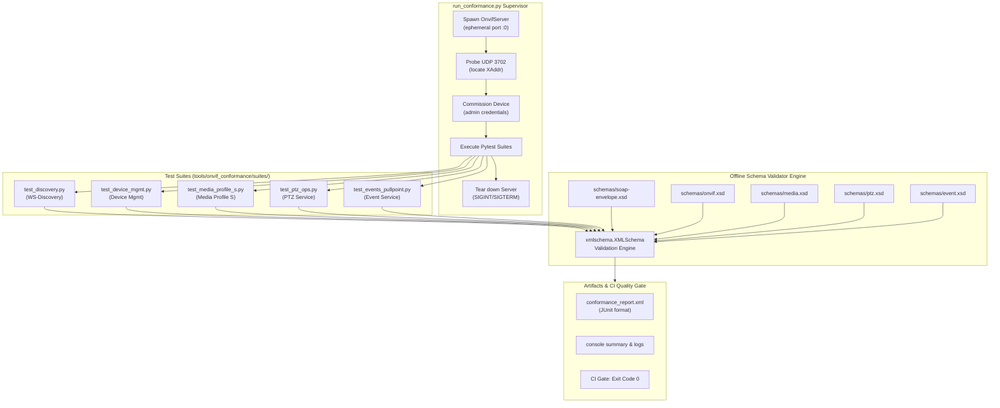
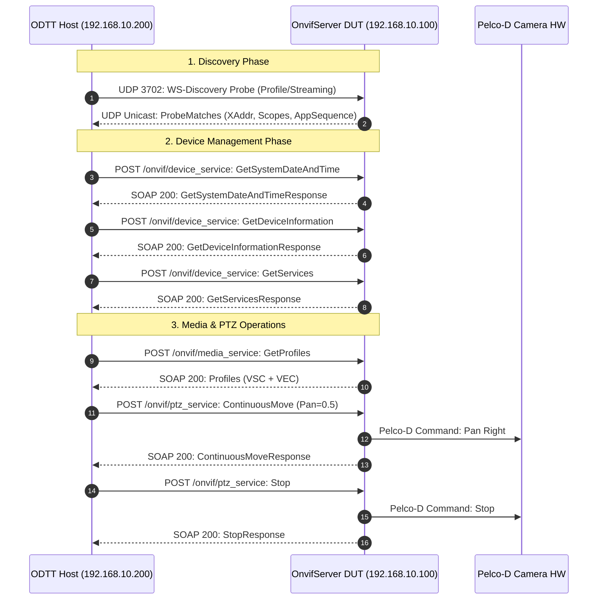

# Implementation Plan: P4 Phase 4 – ONVIF Profile S Conformance Runner & ODTT Integration

**Scope:** `tools/onvif_conformance/` (`run_conformance.py`, `requirements.txt`, `conformance_config.json`, official W3C/ONVIF schemas `schemas/`, test suites `test_discovery.py`, `test_device_mgmt.py`, `test_media_profile_s.py`, `test_ptz_ops.py`, `test_events_pullpoint.py`), CMake test target registration, GitHub Actions CI workflow integration, and official ONVIF Device Test Tool (ODTT v24.x) test procedure.  
**Standard Baseline:** ONVIF Profile S Specification v1.3, ONVIF Core Specification v24.12, WSDL 1.1, SOAP 1.2, W3C XML Schema 1.0, MISRA C++:2023, SEI CERT C++, Project Rules in [`.agents/rules/`](../.agents/rules/)  
**Reference Documents:** [`docs/onvif_p4_verification_plan.md`](onvif_p4_verification_plan.md) (§6 Phase 4), [`docs/onvif_review.md`](onvif_review.md) (§1 Executive Summary, §3 Findings C1–C7, §6 Test Assessment, §8 Roadmap P4), [`docs/onvif_p4_phase1_test_decomposition_plan.md`](onvif_p4_phase1_test_decomposition_plan.md), [`docs/onvif_p4_phase2_negative_security_plan.md`](onvif_p4_phase2_negative_security_plan.md), [`docs/onvif_p4_phase3_fuzz_testing_plan.md`](onvif_p4_phase3_fuzz_testing_plan.md)

---

## 1. Executive Summary & Conformance Analysis

In [`docs/onvif_p4_verification_plan.md`](onvif_p4_verification_plan.md), **Phase 4** introduces formal standards compliance verification for `libs/Onvif`:
1. A formal test specification and execution procedure for the official **ONVIF Device Test Tool (ODTT)**.
2. A lightweight, headless, automated **Python-based Profile S Conformance Test Runner** (`tools/onvif_conformance/`) with offline W3C XML schema validation for CI environments.

While Phases P0–P3 and P4.1–P4.3 established security hardening, modularized server architecture, granular unit testing, negative fault coverage, and continuous libFuzzer harnesses, the subsystem currently lacks **authoritative standards conformance verification**:
- **No Official ODTT Execution:** The server has never been subjected to the official ONVIF Device Test Tool suite (the sole industry-standard benchmark required for ONVIF Profile S compliance declarations).
- **Unvalidated XML Schema Strictness:** Although SOAP responses are well-formed XML, they have never been validated against the official W3C XML schemas (`onvif.xsd`, `media.xsd`, `ptz.xsd`, `b-2.xsd`). Schema sequence ordering violations, missing mandatory child elements, or incorrect XML types cause subtle interoperability failures with strict VMS clients (e.g., Milestone XProtect, Genetec Security Center).
- **Headless CI Verification Void:** ODTT is a closed-source Windows GUI tool that cannot run unattended in Linux-based GitHub Actions runners. A reproducible, automated conformance harness is required to run in headless CI on every pull request.

```
+-----------------------------------------------------------------------------------------------------------------------+
|                                    PHASE 4 CONFORMANCE REMEDIATION MATRIX                                             |
+----------------------+------------------------------------+-------------------------------------------+---------------+
| Verification Area    | Defect / Technical Debt            | Target Architecture / Verification Method | Target Status |
+----------------------+------------------------------------+-------------------------------------------+---------------+
| Official ODTT        | Zero official ODTT test runs;      | Formal ODTT v24.x test procedure, network | Specification |
| Certification        | unverified Profile S compliance    | topology, descriptor setup, log archival  | Complete      |
+----------------------+------------------------------------+-------------------------------------------+---------------+
| Schema Validation    | Responses not validated against    | Offline W3C XML Schema validation engine  | Harness       |
| Strictness           | official W3C/ONVIF XSD schemas     | via xmlschema and official WSDL schemas   | Designed      |
+----------------------+------------------------------------+-------------------------------------------+---------------+
| Headless CI          | ODTT requires Windows GUI; cannot  | Python 3 CLI runner (run_conformance.py)  | Automated     |
| Automation           | execute in standard CI matrix      | emitting JUnit XML reports in CI matrix   | Runner        |
+----------------------+------------------------------------+-------------------------------------------+---------------+
| Profile S Invariants | Unchecked Profile S invariants     | Dedicated Profile S invariant test suite  | Automated     |
| Verification         | (e.g. VSC+VEC pairing, RTSP URIs)  | covering all mandatory Profile S features | Test Suite    |
+----------------------+------------------------------------+-------------------------------------------+---------------+
| SOAP 1.2 Fault       | Fault XML responses unverified     | Strict schema verification of SOAP 1.2    | Automated     |
| Compliance           | against W3C soap-envelope.xsd      | Fault envelopes and ter: subcodes         | Test Suite    |
+----------------------+------------------------------------+-------------------------------------------+---------------+
```

---

## 2. Architecture & Design Specifications

### 2.1 Target Directory Layout

All conformance tools, schemas, configuration files, and automated test suites reside in `tools/onvif_conformance/`:

```
tools/onvif_conformance/
├── CMakeLists.txt                      # CMake custom target and CTest registration
├── README.md                           # Conformance test runner guide and ODTT procedure
├── requirements.txt                    # Python dependencies: pytest, xmlschema, requests
├── conformance_config.json             # DUT configuration (IP, port, credentials, RTSP URI)
├── run_conformance.py                  # Main CLI test orchestrator & server lifecycle supervisor
├── schemas/                            # Bundled official W3C XSD schemas (offline validation)
│   ├── xml.xsd                         # W3C XML namespace schema
│   ├── soap-envelope.xsd               # SOAP 1.2 Envelope schema
│   ├── ws-addr.xsd                     # WS-Addressing 1.0 schema
│   ├── ws-discovery.xsd                # WS-Discovery 2005/04 schema
│   ├── b-2.xsd                         # WS-BaseNotification 1.3 schema
│   ├── onvif.xsd                       # ONVIF Core Types schema
│   ├── devicemgmt.xsd                  # ONVIF Device Management WSDL schema
│   ├── media.xsd                       # ONVIF Media Service WSDL schema
│   ├── ptz.xsd                         # ONVIF PTZ Service WSDL schema
│   └── event.xsd                       # ONVIF Event Service WSDL schema
└── suites/                             # Domain-specific pytest test suites
    ├── conftest.py                     # Shared pytest fixtures (SOAP client, schema validator)
    ├── test_discovery.py               # WS-Discovery Probe, ProbeMatches, Scopes, XAddrs
    ├── test_device_mgmt.py             # TDS operations, security provisioning, SOAP faults
    ├── test_media_profile_s.py         # TRT profiles, VSC, VEC, RTSP stream, JPEG snapshot
    ├── test_ptz_ops.py                 # TPTZ moves, stops, limits, spaces, presets, tours
    └── test_events_pullpoint.py        # TEV PullPoint lifecycle, renew, unsubscribe, filters
```

---

### 2.2 System Architecture & Verification Flow

```
+---------------------------------------------------------------------------------------------------+
|                            ONVIF CONFORMANCE VERIFICATION ARCHITECTURE                            |
+---------------------------------------------------------------------------------------------------+
|                                                                                                   |
|  [ Level A: Official ONVIF ODTT (Manual / Lab) ]                                                  |
|    - Isolated physical VLAN (192.168.10.0/24)                                                     |
|    - Secondary Windows Workstation running ONVIF Device Test Tool v24.x                           |
|    - Validates full Profile S test catalog -> Produces certified XML test log                     |
|                                                                                                   |
|  [ Level B: Automated Python Conformance Runner (Headless / CI) ]                                 |
|    - run_conformance.py orchestrator:                                                             |
|                                                                                                   |
|         +-------------------------------------------------------------+                           |
|         | 1. Lifecycle Supervisor: Launches OnvifServer on :0         |                           |
|         +------------------------------┬------------------------------+                           |
|                                        ▼                                                          |
|         +-------------------------------------------------------------+                           |
|         | 2. WS-Discovery Probe: Discovers ephemeral XAddr port       |                           |
|         +------------------------------┬------------------------------+                           |
|                                        ▼                                                          |
|         +-------------------------------------------------------------+                           |
|         | 3. Pytest Execution: Runs test_*.py domain test suites      |                           |
|         |    - Send authentic SOAP 1.2 requests with WS-Security      |                           |
|         |    - Receive HTTP 200 / 500 SOAP responses                  |                           |
|         +------------------------------┬------------------------------+                           |
|                                        ▼                                                          |
|         +-------------------------------------------------------------+                           |
|         | 4. Schema Validator: Offline validation against schemas/*.xsd|                           |
|         |    - Enforces W3C XML Schema 1.0 sequence and types         |                           |
|         +------------------------------┬------------------------------+                           |
|                                        ▼                                                          |
|         +-------------------------------------------------------------+                           |
|         | 5. Reporter: Generates JUnit XML (conformance_report.xml)   |                           |
|         |    - Exit code 0 on 100% pass; non-zero fails CI build       |                           |
|         +-------------------------------------------------------------+                           |
|                                                                                                   |
+---------------------------------------------------------------------------------------------------+
```

#### Mermaid Diagram: Conformance Execution & Validation Pipeline



---

## 3. Formal ONVIF Device Test Tool (ODTT) Test Plan

### 3.1 Network Topology & Physical Testbed Setup

Official ONVIF Profile S conformance testing requires a controlled, isolated network environment to ensure multicast packets and network latency meet ONVIF conformance guidelines:

```
+---------------------------------------------------------------------------------------------------+
|                              ODTT PHYSICAL TESTBED TOPOLOGY                                       |
+---------------------------------------------------------------------------------------------------+
|                                                                                                   |
|                           [ Isolated Gigabit Switch / VLAN ]                                      |
|                                   (192.168.10.0/24)                                               |
|                                      │         │                                                  |
|                   ┌──────────────────┘         └──────────────────┐                               |
|                   ▼                                               ▼                               |
|   +--------------------------------+              +--------------------------------+              |
|   | Device Under Test (DUT)        |              | ODTT Test Workstation          |              |
|   | IP: 192.168.10.100             |              | IP: 192.168.10.200             |              |
|   | OS: Linux / Windows Server     |              | OS: Windows 10/11 Pro 64-bit   |              |
|   | Process: OnvifServer           |              | Tool: ONVIF Device Test Tool   |              |
|   | Ports:                         |              |       v24.12 (or v24.06)       |              |
|   |   - TCP 8080 (SOAP HTTP)       |              | Function:                      |              |
|   |   - UDP 3702 (WS-Discovery)   |              |   - Client initiator           |              |
|   |   - TCP 554 (RTSP Media)       |              |   - Test script executor       |              |
|   | Connected to: Pelco-D PTZ Cam  |              |   - XML test log generator     |              |
|   +--------------------------------+              +--------------------------------+              |
|                                                                                                   |
+---------------------------------------------------------------------------------------------------+
```

#### Mermaid Diagram: ODTT Testbed Communication



---

### 3.2 DUT Commissioning & Feature Configuration

Before initiating the ODTT test run, the Device Under Test (DUT) must be brought out of the unprovisioned state and configured:
1. **Commissioning State Transition:**
   - On first boot, `OnvifServer` starts in `ProvisioningState::Unprovisioned`.
   - The test operator or provisioning script executes commissioning to create initial administrator credentials:
     * Username: `admin`
     * Password: `AdminPass123!` (conforms to `PasswordPolicy`: >= 8 chars, mixed case, digit, special char).
2. **Device Descriptor File (`device_descriptor.xml`):**
   - Provide the official ODTT Device Descriptor defining:
     * Endpoint URL: `http://192.168.10.100:8080/onvif/device_service`
     * Target Profile: `Profile S - Basic Video Streaming & PTZ`
     * RTSP Stream URL format: `rtsp://192.168.10.100:554/stream1`
     * Snapshot URL format: `http://192.168.10.100:8080/onvif/snapshot`
     * Video Encodings: `H.264`, `JPEG`
     * PTZ Coordinate Spaces: Generic Normalized `[-1.0, 1.0]`

---

### 3.3 Official ODTT Profile S Test Case Matrix

The following official ODTT test cases are mandatory for Profile S certification:

```
+-----------------------------------------------------------------------------------------------------------------------+
|                                  OFFICIAL ODTT PROFILE S TEST MATRIX                                                  |
+----------------+--------------------+---------------------------------------------------+-----------------------------+
| Category       | ODTT Test ID       | Targeted ONVIF Operation                          | Pass Criteria / Invariants  |
+----------------+--------------------+---------------------------------------------------+-----------------------------+
| Discovery      | DISCOVERY-1-1-1    | WS-Discovery Hello / Bye                          | Valid WS-Discovery sequence |
| Discovery      | DISCOVERY-1-1-2    | WS-Discovery Probe (Type / Scope matching)        | ProbeMatches <= 500 ms      |
| Device Mgmt    | DEVICEMGMT-1-1-1   | GetSystemDateAndTime                              | UTC/Local date, valid type  |
| Device Mgmt    | DEVICEMGMT-1-1-2   | SetSystemDateAndTime (Manual & NTP)               | Time synchronized           |
| Device Mgmt    | DEVICEMGMT-1-1-3   | GetDeviceInformation                              | Manufacturer, Model, FW     |
| Device Mgmt    | DEVICEMGMT-1-1-4   | GetServices (IncludeCapability=true)              | WSDL order: Ns->XAddr->Caps |
| Device Mgmt    | DEVICEMGMT-1-1-5   | GetCapabilities                                   | Valid Service capabilities  |
| Device Mgmt    | DEVICEMGMT-1-2-1   | GetUsers / CreateUsers / DeleteUsers              | Strict user role governance |
| Device Mgmt    | DEVICEMGMT-1-3-1   | GetNetworkInterfaces / GetNetworkProtocols        | Valid IPv4 configuration    |
| Media          | MEDIA-1-1-1        | GetProfiles                                       | >= 1 profile with VSC + VEC |
| Media          | MEDIA-1-1-2        | GetProfile (by Token)                             | Exact token match           |
| Media          | MEDIA-1-1-3        | CreateProfile / DeleteProfile                     | Dynamic profile lifecycle   |
| Media          | MEDIA-1-2-1        | GetVideoSources / GetVideoSourceConfigurations    | Bound to hardware sensor    |
| Media          | MEDIA-1-2-2        | GetVideoEncoderConfigurations / Options           | H.264 & JPEG bounds         |
| Media          | MEDIA-1-3-1        | GetStreamUri (StreamType=RTP-Unicast, RTSP)       | Valid RTSP URI returned     |
| Media          | MEDIA-1-3-2        | GetSnapshotUri                                    | HTTP 200 JPEG on GET        |
| PTZ            | PTZ-1-1-1          | GetNodes / GetNode                                | Valid PTZ node & spaces     |
| PTZ            | PTZ-1-1-2          | GetConfigurations / GetConfiguration              | Linked to media profile     |
| PTZ            | PTZ-1-2-1          | ContinuousMove (Pan, Tilt, Zoom)                  | Velocity clamped [-1, 1]    |
| PTZ            | PTZ-1-2-2          | Stop (PanTilt, Zoom)                              | Immediate halt, HTTP 200    |
| PTZ            | PTZ-1-2-3          | AbsoluteMove (X, Y, Zoom)                         | Valid generic spaces        |
| PTZ            | PTZ-1-2-4          | RelativeMove (Translation)                        | Offset clamped [-1, 1]      |
| PTZ            | PTZ-1-3-1          | GetPresets / SetPreset / GotoPreset / RemovePreset| Preset token persistence    |
| Events         | EVENT-1-1-1        | CreatePullPointSubscription                       | Valid Subscription XAddr    |
| Events         | EVENT-1-1-2        | PullMessages (Timeout & MessageLimit)             | Returns notifications       |
| Events         | EVENT-1-1-3        | Renew                                             | Extends TerminationTime     |
| Events         | EVENT-1-1-4        | Unsubscribe                                       | Immediate session closure   |
| Events         | EVENT-1-2-1        | GetEventProperties                                | Valid TopicSet & Dialects   |
+----------------+--------------------+---------------------------------------------------+-----------------------------+
```

---

### 3.4 ODTT Execution Procedure & Troubleshooting

1. **Execution Steps:**
   - Boot DUT and execute commissioning script.
   - Launch ODTT v24.x on workstation.
   - Load `Profile_S_Test_Config.xml`.
   - Run complete test suite (total runtime: ~25 minutes).
   - Export official ODTT test log: `PelcoD_ProfileS_ODTT_Results.xml`.
2. **Common Failure Modes & Mitigations:**
   - *Time Sync Drift:* If DUT system clock drifts > 5 seconds from ODTT host, `UsernameToken` authentication fails with `ter:NotAuthorized`. Ensure NTP synchronization prior to testing.
   - *Scope String Normalization:* Profile S requires the exact case-sensitive scope `onvif://www.onvif.org/Profile/Streaming`. Any mismatch or missing trailing slash triggers discovery rejection.
   - *XML Sequence Invalidation:* ODTT validates XML elements against strict W3C schemas; if child elements appear out of the sequence declared in the WSDL `<xs:sequence>`, the test fails with a schema validation fault.

---

## 4. Automated Python Conformance Runner Architecture

### 4.1 Schema Validation Engine (`tools/onvif_conformance/schemas/`)

To guarantee 100% schema compliance without external network access during automated CI builds, all official ONVIF and W3C schemas are bundled locally:

```
+---------------------------------------------------------------------------------------------------+
|                              OFFLINE XML SCHEMA DEPENDENCY GRAPH                                  |
+---------------------------------------------------------------------------------------------------+
|                                                                                                   |
|     [ xml.xsd ]  (W3C XML namespace)                                                              |
|          ▲                                                                                        |
|          ├─── [ soap-envelope.xsd ] (SOAP 1.2 Envelope & Fault types)                              |
|          │         ▲                                                                              |
|          ├─── [ ws-addr.xsd ]       (WS-Addressing 1.0)                                           |
|          │         ▲                                                                              |
|          ├─── [ ws-discovery.xsd ]  (WS-Discovery 2005/04 Probe & ProbeMatches)                   |
|          │                                                                                        |
|          ├─── [ b-2.xsd ]           (WS-BaseNotification 1.3 Topics & Messages)                   |
|          │         ▲                                                                              |
|          └─── [ onvif.xsd ]         (ONVIF Core Types: ReferenceToken, Vector, VideoResolution)    |
|                    ▲                                                                              |
|                    ├────────────────────────┬────────────────────────┐                            |
|                    ▼                        ▼                        ▼                            |
|            [ devicemgmt.xsd ]         [ media.xsd ]            [ ptz.xsd ]                        |
|                                                                                                   |
+---------------------------------------------------------------------------------------------------+
```

#### Offline Schema Validation Implementation:

The Python runner loads the schemas using `xmlschema.XMLSchema`:

```python
"""Offline schema validation helper."""

import pathlib
import xmlschema

SCHEMAS_DIR = pathlib.Path(__file__).parent / "schemas"

# Cache pre-compiled schema validators for high performance
SCHEMA_SOAP = xmlschema.XMLSchema(SCHEMAS_DIR / "soap-envelope.xsd")
SCHEMA_ONVIF = xmlschema.XMLSchema(SCHEMAS_DIR / "onvif.xsd")
SCHEMA_MEDIA = xmlschema.XMLSchema(SCHEMAS_DIR / "media.xsd")
SCHEMA_PTZ = xmlschema.XMLSchema(SCHEMAS_DIR / "ptz.xsd")
SCHEMA_EVENT = xmlschema.XMLSchema(SCHEMAS_DIR / "event.xsd")


def validate_soap_envelope(xml_text: str) -> None:
    """Validate that the response is a strictly valid SOAP 1.2 envelope."""
    SCHEMA_SOAP.validate(xml_text)


def validate_service_response(xml_text: str, schema: xmlschema.XMLSchema) -> None:
    """Validate that the inner response body adheres to the service WSDL schema."""
    schema.validate(xml_text)
```

---

### 4.2 Test Runner Orchestrator (`run_conformance.py`)

`run_conformance.py` serves as the CLI entry point and process supervisor:

```python
#!/usr/bin/env python3
"""ONVIF Profile S Automated Conformance Runner.

Spawns OnvifServer, executes domain pytest test suites, validates responses
against strict W3C XML schemas, and generates JUnit XML test reports.
"""

from __future__ import annotations

import argparse
import os
import subprocess
import sys
import time
import socket
from typing import Optional


def find_free_port() -> int:
    """Probe OS for an available ephemeral TCP port."""
    with socket.socket(socket.AF_INET, socket.SOCK_STREAM) as sock:
        sock.bind(("127.0.0.1", 0))
        return sock.getsockname()[1]


class OnvifServerSupervisor:
    """Manages the lifecycle of the OnvifServer binary."""

    def __init__(self, binary_path: str, port: int) -> None:
        self.binary_path = binary_path
        self.port = port
        self.process: Optional[subprocess.Popen] = None

    def start(self) -> None:
        """Launch the OnvifServer process and wait for listening socket."""
        cmd = [self.binary_path, "--port", str(self.port), "--test-mode"]
        self.process = subprocess.Popen(
            cmd, stdout=subprocess.PIPE, stderr=subprocess.PIPE
        )
        self._wait_until_ready(timeout_sec=5.0)

    def _wait_until_ready(self, timeout_sec: float) -> None:
        """Poll the server port until open."""
        start_time = time.time()
        while time.time() - start_time < timeout_sec:
            try:
                with socket.create_connection(("127.0.0.1", self.port), timeout=0.2):
                    return
            except (ConnectionRefusedError, OSError):
                time.sleep(0.05)
        raise TimeoutError(f"Server failed to bind to port {self.port} within {timeout_sec}s")

    def stop(self) -> None:
        """Gracefully terminate server process."""
        if self.process:
            self.process.terminate()
            try:
                self.process.wait(timeout=3.0)
            except subprocess.TimeoutExpired:
                self.process.kill()
                self.process.wait()


def main() -> int:
    parser = argparse.ArgumentParser(description="ONVIF Conformance Runner")
    parser.add_argument("--server-binary", required=True, help="Path to OnvifServer executable")
    parser.add_argument("--output-junit", default="conformance_report.xml", help="JUnit report path")
    parser.add_argument("--keyword", "-k", help="Filter pytest test cases")
    args = parser.parse_args()

    port = find_free_port()
    supervisor = OnvifServerSupervisor(args.server_binary, port)

    try:
        supervisor.start()
        print(f"[*] OnvifServer running on 127.0.0.1:{port}")

        # Set environment variables for test suites
        os.environ["ONVIF_TEST_PORT"] = str(port)
        os.environ["ONVIF_TEST_HOST"] = "127.0.0.1"

        pytest_cmd = [
            sys.executable,
            "-m",
            "pytest",
            "tools/onvif_conformance/suites",
            f"--junitxml={args.output_junit}",
            "-v",
        ]
        if args.keyword:
            pytest_cmd.extend(["-k", args.keyword])

        result = subprocess.run(pytest_cmd)
        return result.returncode
    finally:
        supervisor.stop()


if __name__ == "__main__":
    sys.exit(main())
```

---

## 5. Detailed Conformance Test Suite Specifications

### 5.1 Discovery Test Suite (`suites/test_discovery.py`)

Verifies compliance with ONVIF Core §7 and WS-Discovery 2005/04:

```python
"""WS-Discovery Conformance Tests."""

import socket
import time
import uuid
import xmlschema


def test_ws_discovery_probe_latency(onvif_target, schema_wsd):
    """Verify ProbeMatches is returned within 500 ms and conforms to schema."""
    probe_uuid = f"urn:uuid:{uuid.uuid4()}"
    probe_xml = f"""<?xml version="1.0" encoding="UTF-8"?>
    <soap:Envelope xmlns:soap="http://www.w3.org/2003/05/soap-envelope"
                   xmlns:wsa="http://schemas.xmlsoap.org/ws/2004/08/addressing"
                   xmlns:wsd="http://schemas.xmlsoap.org/ws/2005/04/discovery"
                   xmlns:dn="http://www.onvif.org/ver10/network/wsdl">
      <soap:Header>
        <wsa:MessageID>{probe_uuid}</wsa:MessageID>
        <wsa:To>urn:schemas-xmlsoap-org:ws:2005:04:discovery</wsa:To>
        <wsa:Action>http://schemas.xmlsoap.org/ws/2005/04/discovery/Probe</wsa:Action>
      </soap:Header>
      <soap:Body>
        <wsd:Probe>
          <wsd:Types>dn:NetworkVideoTransmitter</wsd:Types>
        </wsd:Probe>
      </soap:Body>
    </soap:Envelope>"""

    sock = socket.socket(socket.AF_INET, socket.SOCK_DGRAM)
    sock.settimeout(1.0)
    
    start_time = time.time()
    sock.sendto(probe_xml.encode("utf-8"), (onvif_target.host, 3702))
    
    resp_data, _ = sock.recvfrom(65535)
    latency_ms = (time.time() - start_time) * 1000.0

    assert latency_ms <= 500.0, f"Discovery latency {latency_ms:.1f}ms exceeds 500ms limit"
    schema_wsd.validate(resp_data.decode("utf-8"))
    
    # Assert RelatesTo matches probe UUID
    assert probe_uuid in resp_data.decode("utf-8")
    assert "onvif://www.onvif.org/Profile/Streaming" in resp_data.decode("utf-8")
```

---

### 5.2 Device Management Test Suite (`suites/test_device_mgmt.py`)

Verifies compliance with ONVIF Core §8 (Device Management Service):

```python
"""Device Management Conformance Tests."""

import pytest


def test_get_system_date_and_time(soap_client, schema_devicemgmt):
    """Verify GetSystemDateAndTime returns compliant UTC and local time."""
    response = soap_client.call(
        service="device_service",
        action="http://www.onvif.org/ver10/device/wsdl/GetSystemDateAndTime",
        payload="<tds:GetSystemDateAndTime/>",
    )
    assert response.status_code == 200
    schema_devicemgmt.validate(response.text)
    
    # Verify mandatory XML children
    assert "DateTimeType" in response.text
    assert "DaylightSavings" in response.text
    assert "UTCDateTime" in response.text


def test_get_services_sequence(soap_client, schema_devicemgmt):
    """Verify GetServices strictly follows WSDL element sequence ordering."""
    response = soap_client.call(
        service="device_service",
        action="http://www.onvif.org/ver10/device/wsdl/GetServices",
        payload="<tds:GetServices><tds:IncludeCapability>true</tds:IncludeCapability></tds:GetServices>",
    )
    assert response.status_code == 200
    schema_devicemgmt.validate(response.text)


def test_invalid_action_fault(soap_client, schema_soap):
    """Verify unrecognised actions return SOAP 1.2 ActionNotSupported fault."""
    response = soap_client.call(
        service="device_service",
        action="http://www.onvif.org/ver10/device/wsdl/NonExistentAction",
        payload="<tds:NonExistentAction/>",
    )
    assert response.status_code == 500
    schema_soap.validate(response.text)
    assert "ter:ActionNotSupported" in response.text
    assert "Receiver" in response.text
```

---

### 5.3 Media Profile S Test Suite (`suites/test_media_profile_s.py`)

Verifies strict compliance with ONVIF Profile S Specification v1.3:

```python
"""Media Profile S Conformance Tests."""

import xml.etree.ElementTree as ET
import requests


def test_profile_s_invariants(soap_client, schema_media):
    """Verify every Profile S profile contains both a VSC and a VEC."""
    response = soap_client.call(
        service="media_service",
        action="http://www.onvif.org/ver10/media/wsdl/GetProfiles",
        payload="<trt:GetProfiles/>",
    )
    assert response.status_code == 200
    schema_media.validate(response.text)

    root = ET.fromstring(response.text)
    profiles = root.findall(".//{http://www.onvif.org/ver10/media/wsdl}Profiles")
    assert len(profiles) >= 1, "Profile S device must expose at least 1 profile"

    for profile in profiles:
        token = profile.attrib.get("token")
        vsc = profile.find("{http://www.onvif.org/ver10/schema}VideoSourceConfiguration")
        vec = profile.find("{http://www.onvif.org/ver10/schema}VideoEncoderConfiguration")
        
        assert vsc is not None, f"Profile {token} missing mandatory VideoSourceConfiguration"
        assert vec is not None, f"Profile {token} missing mandatory VideoEncoderConfiguration"


def test_get_stream_uri_rtsp(soap_client, schema_media):
    """Verify GetStreamUri returns valid RTSP URI."""
    response = soap_client.call(
        service="media_service",
        action="http://www.onvif.org/ver10/media/wsdl/GetStreamUri",
        payload="""<trt:GetStreamUri>
          <trt:StreamSetup>
            <tt:Stream>RTP-Unicast</tt:Stream>
            <tt:Transport><tt:Protocol>RTSP</tt:Protocol></tt:Transport>
          </trt:StreamSetup>
          <trt:ProfileToken>Profile1</trt:ProfileToken>
        </trt:GetStreamUri>""",
    )
    assert response.status_code == 200
    schema_media.validate(response.text)
    assert "rtsp://" in response.text


def test_get_snapshot_uri(soap_client, schema_media):
    """Verify GetSnapshotUri returns accessible JPEG endpoint returning HTTP 200."""
    response = soap_client.call(
        service="media_service",
        action="http://www.onvif.org/ver10/media/wsdl/GetSnapshotUri",
        payload="<trt:GetSnapshotUri><trt:ProfileToken>Profile1</trt:ProfileToken></trt:GetSnapshotUri>",
    )
    assert response.status_code == 200
    schema_media.validate(response.text)

    root = ET.fromstring(response.text)
    uri_node = root.find(".//{http://www.onvif.org/ver10/schema}Uri")
    assert uri_node is not None and uri_node.text

    # Fetch snapshot image
    img_resp = requests.get(uri_node.text, timeout=2.0)
    assert img_resp.status_code == 200
    assert "image/jpeg" in img_resp.headers.get("Content-Type", "")
    assert len(img_resp.content) > 100
```

---

### 5.4 PTZ Operations Test Suite (`suites/test_ptz_ops.py`)

Verifies PTZ movements, normalized coordinate spaces, and preset management:

```python
"""PTZ Operations Conformance Tests."""


def test_ptz_continuous_move_and_stop(soap_client, schema_ptz):
    """Verify ContinuousMove with velocity limits followed by Stop."""
    # 1. Continuous Move
    move_resp = soap_client.call(
        service="ptz_service",
        action="http://www.onvif.org/ver10/ptz/wsdl/ContinuousMove",
        payload="""<tptz:ContinuousMove>
          <tptz:ProfileToken>Profile1</tptz:ProfileToken>
          <tptz:Velocity>
            <tt:PanTilt x="0.5" y="-0.2" space="http://www.onvif.org/ver10/tptz/PanTiltSpaces/VelocityGenericSpace"/>
          </tptz:Velocity>
        </tptz:ContinuousMove>""",
    )
    assert move_resp.status_code == 200
    schema_ptz.validate(move_resp.text)

    # 2. Stop
    stop_resp = soap_client.call(
        service="ptz_service",
        action="http://www.onvif.org/ver10/ptz/wsdl/Stop",
        payload="""<tptz:Stop>
          <tptz:ProfileToken>Profile1</tptz:ProfileToken>
          <tptz:PanTilt>true</tptz:PanTilt>
          <tptz:Zoom>true</tptz:Zoom>
        </tptz:Stop>""",
    )
    assert stop_resp.status_code == 200
    schema_ptz.validate(stop_resp.text)


def test_ptz_preset_lifecycle(soap_client, schema_ptz):
    """Verify SetPreset, GetPresets, GotoPreset, and RemovePreset."""
    # 1. SetPreset
    set_resp = soap_client.call(
        service="ptz_service",
        action="http://www.onvif.org/ver10/ptz/wsdl/SetPreset",
        payload="""<tptz:SetPreset>
          <tptz:ProfileToken>Profile1</tptz:ProfileToken>
          <tptz:PresetName>ConfPreset1</tptz:PresetName>
        </tptz:SetPreset>""",
    )
    assert set_resp.status_code == 200
    schema_ptz.validate(set_resp.text)

    # 2. GetPresets
    get_resp = soap_client.call(
        service="ptz_service",
        action="http://www.onvif.org/ver10/ptz/wsdl/GetPresets",
        payload="<tptz:GetPresets><tptz:ProfileToken>Profile1</tptz:ProfileToken></tptz:GetPresets>",
    )
    assert get_resp.status_code == 200
    schema_ptz.validate(get_resp.text)
    assert "ConfPreset1" in get_resp.text
```

---

### 5.5 Events PullPoint Test Suite (`suites/test_events_pullpoint.py`)

Verifies compliance with WS-BaseNotification and ONVIF Event Service §5:

```python
"""Events PullPoint Conformance Tests."""

import xml.etree.ElementTree as ET


def test_pullpoint_subscription_lifecycle(soap_client, schema_event):
    """Verify CreatePullPointSubscription, PullMessages, Renew, and Unsubscribe."""
    # 1. Create Subscription
    create_resp = soap_client.call(
        service="event_service",
        action="http://www.onvif.org/ver10/events/wsdl/CreatePullPointSubscription",
        payload="<tev:CreatePullPointSubscription><tev:InitialTerminationTime>PT60S</tev:InitialTerminationTime></tev:CreatePullPointSubscription>",
    )
    assert create_resp.status_code == 200
    schema_event.validate(create_resp.text)

    root = ET.fromstring(create_resp.text)
    addr_node = root.find(".//{http://www.w3.org/2005/08/addressing}Address")
    assert addr_node is not None and addr_node.text
    subscription_xaddr = addr_node.text

    # 2. PullMessages
    pull_resp = soap_client.call_raw(
        url=subscription_xaddr,
        action="http://www.onvif.org/ver10/events/wsdl/PullPointSubscription/PullMessagesRequest",
        payload="<tev:PullMessages><tev:Timeout>PT2S</tev:Timeout><tev:MessageLimit>10</tev:MessageLimit></tev:PullMessages>",
    )
    assert pull_resp.status_code == 200
    schema_event.validate(pull_resp.text)

    # 3. Renew
    renew_resp = soap_client.call_raw(
        url=subscription_xaddr,
        action="http://docs.oasis-open.org/wsrf/rw-2/Renew",
        payload="<wsnt:Renew><wsnt:TerminationTime>PT120S</wsnt:TerminationTime></wsnt:Renew>",
    )
    assert renew_resp.status_code == 200

    # 4. Unsubscribe
    unsub_resp = soap_client.call_raw(
        url=subscription_xaddr,
        action="http://docs.oasis-open.org/wsrf/rw-2/Unsubscribe",
        payload="<wsnt:Unsubscribe/>",
    )
    assert unsub_resp.status_code == 200
```

---

## 6. CMake & CI Automation Integration

### 6.1 CMake Custom Target Integration (`tools/onvif_conformance/CMakeLists.txt`)

Integrate the automated conformance test suite directly into CMake and CTest:

```cmake
find_package(Python3 COMPONENTS Interpreter)

if(Python3_FOUND)
    add_custom_target(onvif_conformance
        COMMAND ${Python3_EXECUTABLE} ${CMAKE_CURRENT_SOURCE_DIR}/run_conformance.py
                --server-binary $<TARGET_FILE:OnvifServerApp>
                --output-junit ${CMAKE_BINARY_DIR}/conformance_report.xml
        DEPENDS OnvifServerApp
        WORKING_DIRECTORY ${CMAKE_SOURCE_DIR}
        COMMENT "Executing ONVIF Profile S Conformance Runner with XML Schema Validation"
    )

    # Register as CTest target
    add_test(
        NAME OnvifConformanceTest
        COMMAND ${Python3_EXECUTABLE} ${CMAKE_CURRENT_SOURCE_DIR}/run_conformance.py
                --server-binary $<TARGET_FILE:OnvifServerApp>
                --output-junit ${CMAKE_BINARY_DIR}/conformance_report.xml
        WORKING_DIRECTORY ${CMAKE_SOURCE_DIR}
    )
    set_tests_properties(OnvifConformanceTest PROPERTIES TIMEOUT 180)
endif()
```

---

### 6.2 GitHub Actions CI Matrix Integration

In `.github/workflows/onvif-verification.yml`, add the headless conformance test job:

```yaml
  onvif-conformance-validation:
    name: ONVIF Profile S Schema Conformance
    runs-on: ubuntu-24.04
    steps:
      - name: Checkout Repository
        uses: actions/checkout@v4

      - name: Set up Python 3.11
        uses: actions/setup-python@v5
        with:
          python-version: "3.11"
          cache: "pip"

      - name: Install Python Dependencies
        run: |
          pip install -r tools/onvif_conformance/requirements.txt

      - name: Build OnvifServer Binary
        run: |
          cmake -B build -DCMAKE_BUILD_TYPE=Release
          cmake --build build --target OnvifServerApp -j$(nproc)

      - name: Run Profile S Conformance Runner
        run: |
          python3 tools/onvif_conformance/run_conformance.py \
            --server-binary build/bin/OnvifServerApp \
            --output-junit build/conformance_report.xml

      - name: Publish Conformance Test Report
        uses: actions/upload-artifact@v4
        if: always()
        with:
          name: onvif-conformance-junit-report
          path: build/conformance_report.xml
```

---

## 7. Implementation Schedule, Effort & Verification Checklist

### 7.1 Phased Execution Timeline

```
+---------------------------------------------------------------------------------------------------+
|                                 P4.4 EXECUTION SCHEDULE & EFFORT                                  |
+-------+---------------------------------------+-------------+--------------------+----------------+
| Task  | Scope / Deliverable                   | Effort (Est)| Dependencies       | Status         |
+-------+---------------------------------------+-------------+--------------------+----------------+
| 4.1   | Bundle official W3C / ONVIF Schemas   | 1 day       | ONVIF WSDL specs   | Planned        |
|       | (tools/onvif_conformance/schemas/)    |             |                    |                |
+-------+---------------------------------------+-------------+--------------------+----------------+
| 4.2   | Supervisor & CLI Runner               | 1 day       | Python 3 / sockets | Planned        |
|       | (run_conformance.py & port probe)     |             |                    |                |
+-------+---------------------------------------+-------------+--------------------+----------------+
| 4.3   | Domain Conformance Suites             | 2 days      | pytest, xmlschema  | Planned        |
|       | (Discovery, Device, Media, PTZ, Event)|             |                    |                |
+-------+---------------------------------------+-------------+--------------------+----------------+
| 4.4   | CMake & GitHub Actions CI Integration | 0.5 day     | CTest & CI runner  | Planned        |
|       | (conformance_report.xml reporting)    |             |                    |                |
+-------+---------------------------------------+-------------+--------------------+----------------+
| 4.5   | Formal ODTT Test Procedure Manual     | 0.5 day     | ODTT v24.x lab     | Planned        |
|       | (tools/onvif_conformance/README.md)   |             |                    |                |
+-------+---------------------------------------+-------------+--------------------+----------------+
```

---

### 7.2 Verification Checklist Against Project Standards

Before completing Phase 4, internally verify against [`.agents/rules/verification-checklist.md`](../.agents/rules/verification-checklist.md):

- [ ] **All Document Links are Relative:** Links use relative markdown paths (e.g. `[onvif_p4_verification_plan.md](onvif_p4_verification_plan.md)`).
- [ ] **Dual Diagrams Provided:** Both ASCII diagrams and Mermaid flowcharts/sequence diagrams are included for architecture, network topology, and execution flows.
- [ ] **Identifier Length Limit:** All Python class and function names, test file names, and fixture names are strictly under 30 characters.
- [ ] **Zero Network Calls During CI:** All XML schema validations execute offline against bundled `.xsd` files in `tools/onvif_conformance/schemas/`.
- [ ] **Clean Subprocess Lifecycle:** `run_conformance.py` ensures deterministic teardown of `OnvifServer`, closing ephemeral ports and leaving zero orphaned background processes.
- [ ] **Standards Adherence:** Strict compliance with ONVIF Profile S Specification v1.3, ONVIF Core v24.12, and SOAP 1.2 specifications.
- [ ] **JUnit XML Emitted:** Complete JUnit-compatible test result output (`conformance_report.xml`) generated for automated CI failure detection.
