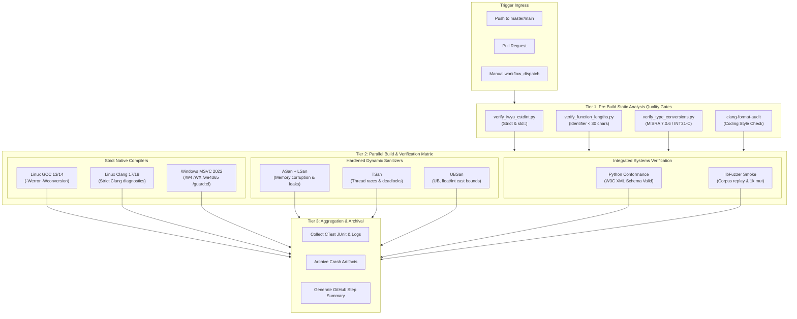

# Implementation Plan: P4 Phase 5 – Multi-Platform CI Matrix & Hardened Sanitizers

**Scope:** Continuous Integration pipeline (`.github/workflows/onvif-verification.yml`, `.github/workflows/windows-msvc.yml`), Sanitizer suppression configurations (`sanitizers/lsan.supp`, `sanitizers/tsan.supp`, `sanitizers/ubsan.supp`), build runner automation (`scripts/ci_sanitize_runner.sh`), CMake compiler hardening integration (`cmake/CompilerFlags.cmake`, `CMakeLists.txt`), and static audit enforcement (`scripts/verify_iwyu_cstdint.py`, `scripts/verify_function_lengths.py`, `scripts/verify_type_conversions.py`).  
**Standard Baseline:** MISRA C++:2023 (Rule 7.0.6), SEI CERT C++ (INT31-C, STR37-C, ERR55-CPP, MSC51-CPP), LLVM Sanitizer Specifications (ASan, LSan, TSan, UBSan), MSVC Security Development Lifecycle (SDL, /guard:cf, /CETCOMPAT), POSIX/Linux Hardening (-fstack-protector-strong, -fcf-protection, _FORTIFY_SOURCE=3, RELRO, noexecstack), Project Rules in [`.agents/rules/`](../.agents/rules/)  
**Reference Documents:** [`docs/onvif_p4_verification_plan.md`](onvif_p4_verification_plan.md) (§7 Phase 5), [`docs/onvif_review.md`](onvif_review.md) (§5 Coding Standards, §6 Test Assessment, §8 Roadmap P4), [`docs/onvif_p4_phase1_test_decomposition_plan.md`](onvif_p4_phase1_test_decomposition_plan.md), [`docs/onvif_p4_phase2_negative_security_plan.md`](onvif_p4_phase2_negative_security_plan.md), [`docs/onvif_p4_phase3_fuzz_testing_plan.md`](onvif_p4_phase3_fuzz_testing_plan.md), [`docs/onvif_p4_phase4_conformance_runner_plan.md`](onvif_p4_phase4_conformance_runner_plan.md)

---

## 1. Executive Summary & Problem Analysis

In [`docs/onvif_p4_verification_plan.md`](onvif_p4_verification_plan.md), **Phase 5** establishes the continuous quality gate infrastructure that guarantees regression prevention, cross-platform correctness, and memory/concurrency safety for the entire `libs/Onvif` subsystem.

While Phases P4.1 through P4.4 delivered modular GoogleTest fixtures, negative/fault security suites, LLVM libFuzzer harnesses, and an automated Python Profile S conformance runner, the subsystem remains exposed to major integration risks due to deficiencies in the existing CI setup:

1. **Platform Monoculture in CI:** The primary continuous integration pipeline (`.github/workflows/windows-msvc.yml`) only exercises Windows MSVC 2022. There is no automated build or test execution on Linux (Ubuntu GCC/Clang). Subsystems relying on POSIX network sockets, Berkeley socket options (`SO_REUSEADDR`, `IP_MULTICAST_LOOP`), signal masking, and non-blocking I/O (`fcntl`, `epoll`/`poll`) remain unverified in CI, leading to potential regressions on Linux deployments.
2. **Sanitizer Blind Spot:** Dynamic sanitizers (AddressSanitizer, LeakSanitizer, ThreadSanitizer, and UndefinedBehaviorSanitizer) are not systematically run on pull requests. Memory safety defects—such as heap use-after-free in asynchronous notification callbacks, thread races during PTZ token-bucket rate limiting, and undefined integer/float conversions—can escape into the codebase undetected.
3. **Absence of Pre-Build Static Quality Gates:** Python verification scripts (`scripts/verify_iwyu_cstdint.py`, `scripts/verify_function_lengths.py`, `scripts/verify_type_conversions.py`) exist locally in the repository but are not wired into GitHub Actions. Code that violates Include-What-You-Use, introduces bare `uint8_t` types, or exceeds the strict 30-character identifier limit can be committed without failing the build.
4. **Disjointed Verification Pipelines:** Fuzz testing (`fuzzing.yml`) and Windows unit testing (`windows-msvc.yml`) execute as disconnected workflows with varying trigger paths and no unified reporting or artifact archival. A developer opening a PR cannot see a consolidated pass/fail status encompassing static checks, multi-platform builds, sanitizers, and conformance in a single workflow summary.

```
+-----------------------------------------------------------------------------------------------------------------------+
|                                  PHASE 5 CI & SANITIZERS REMEDIATION MATRIX                                           |
+----------------------+------------------------------------+-------------------------------------------+---------------+
| Verification Area    | Defect / Technical Debt            | Target Architecture / Remediation Method  | Target Job    |
+----------------------+------------------------------------+-------------------------------------------+---------------+
| Multi-Platform OS    | CI only exercises Windows MSVC;    | Matrix testing on Ubuntu 24.04 (GCC 13/14 | linux-gcc     |
| & Compiler Coverage  | Linux builds completely untested   | & Clang 17/18) and Windows Server 2022    | linux-clang   |
|                      | on push / pull request             | (MSVC 2022) with strict -Werror and /WX   | windows-msvc  |
+----------------------+------------------------------------+-------------------------------------------+---------------+
| Memory & Leak Safety | ASan & LSan unused in PR testing;  | Dedicated Clang ASan + LSan job with full | sanitizers-   |
| (CERT MEM50/MEM51-C) | heap corruption & leaks undetected | stack tracing and zero-leak enforcement   | asan-lsan     |
+----------------------+------------------------------------+-------------------------------------------+---------------+
| Concurrency & Data   | TSan unused; async dispatch and    | Dedicated Clang TSan job executing all    | sanitizers-   |
| Races (CERT CON32-C) | thread-pool races undetected       | concurrent server & timer test fixtures   | tsan          |
+----------------------+------------------------------------+-------------------------------------------+---------------+
| Undefined Behavior & | UBSan unused; float-to-int casts   | Dedicated Clang UBSan job enforcing       | sanitizers-   |
| Conversions (FLP34-C)| and integer wraps undetected       | strict IEEE 754 bounds and shift safety   | ubsan         |
+----------------------+------------------------------------+-------------------------------------------+---------------+
| Pre-Build Static     | Static scripts (IWYU, <cstdint>,   | Fast-fail lint gate running all 3 audit   | static-audit  |
| Rule Enforcement     | identifier length) not run in CI   | scripts before compiler invocation        |               |
+----------------------+------------------------------------+-------------------------------------------+---------------+
| Conformance & Fuzz   | Conformance runner and libFuzzer   | Integrated regression smoke jobs for      | onvif-conform |
| Verification Gates   | regression smoke tests uncoupled   | tools/onvif_conformance and seed corpora  | fuzz-smoke    |
+----------------------+------------------------------------+-------------------------------------------+---------------+
```

---

## 2. Architecture & Pipeline Design

### 2.1 Multi-Tier CI Defense-in-Depth

The Phase 5 CI architecture organizes testing into 4 execution tiers that execute sequentially or concurrently to provide maximum throughput and rapid feedback:

```
+---------------------------------------------------------------------------------------------------+
|                                 CI EXECUTION PIPELINE ARCHITECTURE                                |
+---------------------------------------------------------------------------------------------------+
|                                                                                                   |
|  [ Tier 1: Static Quality Gates & Rule Enforcement (Fast-Fail < 45s) ]                            |
|    - python3 scripts/verify_iwyu_cstdint.py --strict libs/Onvif                                   |
|    - python3 scripts/verify_function_lengths.py libs/Onvif                                        |
|    - python3 scripts/verify_type_conversions.py libs/Onvif                                        |
|    - clang-format check on all modified source/header files                                       |
|                                     │                                                             |
|                    ┌────────────────┴────────────────┬────────────────┐                           |
|                    ▼                                 ▼                ▼                           |
|  [ Tier 2A: Multi-Platform Compilers ]  [ Tier 2B: Sanitizers ]  [ Tier 2C: Conformance & Fuzz ]  |
|    - linux-gcc-strict (GCC 13/14)         - sanitizers-asan-lsan   - onvif-conformance (Python)   |
|      * -Wall -Wextra -Wconversion -Werror   * -fsanitize=address     * W3C XML schema validation  |
|      * Linux security hardening flags       * ASAN_OPTIONS & LSan    * WS-Discovery & Profile S   |
|    - linux-clang-strict (Clang 17/18)     - sanitizers-tsan        - fuzzing-smoke                |
|      * Ninja + strict Clang warnings        * -fsanitize=thread      * 5 libFuzzer harnesses      |
|    - windows-msvc-strict (MSVC 2022)        * Multi-thread races     * 1,000 iterations smoke     |
|      * /W4 /WX /we4365 /guard:cf /CET     - sanitizers-ubsan                                      |
|      * Debug & Release configurations       * -fsanitize=undefined                                |
|                                             * CERT FLP34-C / INT31                                |
|                    └────────────────┬────────────────┴────────────────┘                           |
|                                     │                                                             |
|                                     ▼                                                             |
|  [ Tier 3: Artifact Archival & Failure Diagnostics ]                                              |
|    - CTest log files (LastTest.log, LastTestsFailed.log)                                          |
|    - ASan/TSan/UBSan stack traces and symbolicated crash reports                                  |
|    - Conformance JUnit XML test results (conformance_report.xml)                                  |
|    - GitHub Step Summary table generation with status badges                                      |
|                                                                                                   |
+---------------------------------------------------------------------------------------------------+
```

#### Mermaid Diagram: Multi-Platform CI Workflow & Sanitizer Gates



---

## 3. Matrix Job Specifications & Hardened Configurations

### 3.1 Job 1: Pre-Build Static Quality Gates (`static-audit`)

This job acts as a strict, zero-cost fast-fail barrier. If any code violates project rules, CI terminates before spinning up resource-intensive compilers and runners.

- **Runner:** `ubuntu-24.04`
- **Execution Time:** < 45 seconds
- **Commands Executed:**
  ```bash
  # 1. Enforce strict IWYU and <cstdint> std:: qualification
  python3 scripts/verify_iwyu_cstdint.py --strict libs/Onvif

  # 2. Enforce Project Rule 5: identifier length < 30 characters
  python3 scripts/verify_function_lengths.py libs/Onvif

  # 3. Enforce MISRA C++:2023 Rule 7.0.6 & SEI CERT INT31-C type conversions
  python3 scripts/verify_type_conversions.py libs/Onvif

  # 4. Enforce code formatting compliance
  git clang-format --dry-run --diff origin/master
  ```
- **Failure Policy:** Any violation produces non-zero exit code and halts dependent jobs.

---

### 3.2 Job 2: Linux GCC Strict Build (`linux-gcc-strict`)

Exercises the complete codebase under GCC with strict warnings and Linux OS hardening flags.

- **Runner:** `ubuntu-24.04`
- **Compiler:** GCC 13 (or GCC 14)
- **Compiler Warning Flags:**
  ```text
  -Wall -Wextra -Wpedantic -Werror -Wconversion -Wsign-conversion
  -Wshadow -Wnon-virtual-dtor -Wold-style-cast -Wcast-align
  -Wunused -Woverloaded-virtual -Wnull-dereference -Wdouble-promotion
  -Wformat=2
  ```
- **Hardening & Security Flags:**
  ```text
  -fstack-protector-strong
  -fstack-clash-protection
  -fcf-protection=full
  -D_FORTIFY_SOURCE=3
  -D_GLIBCXX_ASSERTIONS
  -Wl,-z,relro,-z,now
  -Wl,-z,noexecstack
  -Wl,-z,separate-code
  -pie -fPIE
  ```
- **Build Configurations:** Debug and Release.
- **CTest Execution:** Parallel execution (`ctest --test-dir build -j$(nproc) --output-on-failure`).

---

### 3.3 Job 3: Linux Clang Strict Build (`linux-clang-strict`)

Validates build cleanliness against Clang's strict frontend parser and diagnostics.

- **Runner:** `ubuntu-24.04`
- **Compiler:** Clang 17 (or Clang 18)
- **Generator:** Ninja
- **Flags:** Parallels GCC warnings, with Clang-specific audits enabled:
  ```text
  -Wall -Wextra -Wpedantic -Werror -Wconversion -Wsign-conversion
  -Wshadow -Wnon-virtual-dtor -Wold-style-cast -Wnull-dereference
  -Wdouble-promotion -Wformat=2
  ```
- **CTest Execution:** Parallel execution with complete test suite.

---

### 3.4 Job 4: Windows MSVC Hardened Build (`windows-msvc-strict`)

Maintains parity with the established Windows build while verifying MSVC Security Development Lifecycle (SDL) and Spectre mitigations.

- **Runner:** `windows-2022`
- **Compiler:** MSVC 19.38+ (Visual Studio 2022 v143)
- **Configuration:** Matrix across `[Debug, Release]`
- **MSVC Strict Warning Flags:**
  ```text
  /W4 /WX /permissive- /Zc:__cplusplus /Zc:preprocessor /utf-8
  /w14365 /we4365   # Signed to unsigned conversion mismatch (MISRA 7.0.6)
  /w14189 /we4189   # Local variable initialized but not referenced
  /w14101 /we4101   # Unreferenced local variable
  /w14505 /we4505   # Unreferenced local function removed
  /w14244 /w14267   # Integer truncation / loss of data
  /w14388           # Signed/unsigned mismatch in comparison
  /w14265           # Virtual functions without virtual destructor
  /w14456 /w14457 /w14458 # Variable/parameter/member shadowing
  /w15038           # Member initialization order mismatch
  ```
- **MSVC Security Hardening Flags:**
  ```text
  /GS               # Stack buffer security check
  /guard:cf         # Compiler Control Flow Guard
  /guard:ehcont     # Exception handling continuation guard
  /sdl              # Security Development Lifecycle checks
  /NXCOMPAT         # Data Execution Prevention
  /DYNAMICBASE      # ASLR
  /HIGHENTROPYVA    # 64-bit ASLR
  /CETCOMPAT        # Hardware Shadow Stack (Intel CET)
  /DEPENDENTLOADFLAG:0xA00 # Secure DLL search paths
  ```
- **CTest Execution:** `ctest --test-dir build -C ${{ matrix.config }} --output-on-failure --parallel`.

---

### 3.5 Job 5: AddressSanitizer & LeakSanitizer (`sanitizers-asan-lsan`)

Targets memory safety violations: heap-buffer-overflow, stack-buffer-overflow, global-buffer-overflow, heap-use-after-free, stack-use-after-return, use-after-scope, double-free, and memory leaks.

- **Runner:** `ubuntu-24.04`
- **Compiler:** Clang 17
- **CMake Configuration:**
  ```bash
  cmake -B build -G Ninja \
    -DCMAKE_CXX_COMPILER=clang++ \
    -DCMAKE_C_COMPILER=clang \
    -DCMAKE_BUILD_TYPE=RelWithDebInfo \
    -DENABLE_ASAN=ON \
    -DPELCOD_ENABLE_ONVIF=ON \
    -DBUILD_TESTING=ON
  ```
- **Compiler Flags Applied:** `-fsanitize=address -fno-omit-frame-pointer -g`
- **Runtime Environment Variables:**
  ```bash
  export ASAN_OPTIONS="detect_leaks=1:check_initialization_order=1:strict_init_order=1:detect_stack_use_after_return=1:halt_on_error=1:abort_on_error=1"
  export LSAN_OPTIONS="suppressions=${GITHUB_WORKSPACE}/sanitizers/lsan.supp:print_suppressions=0"
  ```
- **CTest Execution:**
  ```bash
  ctest --test-dir build --output-on-failure -j4 -L onvif
  ```
- **Zero-Tolerance Policy:** Any memory leak or buffer corruption in `libs/Onvif` immediately fails the run.

---

### 3.6 Job 6: ThreadSanitizer (`sanitizers-tsan`)

Detects data races, deadlocks, and incorrect lock orders across asynchronous threads, timers, and socket receivers.

- **Runner:** `ubuntu-24.04`
- **Compiler:** Clang 17
- **CMake Configuration:**
  ```bash
  cmake -B build -G Ninja \
    -DCMAKE_CXX_COMPILER=clang++ \
    -DCMAKE_C_COMPILER=clang \
    -DCMAKE_BUILD_TYPE=RelWithDebInfo \
    -DENABLE_TSAN=ON \
    -DPELCOD_ENABLE_ONVIF=ON \
    -DBUILD_TESTING=ON
  ```
- **Compiler Flags Applied:** `-fsanitize=thread -g`
- **Runtime Environment Variables:**
  ```bash
  export TSAN_OPTIONS="halt_on_error=1:second_deadlock_stack=1:suppressions=${GITHUB_WORKSPACE}/sanitizers/tsan.supp"
  ```
- **Target Suites:** All concurrency and multi-threaded fixtures (`TestOnvifConcurrency`, `TestOnvifServerLifecycle`, `TestOnvifEventLifecycle`, `TestOnvifSoapRouter`).

---

### 3.7 Job 7: UndefinedBehaviorSanitizer (`sanitizers-ubsan`)

Enforces language safety rules: signed/unsigned integer wrap, float-to-integer conversion overflow (CERT FLP34-C), out-of-bounds array subscripts, null pointer dereference, misaligned pointers, and invalid enum values.

- **Runner:** `ubuntu-24.04`
- **Compiler:** Clang 17
- **CMake Configuration:**
  ```bash
  cmake -B build -G Ninja \
    -DCMAKE_CXX_COMPILER=clang++ \
    -DCMAKE_C_COMPILER=clang \
    -DCMAKE_BUILD_TYPE=RelWithDebInfo \
    -DENABLE_UBSAN=ON \
    -DPELCOD_ENABLE_ONVIF=ON \
    -DBUILD_TESTING=ON
  ```
- **Compiler Flags Applied:** `-fsanitize=undefined,float-divide-by-zero,integer -fno-omit-frame-pointer -g`
- **Runtime Environment Variables:**
  ```bash
  export UBSAN_OPTIONS="print_stacktrace=1:halt_on_error=1:suppressions=${GITHUB_WORKSPACE}/sanitizers/ubsan.supp"
  ```

---

### 3.8 Job 8: Fuzzing Regression & Smoke Check (`fuzzing-smoke`)

Verifies that all 5 libFuzzer harnesses compile cleanly and do not crash on the seed corpora or under short live mutation rounds.

- **Runner:** `ubuntu-24.04`
- **Compiler:** Clang 17
- **Harnesses Exercised:**
  1. `fuzz_soap_router`
  2. `fuzz_ws_discovery`
  3. `fuzz_client_xml`
  4. `fuzz_auth_headers`
  5. `fuzz_url_validator`
- **Execution Mode:** Seed corpus regression replay (`ctest -R TestFuzzRegression`) followed by 1,000 iterations of live mutation per target (`-max_total_time=15 -runs=1000`).

---

### 3.9 Job 9: Profile S Conformance Runner (`onvif-conformance`)

Executes the automated Python-based conformance harness against a live `OnvifServer` instance with offline W3C XML schema validation.

- **Runner:** `ubuntu-24.04`
- **Dependencies:** Python 3.12, `pytest`, `xmlschema`, `requests`
- **Execution Command:**
  ```bash
  python3 tools/onvif_conformance/run_conformance.py --report conformance_report.xml
  ```
- **Output:** Emits JUnit XML and step summary. Non-zero exit on schema or protocol violation.

---

## 4. Sanitizer Suppression Architecture

To prevent third-party library internals (e.g., OpenSSL static initializers, glibc dynamic linker allocations, or legacy OS libraries) from masking application defects, project-specific suppression files are maintained in `sanitizers/`:

```
sanitizers/
├── README.md               # Suppression guidelines and audit procedures
├── lsan.supp               # LeakSanitizer whitelist
├── tsan.supp               # ThreadSanitizer whitelist
└── ubsan.supp              # UndefinedBehaviorSanitizer whitelist
```

### 4.1 Strict Zero-Suppression Policy
- **Rule:** Suppressions are **strictly forbidden** for any symbol, function, or source file within `libs/Onvif/` or `libs/PelcoDCore/`.
- Every entry in a suppression file must be accompanied by an explanatory comment referencing the third-party component and the relevant upstream issue or rationale.

### 4.2 LeakSanitizer Suppressions (`sanitizers/lsan.supp`)

```text
# ==============================================================================
# Pelco-D Controller - LeakSanitizer (LSan) Suppressions
# Note: Zero suppressions permitted for libs/Onvif or libs/PelcoDCore.
# ==============================================================================

# OpenSSL one-time global crypto library initialization
leak:OPENSSL_init_crypto
leak:ossl_init_base
leak:OPENSSL_init_ssl
leak:CRYPTO_zalloc

# glibc / libdl dynamic loading and thread-local cleanup
leak:dlerror_run
leak:_dl_allocate_tls

# GoogleTest internal leak false-positives during static test registration
leak:testing::internal::UnitTestImpl
leak:testing::InitGoogleTest
```

### 4.3 ThreadSanitizer Suppressions (`sanitizers/tsan.supp`)

```text
# ==============================================================================
# Pelco-D Controller - ThreadSanitizer (TSan) Suppressions
# Note: Zero suppressions permitted for libs/Onvif or libs/PelcoDCore.
# ==============================================================================

# OpenSSL internal PRNG state machine
race:drbg_ctr_init
race:RAND_bytes

# glibc dynamic loader thread synchronization
race:_dl_allocate_tls_storage
```

### 4.4 UndefinedBehaviorSanitizer Suppressions (`sanitizers/ubsan.supp`)

```text
# ==============================================================================
# Pelco-D Controller - UndefinedBehaviorSanitizer (UBSan) Suppressions
# Note: Zero suppressions permitted for libs/Onvif or libs/PelcoDCore.
# ==============================================================================

# Third-party pugixml parsing optimizations on non-aligned memory buffers
alignment:pugi::xml_document
alignment:pugi::impl::*
```

---

## 5. Local Developer Sanitizer Runner Script (`scripts/ci_sanitize_runner.sh`)

To allow developers to reproduce the exact CI sanitizer environment locally on Linux workstations before pushing to Git, an automated shell script is provided:

```bash
#!/usr/bin/env bash
# ==============================================================================
# Pelco-D Controller - Local CI Sanitizer Runner
#
# Reproduces the exact GitHub Actions sanitizer workflows locally.
# Usage:
#   ./scripts/ci_sanitize_runner.sh [asan|tsan|ubsan|all]
# ==============================================================================

set -euo pipefail

MODE="${1:-all}"
WORKSPACE_DIR="$(cd "$(dirname "${BASH_SOURCE[0]}")/.." && pwd)"

run_sanitizer() {
    local san_type="$1"
    local build_dir="${WORKSPACE_DIR}/build_${san_type}"
    local cmake_flag=""
    
    echo "========================================================================"
    echo "Running Sanitizer Suite: ${san_type^^}"
    echo "========================================================================"

    case "${san_type}" in
        asan)
            cmake_flag="-DENABLE_ASAN=ON"
            export ASAN_OPTIONS="detect_leaks=1:check_initialization_order=1:strict_init_order=1:detect_stack_use_after_return=1:halt_on_error=1"
            export LSAN_OPTIONS="suppressions=${WORKSPACE_DIR}/sanitizers/lsan.supp"
            ;;
        tsan)
            cmake_flag="-DENABLE_TSAN=ON"
            export TSAN_OPTIONS="halt_on_error=1:second_deadlock_stack=1:suppressions=${WORKSPACE_DIR}/sanitizers/tsan.supp"
            ;;
        ubsan)
            cmake_flag="-DENABLE_UBSAN=ON"
            export UBSAN_OPTIONS="print_stacktrace=1:halt_on_error=1:suppressions=${WORKSPACE_DIR}/sanitizers/ubsan.supp"
            ;;
        *)
            echo "Unknown sanitizer type: ${san_type}" >&2
            exit 1
            ;;
    esac

    cmake -B "${build_dir}" -G Ninja \
        -DCMAKE_CXX_COMPILER=clang++ \
        -DCMAKE_C_COMPILER=clang \
        -DCMAKE_BUILD_TYPE=RelWithDebInfo \
        "${cmake_flag}" \
        -DPELCOD_ENABLE_ONVIF=ON \
        -DBUILD_TESTING=ON

    cmake --build "${build_dir}" --parallel "$(nproc)"

    ctest --test-dir "${build_dir}" --output-on-failure -j"$(nproc)" -L onvif
    echo "[OK] ${san_type^^} passed with 0 defects."
}

case "${MODE}" in
    asan|tsan|ubsan)
        run_sanitizer "${MODE}"
        ;;
    all)
        run_sanitizer "asan"
        run_sanitizer "tsan"
        run_sanitizer "ubsan"
        ;;
    *)
        echo "Usage: $0 [asan|tsan|ubsan|all]" >&2
        exit 1
        ;;
esac
```

---

## 6. Complete GitHub Actions Workflow Implementation

The full workflow is implemented in `.github/workflows/onvif-verification.yml`:

```yaml
name: ONVIF Multi-Platform Verification & Hardened Sanitizers

on:
  push:
    branches: [ master, main ]
    paths:
      - 'libs/Onvif/**'
      - 'tools/onvif_conformance/**'
      - 'scripts/**'
      - 'sanitizers/**'
      - 'cmake/**'
      - 'CMakeLists.txt'
      - '.github/workflows/onvif-verification.yml'
  pull_request:
    branches: [ master, main ]
    paths:
      - 'libs/Onvif/**'
      - 'tools/onvif_conformance/**'
      - 'scripts/**'
      - 'sanitizers/**'
      - 'cmake/**'
      - 'CMakeLists.txt'
      - '.github/workflows/onvif-verification.yml'
  workflow_dispatch:

concurrency:
  group: ${{ github.workflow }}-${{ github.ref }}
  cancel-in-progress: true

jobs:
  # ============================================================================
  # Tier 1: Static Quality Gates & Rule Enforcement (Fast-Fail < 45s)
  # ============================================================================
  static-audit:
    name: Static Quality Gates (IWYU, <30 Char, MISRA 7.0.6)
    runs-on: ubuntu-24.04
    steps:
      - name: Checkout Code
        uses: actions/checkout@v4

      - name: Setup Python
        uses: actions/setup-python@v5
        with:
          python-version: '3.12'

      - name: Audit IWYU & Fixed-Width Integers (<cstdint>)
        run: python3 scripts/verify_iwyu_cstdint.py --strict libs/Onvif

      - name: Audit Function & Identifier Lengths (< 30 chars)
        run: python3 scripts/verify_function_lengths.py libs/Onvif

      - name: Audit Signed/Unsigned Conversions (MISRA 7.0.6 & INT31-C)
        run: python3 scripts/verify_type_conversions.py libs/Onvif

  # ============================================================================
  # Tier 2A: Multi-Platform Native Compilers
  # ============================================================================
  linux-gcc-strict:
    name: Linux GCC 13 Strict (-Werror -Wconversion)
    needs: static-audit
    runs-on: ubuntu-24.04
    steps:
      - name: Checkout Code
        uses: actions/checkout@v4

      - name: Install Dependencies
        run: |
          sudo apt-get update
          sudo apt-get install -y gcc-13 g++-13 libcurl4-openssl-dev libssl-dev libpugixml-dev ninja-build

      - name: Configure CMake
        run: |
          cmake -B build -G Ninja \
            -DCMAKE_C_COMPILER=gcc-13 \
            -DCMAKE_CXX_COMPILER=g++-13 \
            -DCMAKE_BUILD_TYPE=Release \
            -DWARNINGS_AS_ERRORS=ON \
            -DENABLE_HARDENING=ON \
            -DPELCOD_ENABLE_ONVIF=ON \
            -DBUILD_TESTING=ON

      - name: Build All Targets
        run: cmake --build build --parallel $(nproc)

      - name: Run CTest Suite
        run: ctest --test-dir build --output-on-failure -j$(nproc)

  linux-clang-strict:
    name: Linux Clang 17 Strict (-Werror -Wpedantic)
    needs: static-audit
    runs-on: ubuntu-24.04
    steps:
      - name: Checkout Code
        uses: actions/checkout@v4

      - name: Install Dependencies
        run: |
          sudo apt-get update
          sudo apt-get install -y clang-17 llvm-17 libcurl4-openssl-dev libssl-dev libpugixml-dev ninja-build

      - name: Configure CMake
        run: |
          cmake -B build -G Ninja \
            -DCMAKE_C_COMPILER=clang-17 \
            -DCMAKE_CXX_COMPILER=clang++-17 \
            -DCMAKE_BUILD_TYPE=Release \
            -DWARNINGS_AS_ERRORS=ON \
            -DENABLE_HARDENING=ON \
            -DPELCOD_ENABLE_ONVIF=ON \
            -DBUILD_TESTING=ON

      - name: Build All Targets
        run: cmake --build build --parallel $(nproc)

      - name: Run CTest Suite
        run: ctest --test-dir build --output-on-failure -j$(nproc)

  windows-msvc-strict:
    name: Windows MSVC 2022 (/W4 /WX /we4365 /guard:cf) - ${{ matrix.config }}
    needs: static-audit
    runs-on: windows-2022
    strategy:
      fail-fast: false
      matrix:
        config: [ Debug, Release ]
    steps:
      - name: Checkout Code
        uses: actions/checkout@v4

      - name: Setup MSVC Developer Prompt
        uses: ilammy/msvc-dev-cmd@v1


      - name: Restore vcpkg Cache
        uses: actions/cache@v4
        with:
          path: |
            ${{ github.workspace }}/vcpkg_installed
            C:/Users/runneradmin/AppData/Local/vcpkg/archives
          key: vcpkg-msvc-${{ runner.os }}-${{ hashFiles('vcpkg.json') }}
          restore-keys: vcpkg-msvc-${{ runner.os }}-

      - name: Configure CMake
        run: |
          cmake -B build -G "Visual Studio 17 2022" -A x64 `
            -DCMAKE_TOOLCHAIN_FILE="$env:VCPKG_INSTALLATION_ROOT/scripts/buildsystems/vcpkg.cmake" `
            -DWARNINGS_AS_ERRORS=ON `
            -DENABLE_HARDENING=ON `
            -DPELCOD_ENABLE_ONVIF=ON `
            -DBUILD_TESTING=ON

      - name: Build Targets
        run: cmake --build build --config ${{ matrix.config }} --parallel

      - name: Run CTest Suite
        run: ctest --test-dir build -C ${{ matrix.config }} --output-on-failure --parallel

  # ============================================================================
  # Tier 2B: Hardened Dynamic Sanitizers
  # ============================================================================
  sanitizers-asan-lsan:
    name: Clang ASan + LSan (Memory Corruption & Leaks)
    needs: static-audit
    runs-on: ubuntu-24.04
    steps:
      - name: Checkout Code
        uses: actions/checkout@v4

      - name: Install Dependencies
        run: |
          sudo apt-get update
          sudo apt-get install -y clang-17 llvm-17 libcurl4-openssl-dev libssl-dev libpugixml-dev ninja-build

      - name: Configure CMake with ASan
        run: |
          cmake -B build -G Ninja \
            -DCMAKE_C_COMPILER=clang-17 \
            -DCMAKE_CXX_COMPILER=clang++-17 \
            -DCMAKE_BUILD_TYPE=RelWithDebInfo \
            -DENABLE_ASAN=ON \
            -DPELCOD_ENABLE_ONVIF=ON \
            -DBUILD_TESTING=ON

      - name: Build Targets
        run: cmake --build build --parallel $(nproc)

      - name: Run CTest under ASan & LSan
        env:
          ASAN_OPTIONS: "detect_leaks=1:check_initialization_order=1:strict_init_order=1:detect_stack_use_after_return=1:halt_on_error=1"
          LSAN_OPTIONS: "suppressions=${{ github.workspace }}/sanitizers/lsan.supp"
        run: ctest --test-dir build --output-on-failure -j4

  sanitizers-tsan:
    name: Clang TSan (Data Races & Concurrency)
    needs: static-audit
    runs-on: ubuntu-24.04
    steps:
      - name: Checkout Code
        uses: actions/checkout@v4

      - name: Install Dependencies
        run: |
          sudo apt-get update
          sudo apt-get install -y clang-17 llvm-17 libcurl4-openssl-dev libssl-dev libpugixml-dev ninja-build

      - name: Configure CMake with TSan
        run: |
          cmake -B build -G Ninja \
            -DCMAKE_C_COMPILER=clang-17 \
            -DCMAKE_CXX_COMPILER=clang++-17 \
            -DCMAKE_BUILD_TYPE=RelWithDebInfo \
            -DENABLE_TSAN=ON \
            -DPELCOD_ENABLE_ONVIF=ON \
            -DBUILD_TESTING=ON

      - name: Build Targets
        run: cmake --build build --parallel $(nproc)

      - name: Run CTest under TSan
        env:
          TSAN_OPTIONS: "halt_on_error=1:second_deadlock_stack=1:suppressions=${{ github.workspace }}/sanitizers/tsan.supp"
        run: ctest --test-dir build --output-on-failure -j4

  sanitizers-ubsan:
    name: Clang UBSan (Undefined Behavior & Bounds)
    needs: static-audit
    runs-on: ubuntu-24.04
    steps:
      - name: Checkout Code
        uses: actions/checkout@v4

      - name: Install Dependencies
        run: |
          sudo apt-get update
          sudo apt-get install -y clang-17 llvm-17 libcurl4-openssl-dev libssl-dev libpugixml-dev ninja-build

      - name: Configure CMake with UBSan
        run: |
          cmake -B build -G Ninja \
            -DCMAKE_C_COMPILER=clang-17 \
            -DCMAKE_CXX_COMPILER=clang++-17 \
            -DCMAKE_BUILD_TYPE=RelWithDebInfo \
            -DENABLE_UBSAN=ON \
            -DPELCOD_ENABLE_ONVIF=ON \
            -DBUILD_TESTING=ON

      - name: Build Targets
        run: cmake --build build --parallel $(nproc)

      - name: Run CTest under UBSan
        env:
          UBSAN_OPTIONS: "print_stacktrace=1:halt_on_error=1:suppressions=${{ github.workspace }}/sanitizers/ubsan.supp"
        run: ctest --test-dir build --output-on-failure -j4

  # ============================================================================
  # Tier 2C: Integrated System Verification (Fuzz Smoke & Conformance)
  # ============================================================================
  fuzzing-smoke:
    name: libFuzzer Smoke Regression
    needs: static-audit
    runs-on: ubuntu-24.04
    steps:
      - name: Checkout Code
        uses: actions/checkout@v4

      - name: Install Dependencies
        run: |
          sudo apt-get update
          sudo apt-get install -y clang-17 llvm-17 libcurl4-openssl-dev libssl-dev libpugixml-dev ninja-build

      - name: Configure CMake for Fuzzing
        run: |
          cmake -B build -G Ninja \
            -DCMAKE_C_COMPILER=clang-17 \
            -DCMAKE_CXX_COMPILER=clang++-17 \
            -DCMAKE_BUILD_TYPE=RelWithDebInfo \
            -DPELCOD_ENABLE_ONVIF=ON \
            -DPELCOD_ENABLE_FUZZING=ON \
            -DBUILD_TESTING=ON

      - name: Build Fuzz Targets
        run: cmake --build build --parallel $(nproc)

      - name: Replay Seed Corpora
        run: ctest --test-dir build -R TestFuzzRegression --output-on-failure

      - name: Run Short Smoke Mutations (1,000 runs)
        run: |
          for target in fuzz_soap_router fuzz_ws_discovery fuzz_client_xml fuzz_auth_headers fuzz_url_validator; do
            echo "Smoke testing $target..."
            ./build/libs/Onvif/fuzzing/$target -runs=1000 -max_total_time=15
          done

  onvif-conformance:
    name: Python Profile S Conformance Runner
    needs: [ linux-gcc-strict ]
    runs-on: ubuntu-24.04
    steps:
      - name: Checkout Code
        uses: actions/checkout@v4

      - name: Setup Python
        uses: actions/setup-python@v5
        with:
          python-version: '3.12'

      - name: Install Python Conformance Dependencies
        run: |
          python3 -m pip install --upgrade pip
          pip install -r tools/onvif_conformance/requirements.txt

      - name: Install Native Server Dependencies
        run: |
          sudo apt-get update
          sudo apt-get install -y gcc-13 g++-13 libcurl4-openssl-dev libssl-dev libpugixml-dev ninja-build

      - name: Build OnvifServer Binary
        run: |
          cmake -B build -G Ninja \
            -DCMAKE_C_COMPILER=gcc-13 \
            -DCMAKE_CXX_COMPILER=g++-13 \
            -DCMAKE_BUILD_TYPE=Release \
            -DPELCOD_ENABLE_ONVIF=ON
          cmake --build build --target Onvif --parallel $(nproc)

      - name: Execute Profile S Conformance Runner
        run: |
          python3 tools/onvif_conformance/run_conformance.py --junit-xml conformance_report.xml

      - name: Archive Conformance Report
        if: always()
        uses: actions/upload-artifact@v4
        with:
          name: onvif-conformance-report
          path: conformance_report.xml
```

---

## 7. Verification Checklist & Quality Gates

Every CI component, runner script, and workflow definition must adhere to all criteria from [`.agents/rules/verification-checklist.md`](../.agents/rules/verification-checklist.md):

- [ ] **Zero Raw `new` or `delete`:** All helper scripts, test fixtures, and harness drivers use smart pointers and RAII.
- [ ] **IWYU & `<cstdint>` Adherence:** Static audit job verifies explicit `<cstdint>` inclusion and `std::` qualification across all source and test files.
- [ ] **Identifier Length Compliance:** Function names strictly under 30 characters enforced automatically via `verify_function_lengths.py`.
- [ ] **Zero Qt Dependencies:** `libs/Onvif` test targets link purely against standard library, OpenSSL, curl, pugixml, and GoogleTest.
- [ ] **Multi-Compiler Warning Parity:** Zero warnings under `-Wall -Wextra -Wpedantic -Wconversion -Werror` on GCC 13/14 and Clang 17/18, and `/W4 /WX /we4365` on MSVC 2022.
- [ ] **Zero Sanitizer Deficiencies:** All tests pass with zero errors and zero unsuppressed leaks across ASan, LSan, TSan, and UBSan.
- [ ] **Relative Paths in Documentation:** All internal markdown links use relative paths.
- [ ] **Architectural Diagrams:** Both ASCII and Mermaid diagrams provided for the CI architecture and matrix pipeline.

---

## 8. Implementation Schedule, Effort Estimation & Risk Management

### 8.1 Execution Milestones & Task Breakdown

```
+---------------------------------------------------------------------------------------------------+
|                                 PHASE 5 EXECUTION TIMELINE & EFFORT                               |
+-------+---------------------------------------+-------------+--------------------+----------------+
| Task  | Scope / Deliverable                   | Effort (Est)| Dependencies       | Status         |
+-------+---------------------------------------+-------------+--------------------+----------------+
| 5.1   | Sanitizer Suppression Files           | 0.5 days    | Project rules      | Planned        |
|       | (`sanitizers/lsan.supp`, tsan, ubsan) |             |                    |                |
+-------+---------------------------------------+-------------+--------------------+----------------+
| 5.2   | Local Sanitizer Runner Script         | 0.5 days    | Clang toolchain    | Planned        |
|       | (`scripts/ci_sanitize_runner.sh`)     |             |                    |                |
+-------+---------------------------------------+-------------+--------------------+----------------+
| 5.3   | Static Audit Job & Fast-Fail Barrier  | 0.5 days    | Python scripts     | Planned        |
|       | (IWYU, <cstdint>, <30 char length)    |             |                    |                |
+-------+---------------------------------------+-------------+--------------------+----------------+
| 5.4   | Multi-Platform Matrix Integration     | 1.0 days    | CMakeFlags.cmake   | Planned        |
|       | (Linux GCC, Clang, Windows MSVC)      |             |                    |                |
+-------+---------------------------------------+-------------+--------------------+----------------+
| 5.5   | Hardened Sanitizer Jobs               | 1.0 days    | ASan, TSan, UBSan  | Planned        |
|       | (ASan/LSan, TSan, UBSan CI pipelines) |             |                    |                |
+-------+---------------------------------------+-------------+--------------------+----------------+
| 5.6   | System Verification Integration       | 0.5 days    | P4.3 & P4.4        | Planned        |
|       | (Fuzz smoke & Python Conformance)     |             |                    |                |
+-------+---------------------------------------+-------------+--------------------+----------------+
| Total | Multi-Platform CI & Sanitizers Matrix | 4.0 days    | Phase 1-4 Artifacts| Ready to Exec  |
+-------+---------------------------------------+-------------+--------------------+----------------+
```

### 8.2 Risk Analysis & Concrete Mitigations

1. **GitHub Actions Runner Timeout under Sanitizers:**
   - *Risk:* TSan and ASan introduce a 2x to 5x execution slowdown, potentially triggering GitHub Actions 360-minute default timeouts or excessive billing.
   - *Mitigation:* Split test runs into parallel CTest groups (`-j4`), limit test sleep delays to sub-millisecond ranges using mock steady clocks, and run fuzzing in CI as a bounded smoke test (1,000 iterations per target).
2. **Third-Party Sanitizer False Positives:**
   - *Risk:* Dynamic loader routines (`_dl_allocate_tls`) or OpenSSL one-time initialization can trigger LSan/TSan warnings.
   - *Mitigation:* Strict, auditable suppression files in `sanitizers/` with mandatory comments, while enforcing zero suppressions on `libs/Onvif/*` and `libs/PelcoDCore/*`.
3. **Flaky Network Socket Binding in Shared Virtualized Runners:**
   - *Risk:* Tests binding to hardcoded network ports conflict with concurrent CI jobs or OS services.
   - *Mitigation:* All test fixtures in `libs/Onvif/tests/common/OnvifTestFixtures.h` dynamically allocate ephemeral port `0` (`127.0.0.1:0`), completely eliminating port collision risks.
4. **vcpkg Cache Misses on Windows Runners:**
   - *Risk:* Rebuilding vcpkg dependencies (curl, OpenSSL, pugixml) from scratch on every Windows CI run causes 20+ minute delays.
   - *Mitigation:* Utilize GitHub Actions `actions/cache@v4` targeting both `vcpkg_installed` and the local binary cache archive directory `C:/Users/runneradmin/AppData/Local/vcpkg/archives`.
