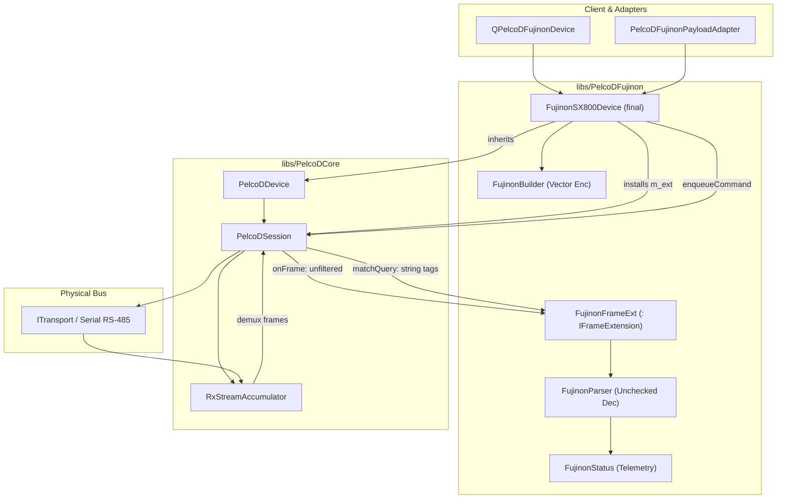

# PelcoDFujinon — Senior Engineering & Architectural Review

**Scope:** `libs/PelcoDFujinon/` (5 headers, 4 implementation files, ~102 KB) plus test suites in `libs/PelcoDFujinon/tests/`.
**Baseline:** The project compliance framework in `.agents/rules/compliance.md` (MISRA C++:2023 and SEI CERT C++) and `.agents/rules/verification-checklist.md`.
**Reviewers:** Senior Software Engineer & Senior Software Architect.

---

## 1. Executive Summary

| Dimension | Verdict | Summary |
|---|---|---|
| **Layering & Modularity** | 🟢 Good | Cleanly decoupled from Qt (`#include <Q...>` strictly zero); integrates with `PelcoDCore` via `IFrameExtension` to eliminate destruction races. |
| **Protocol Completeness (Encoder)** | 🟡 Partial | High breadth on configuration commands (60+ builder methods), but lacks parameter validation/clamping and duplicates base Pelco-D opcodes. |
| **Protocol Completeness (Decoder & Telemetry)** | 🔴 Deficient | **10 queries have dead tags** (never matched in `matchQuery`, always timing out). RTC parser is never invoked. 10 response opcodes lack decoders entirely. |
| **Multi-Drop Bus Safety** | 🔴 Critical | **Cross-device state pollution:** `FujinonFrameExt::onFrame` and `FujinonParser::updateFujinonStatus` completely ignore frame addresses. On multi-camera RS-485 buses, frames from Camera B overwrite Camera A's state. |
| **Thread & Runtime Safety** | 🔴 Critical | **Process crash hazard:** `publish()` invokes subscriber callbacks without SEI CERT exception boundaries on the RX thread. Unchecked `noexcept` allocations can call `std::terminate()`. |
| **Input Robustness & Standards** | 🔴 High | **Corrupted frames accepted:** No parser method verifies checksums. Direct `static_cast` of unvalidated wire bytes to enum classes violates MISRA Rule 10.2 / CERT INT31-C. |
| **Performance & Allocations** | 🟡 Gap | All builders return `std::vector<uint8_t>` instead of stack-allocated `StandardFrame` (`std::array<uint8_t, 7>`), missing the zero-heap hot path. |
| **Checklist Compliance** | 🟡 7 of 12 | Fails Doxygen templates (item 9), `{}` initialization (item 7), MISRA/CERT standards (item 10), and header namespace hygiene. |

**Architectural Bottom Line:** While the introduction of `FujinonFrameExt` successfully resolved earlier object-destruction races (review C3a/C3b), `PelcoDFujinon` is **not ready for multi-camera production or safety-critical deployments**. Multi-drop address cross-talk, unhandled query tags leading to deterministic 1-second timeouts, and unshielded RX callbacks causing process termination must be rectified.

---

## 2. Architecture & Subsystem Assessment

### 2.1 Current System Architecture

```
                       ┌──────────────────────────────────────────────┐
  Application Layer    │  QPelcoDFujinonDevice / PelcoDFujinonAdapter │
                       └──────────────────────┬───────────────────────┘
                                              │ Direct C++ Call
                                              ▼
                       ┌──────────────────────────────────────────────┐
  Device Profile Layer │  FujinonSX800Device (final, : PelcoDDevice)  │
                       │   ├─ enqueueCommand()                        │
                       │   ├─ sendQueryFrame()                        │
                       │   └─ m_ext: FujinonFrameExt                  │
                       └──────────────┬───────────────────────────────┘
                                      │ co-owns shared_ptr<IFrameExtension>
                     ┌────────────────┴──────────────┐
                     ▼                               ▼
    ┌─────────────────────────────────┐   ┌────────────────────────────────┐
    │ PelcoDCore (PelcoDSession)      │   │ FujinonFrameExt                │
    │  ├─ RxStreamAccumulator         │   │  ├─ m_status: FujinonStatus    │
    │  ├─ dispatchFrame() ────────────┼──►│  ├─ onFrame() (unfiltered RX)  │
    │  │   (calls extension BEFORE    │   │  ├─ matchQuery() (13 of 23 tags│
    │  │    address filter!)          │   │  └─ publish() (unshielded cb)  │
    │  └─ isResponseMatchingQuery()   │   └────────────────────────────────┘
    └────────────────┬────────────────┘
                     ▼
    ┌─────────────────────────────────┐
    │ Codec Layer                     │
    │  ├─ FujinonBuilder (Heap alloc) │
    │  └─ FujinonParser  (No checksum)│
    └─────────────────────────────────┘
```



---

## 3. Compliance Matrix (Project Checklist)

| # | Checklist Item | Status | Evidence & Deficiencies |
|---|---|---|---|
| 1 | No raw `new` / `delete` | ✅ Pass | Only smart pointers and RAII used; only `= delete` on copy/move constructors. |
| 2 | `#pragma once` header guards | ✅ Pass | All 5 headers (`FujinonBuilder.h`, `FujinonParser.h`, `FujinonSX800Device.h`, `FujinonTypes.h`, `PelcoDFujinon.h`) strictly use `#pragma once`. |
| 3 | `.h` / `.cpp` co-located | ✅ Pass | All header and implementation pairs reside directly in `libs/PelcoDFujinon/`. |
| 4 | Zero Qt dependencies | ✅ Pass | Zero `#include <Q...>` in `libs/PelcoDFujinon/`. |
| 5 | Function names < 30 chars | ✅ Pass | Longest method name is `buildSetDayToNightThreshold` (27 chars). All $\le 27$. |
| 6 | Linux + Windows transport | ✅ Pass | Core transport delegation preserved via `ITransport`. |
| 7 | `{}` explicit initialization | 🟡 Partial | Widespread use of copy-initialization instead of `{}` in `FujinonBuilder.cpp` (`const double clamped = ...`) and `FujinonParser.cpp` (`const auto target = ...`). |
| 8 | `[[nodiscard]]` status returns | ✅ Pass | `SendResult` returning methods, parser outcomes, and builder results use `[[nodiscard]]`. |
| 9 | Full Doxygen templates | ❌ Fail | **Severe omission in `FujinonParser.h`:** All 14 methods lack `@param` and `@return` documentation. In `FujinonSX800Device.h`, all 60+ `SendResult` methods lack `@return` annotations and `@details`. |
| 10 | MISRA C++:2023 / SEI CERT | ❌ Fail | Multiple rule violations: Rule 10.2 (enum conversion), Rule 10.3 (header `using namespace`), Rule 15.3 / CERT ERR55-CPP (`noexcept` allocations), and CERT ERR50-CPP (unshielded callback). |
| 11 | Failing test first for bugs | 🟡 Gap | Unit tests test nominal paths; zero tests exist for checksum corruption, multi-drop address isolation, or callback exception unwinding. |
| 12 | Zero warnings under `/W4` | ✅ Pass | Compiles with `-Wall -Wextra -pedantic` without warnings. |
| 13 | Relative file paths in docs | ✅ Pass | Followed across all documentation links. |
| 14 | ASCII & Mermaid diagrams | ✅ Pass | Both diagram formats provided. |

---

## 4. In-Depth Findings

### 4.1 Critical Severity

#### **F1. Multi-Drop Address Isolation Failure (Cross-Device Telemetry Corruption)**
* **Location:** `libs/PelcoDFujinon/FujinonSX800Device.cpp:94-98`, `libs/PelcoDFujinon/FujinonParser.cpp:354-482`, `libs/PelcoDCore/PelcoDSession.cpp:524-540`
* **Standard:** Functional Safety, Multi-Drop Bus Integrity
* **Description:** In `PelcoDSession::dispatchFrame(frame)`, `m_frameExt->onFrame(frame)` is invoked **before** the session verifies `if (frame[1] != m_address)`. The interface contract in `FrameExtension.h` explicitly notes: `@param[in] frame Complete received frame (any address; the extension filters as needed)`. However:
  1. `FujinonSX800Device::FujinonFrameExt` does not store the device's bus address.
  2. `FujinonParser::updateFujinonStatus(frame, status)` never inspects `frame[1]`.
* **Impact:** On a multi-drop RS-485 bus with multiple cameras (e.g., Camera 1 and Camera 2), every telemetry response from Camera 2 mutates Camera 1's `FujinonStatus` and calls `resolveQueryWait()`, prematurely resolving Camera 1's pending queries with Camera 2's data.
* **Remediation:** Pass `m_address` to `FujinonFrameExt` at construction. Guard `onFrame()` with `if (frame.size() < 2U || frame[1] != m_address) return false;`.

```
Multi-Drop RS-485 Bus
──────────────────┬─────────────────────────────────────┬──────────────────
                  │                                     │
           Camera 1 (Addr 1)                     Camera 2 (Addr 2)
                  │                                     │ Response: [FF 02 00 81 12 34 87]
                  ▼                                     ▼
        PelcoDSession (Addr 1)
                  │
                  ├──► dispatchFrame(frame)
                  │       │
                  │       ├──► m_frameExt->onFrame(frame)  <-- BUG: No address check!
                  │       │       └── FujinonStatus (Addr 1) overwritten with Addr 2 data!
                  │       └──► resolveQueryWait()           <-- BUG: Addr 1 query resolves early!
                  │
                  └──► if (frame[1] != m_address) drop;     <-- Too late!
```

#### **F2. Unhandled Exception on RX Thread Crashes Process (CERT ERR50-CPP / ERR51-CPP)**
* **Location:** `libs/PelcoDFujinon/FujinonSX800Device.cpp:100-117`
* **Standard:** SEI CERT ERR50-CPP, ERR51-CPP
* **Description:** In `FujinonFrameExt::publish()`, client callbacks are invoked directly on the transport RX thread:
  ```cpp
  for (const auto& entry : *callbacks) {
      if (entry.cb && entry.gate) {
          const CallbackGate::Pass pass { *entry.gate };
          if (pass) {
              entry.cb(current); // <-- No try-catch boundary!
          }
      }
  }
  ```
  If a subscriber throws any exception (e.g., UI synchronization error, `std::bad_alloc`, logic exception), the exception escapes `publish()`, traverses `PelcoDSession::dispatchFrame()`, and escapes the transport worker loop.
* **Impact:** Causes abnormal process termination via `std::terminate()`.
* **Remediation:** Enclose callback dispatch in an exception barrier matching `PelcoDDevice::invokeCallbackSafely`:
  ```cpp
  try {
      entry.cb(current);
  } catch (const std::exception& ex) {
      // Log error safely without rethrowing
  } catch (...) {
      // Log unknown exception
  }
  ```

---

### 4.2 High Severity

#### **F3. Dead Query Tags: 10 Public Query APIs Always Time Out**
* **Location:** `libs/PelcoDFujinon/FujinonSX800Device.cpp:746-804`
* **Standard:** Protocol Completeness, Functional Safety
* **Description:** `FujinonSX800Device` provides 10 public query methods that transmit query packets with specific string tags, but `FujinonFrameExt::matchQuery` omits handling for all 10 tags:
  1. `queryManualShutter()` (`"FujinonQueryManualShutter"`)
  2. `queryManualISO()` (`"FujinonQueryManualISO"`)
  3. `queryManualIris()` (`"FujinonQueryManualIris"`)
  4. `queryDisplay()` (`"FujinonQueryDisplay"`)
  5. `queryKeySetting()` (`"FujinonQueryKeySetting"`)
  6. `queryMovieCount()` (`"FujinonQueryMovieCount"`)
  7. `queryMovieYear()` (`"FujinonQueryMovieYear"`)
  8. `queryMovieDate()` (`"FujinonQueryMovieDate"`)
  9. `queryMovieTime()` (`"FujinonQueryMovieTime"`)
  10. `queryLogData()` (`"FujinonQueryLogData"`)
* **Impact:** Incoming responses for these queries return `ExtMatch::NotHandled`. Since `PelcoDCore` does not recognize these tags either, the session treats the response as unsolicited. The caller always waits until `m_queryTimeoutMs` (1000 ms) expires, failing every single call with a false timeout.
* **Remediation:** Implement query decoders and matching rules in `FujinonParser` and register all 10 tags in `FujinonFrameExt::matchQuery`.

#### **F4. Missing Checksum Validation Across All Parsers (Corrupted Frames Accepted)**
* **Location:** `libs/PelcoDFujinon/FujinonParser.cpp:12-352`
* **Standard:** MISRA C++:2023 Rule 17.1, Input Robustness
* **Description:** `isFujinonResponse` and all 13 `parse*` functions in `FujinonParser` verify only `frame[0] == PelcoDFrame::SyncByte` and the frame length. None of them call `PelcoDFrame::isValidFrame(frame)` or compute the Pelco-D checksum modulo 256.
* **Impact:** Garbled RS-485 line noise or truncated transmissions matching opcode patterns are parsed as valid responses, causing erratic focus jumps or invalid status parameters.
* **Remediation:** Add entry checksum verification:
  ```cpp
  if (!PelcoDFrame::isValidFrame(frame)) {
      return false;
  }
  ```

#### **F5. Undefined Behavior via Unvalidated Enum Conversions (MISRA C++:2023 Rule 10.2 / CERT INT31-C)**
* **Location:** `libs/PelcoDFujinon/FujinonParser.cpp:117-194, 281, 331, 440-473`
* **Standard:** MISRA C++:2023 Rule 10.2, SEI CERT INT31-C
* **Description:** Raw wire bytes are cast directly into scoped enumerations without range checking:
  - `static_cast<FujinonOISMode>(val)`
  - `static_cast<FujinonDayNightMode>(val)`
  - `static_cast<FujinonIRWavelength>(val)`
  - `static_cast<FujinonWDRLevel>(val)`
  - `static_cast<FujinonHeatHazeLevel>(val)`
  - `static_cast<FujinonDefogLevel>(val)`
  - `static_cast<FujinonDigitalZoom>(val)`
  - `static_cast<FujinonDayNightModeEx>(data2)`
  - `static_cast<FujinonDigitalZoomMode>(val)`
  - `static_cast<FujinonLanguage>(frame[5])`
* **Impact:** Malformed or unexpected values from the camera result in enumeration objects holding invalid values, leading to undefined behavior when switching over enumerators.
* **Remediation:** Provide `constexpr std::optional<Enum>` conversion functions with strict validation tables.

#### **F6. `noexcept` Specification Violations on Heap Operations (CERT ERR55-CPP / MISRA Rule 15.3)**
* **Location:** `libs/PelcoDFujinon/FujinonParser.cpp:57-89, 354-482`, `libs/PelcoDFujinon/FujinonParser.h:31-36, 75`
* **Standard:** SEI CERT ERR55-CPP, MISRA C++:2023 Rule 15.3
* **Description:**
  1. `parseQueryFirmwareVersion(...) noexcept` constructs a `std::ostringstream` and returns `std::string`.
  2. `parseQuerySerialNumber(...) noexcept` performs dynamic allocations via `serialStr.push_back()`.
  3. `updateFujinonStatus(...) noexcept` copies strings (`status.serialNumber = serial`).
* **Impact:** If `malloc`/operator `new` fails, `std::bad_alloc` is thrown inside a `noexcept` function, causing immediate process termination (`std::terminate()`).
* **Remediation:** Remove `noexcept` where heap allocation can occur, or use fixed-capacity buffers (`std::array<char, N>` / `std::string_view`) and avoid `std::ostringstream`.

---

### 4.3 Medium Severity

#### **F7. Zero-Allocation Hot Path Ignored (MISRA C++:2023 Rule 21.6.1)**
* **Location:** `libs/PelcoDFujinon/FujinonBuilder.h:20-693`
* **Description:** Every single command builder returns `std::vector<std::uint8_t>`. While `PelcoDCore` was upgraded to `StandardFrame = std::array<std::uint8_t, 7>` to achieve 100% zero heap allocations on PTZ control loops, `FujinonBuilder` performs heap allocations on every zoom, focus, and camera adjustment frame.
* **Remediation:** Introduce `[[nodiscard]] static StandardFrame build*(...) noexcept;` overloads and deprecate heap vector returns on standard 7-byte commands.

#### **F8. Method Hiding and Telemetry Disconnect with Base Class**
* **Location:** `libs/PelcoDFujinon/FujinonSX800Device.h:124, 372-388`
* **Description:**
  - `FujinonSX800Device::setFocusPosition(uint16_t)` hides `PelcoDDevice::setFocusPosition`. The derived method sends Fujinon opcode `0x8F`, but never updates `DeviceStatus::focusPosition`.
  - `FujinonSX800Device::setZoomSpeed` and `setFocusSpeed` hide the base methods, bypassing speed saturation (`std::min(speed, 0x03)`) and bypassing telemetry tracking in `DeviceStatus`.
  - `setZoomPosition` duplicates `PelcoDDevice::setZoomPosition` with identical opcodes (`0x00 0x4F`).
* **Remediation:** Add `using PelcoDDevice::setFocusPosition;`, unify speed validation, and update the status model on command dispatch.

#### **F9. Lack of Input Range Clamping in Builders**
* **Location:** `libs/PelcoDFujinon/FujinonBuilder.cpp:33-575`
* **Description:** Input parameters with bounded specifications are encoded without saturation or range verification:
  - `buildSetBrightness` (spec: 1..21) accepts 0 and 255.
  - `buildSetContrast`, `Saturation`, `Sharpness` (spec: 1..5) accept out-of-range values.
  - `buildSetBrightnessFine`, `ContrastFine`, `SaturationFine` (spec: 1..100) accept values > 100.
  - `buildSetRTCHourMinute`, `buildSetDayStartTime` accept invalid hours (> 23) and minutes (> 59).
  - `buildSetRS485Address` accepts values outside 1..31.
* **Remediation:** Clamp values with `std::clamp` or return `std::optional<StandardFrame>` on out-of-bound arguments.

#### **F10. Header Namespace Pollution (MISRA C++:2023 Rule 10.3)**
* **Location:** `libs/PelcoDFujinon/PelcoDFujinon.h:19`
* **Description:** `PelcoDFujinon.h` defines:
  ```cpp
  namespace PelcoD {
  using namespace Fujinon; // Violation: using directive in header
  }
  ```
* **Impact:** Injects all symbols from `PelcoD::Fujinon` into `PelcoD` for any translation unit including this umbrella header.
* **Remediation:** Remove `using namespace Fujinon;` and use explicit type aliases (`using FujinonSX800Device = Fujinon::FujinonSX800Device;`) or fully qualified namespace references.

#### **F11. RTC Parser Disconnected from Status Pipeline**
* **Location:** `libs/PelcoDFujinon/FujinonParser.cpp:340, 354-482`
* **Description:** `FujinonParser::parseQueryRTC` decodes real-time clock bytes, but `FujinonParser::updateFujinonStatus` never calls `parseQueryRTC`. RTC responses from the camera are ignored.
* **Remediation:** Integrate RTC parsing into `updateFujinonStatus` and populate `DeviceStatus::deviceTime`.

---

## 5. Protocol Completeness Matrix (Fujinon SX800 / SX801)

| Command Category | Command / Feature | Builder | Parser / Decoder | Status Tracking | Query Matched | Notes |
|---|---|:---:|:---:|:---:|:---:|---|
| **Stabilization** | OIS Mode (Auto, OIS, EIS, Off) | ✅ | ✅ | ✅ | ✅ | Opcode `0xF0 0x13` |
| **Optics & Focus**| Focus Absolute Position | ✅ | ✅ | ✅ | ✅ | Opcode `0x00 0x8F` / Resp `0x81` |
| | One-Push AF | ✅ | — | — | — | Opcode `0xF0 0x07` |
| | AF Sensitivity & AF Area | ✅ | ✅ | ✅ | ✅ | Opcode `0xF0 0x05`, `0x03` |
| | Auto Focus Mode (On/Off/Quick) | ✅ | ✅ | ✅ | — | Opcode `0x00 0x2B` |
| | Focus Speed (Std / Ex 1..5) | ✅ | ✅ | ✅ | ✅ | Opcode `0x00 0x27`, `0xF1 0x27` |
| **Zoom & Sizing** | Optical Zoom (Absolute) | ✅ | ✅ | ✅ | ✅ | Opcode `0x00 0x4F` / Resp `0x83` |
| | Zoom Speed (Std / Ex 1..8) | ✅ | ✅ | ✅ | ✅ | Opcode `0x00 0x25`, `0xF1 0x25` |
| | Digital Zoom (1.25x..2.0x) | ✅ | ✅ | ✅ | ✅ | Opcode `0xF0 0x37` |
| | Digital Zoom Mode (Crop/Zoom) | ✅ | ✅ | ✅ | ✅ | Opcode `0xF1 0x21` |
| | Focal Length Calculation (mm) | ✅ | ✅ | ✅ | — | 20 mm to 800 mm optical |
| **Enhancement**   | Defog (Off, L1..L3) | ✅ | ✅ | ✅ | ✅ | Opcode `0xF0 0x29` |
| | Heat Haze Reduction (Off, L1..L2)| ✅ | ✅ | ✅ | ✅ | Opcode `0xF0 0x27` |
| | WDR (Off, L1..L3) | ✅ | ✅ | ✅ | ✅ | Opcode `0xF0 0x23` |
| | VLC Filter (IR cut toggle) | ✅ | ✅ | ✅ | ✅ | Opcode `0xF0 0x21` |
| | Noise Reduction (2D/3D 1..3) | ✅ | ✅ | ✅ | ✅ | Opcode `0xF0 0x39` |
| | Anti-Aliasing Filter | ✅ | ✅ | ✅ | — | Opcode `0xF0 0x55` |
| **Day / Night**   | Day/Night Mode (Color/IR) | ✅ | ✅ | ✅ | ✅ | Opcode `0xF0 0x0F` |
| | IR Bandpass Wavelength | ✅ | ✅ | ✅ | ✅ | Opcode `0xF0 0x11` (808 to 950nm) |
| | DayNight Mode Ex (Scheduled) | ✅ | ✅ | ✅ | ✅ | Opcode `0xF1 0x01` |
| | Day/Night Switching Thresholds | ✅ | ✅ | ✅ | ✅ | Opcode `0xF1 0x03`, `0x05` |
| | Day/Night Start Schedules | ✅ | ✅ | ✅ | ✅ | Opcode `0xF1 0x09`, `0x0B` |
| | Optical Filters (Day/Night IR) | ✅ | ✅ | ✅ | ✅ | Opcode `0xF1 0x0D`, `0x0F` |
| **Image Quality** | Standard (Bright, Contrast, etc.)| ✅ | ✅ | ✅ | ✅ | Opcode `0xF0 0x2B..31` |
| | Fine Image Quality (1..100) | ✅ | ✅ | ✅ | ✅ | Opcode `0xF0 0xEB..F7` |
| | White Balance (WB & ColorTemp) | ✅ | — | ✅ | — | Opcode `0xF0 0x33`, `0x35` |
| **Exposure**      | Auto Iris Mode (Manual/Auto) | ✅ | — | — | — | Opcode `0x00 0x2D` |
| | Manual Iris Aperture | ✅ | ❌ | 🟡 | ❌ Dead | Query `0x00 0x9D` not parsed/matched |
| | Manual Electronic Shutter | ✅ | ❌ | 🟡 | ❌ Dead | Query `0x00 0x97` not parsed/matched |
| | Manual ISO / Gain Sensitivity | ✅ | ❌ | 🟡 | ❌ Dead | Query `0x00 0x9B` not parsed/matched |
| | Auto Shutter Lower Limit | ✅ | — | — | — | Opcode `0x00 0x93` |
| | AGC Mode & BLC Mode | ✅ | — | — | — | Opcode `0x00 0x2F`, `0x31` |
| **OSD Overlays**  | Time, Title, ID, Reticle OSD | ✅ | ✅ | ✅ | — | Opcode `0xF0 0x43..51` |
| | Query Display Settings | ✅ | ❌ | ❌ | ❌ Dead | Query `0xF0 0x5D` not parsed/matched |
| | Time / Date Format | ✅ | — | — | — | Opcode `0xF0 0x61`, `0x63` |
| | Language (English/French/Japanese)| ✅ | ✅ | ✅ | — | Opcode `0xF0 0x85` |
| **Media / Storage**| Record Live View / Movie Mode | ✅ | — | — | — | Opcode `0xF0 0x93`, `0x97` |
| | Query Movie Count | ✅ | ❌ | ❌ | ❌ Dead | Query `0xF0 0xB1` not parsed/matched |
| | Query Movie Timestamp (Yr/Dt/Tm)| ✅ | ❌ | ❌ | ❌ Dead | Queries `0xF0 0xB5..BD` dead |
| | SD Format & SD Recording Mode | ✅ | — | — | — | Opcode `0xF0 0x77`, `0x7B` |
| **System**        | Serial Number (ASCII 18-byte) | ✅ | ✅ | ✅ | ✅ | Opcode `0x00 0x89` |
| | Firmware Version | ✅ | ✅ | ✅ | ✅ | Opcode `0x00 0x8B` |
| | Lens Diagnostic Status | ✅ | ✅ | ✅ | ✅ | Opcode `0x00 0x8D` |
| | Diagnostic Log Data Query | ✅ | ❌ | ❌ | ❌ Dead | Query `0xF0 0xD1` not parsed/matched |
| | Real-Time Clock Query (0x3B) | ✅ | 🟡 | ❌ | ✅ | Parser not called in status |
| | RS-485 Termination (120 Ohm) | ✅ | ✅ | ✅ | — | Opcode `0xF0 0x73` |
| | Software Reboot & Factory Reset | ✅ | — | — | — | Opcode `0xF0 0x81`, `0x83` |

---

## 6. Recommendations & Action Plan

### Phase 1: Critical Safety & Concurrency Hardening (Immediate) — ✅ Completed
*Plan and Details:* [`docs/PelcoD_Fujinon_Phase1_Plan.md`](PelcoD_Fujinon_Phase1_Plan.md)
1. **Multi-Drop Address Gate:** ✅ Bound the device bus address into `FujinonFrameExt` and discarded foreign address frames in `onFrame()` before modifying status or resolving query waits.
2. **RX Callback Shielding:** ✅ Wrapped client callback invocations in `FujinonFrameExt::publish()` with `try/catch` exception barriers to ensure user-space exceptions cannot terminate the RX thread.
3. **Dead Query Tag Fix:** ✅ Implemented decoders in `FujinonParser` for `0x97`, `0x9B`, `0x9D`, `0x5D`, `0xAD`, `0xB1`, `0xB5`, `0xB9`, `0xBD`, and `0xD1`, and bound all 10 query tags in `FujinonFrameExt::matchQuery`.

### Phase 2: Input Robustness & Standards Compliance — ✅ Completed
*Plan and Details:* [`docs/PelcoD_Fujinon_Phase2_Plan.md`](PelcoD_Fujinon_Phase2_Plan.md)
1. **Checksum Barriers:** ✅ Added `isValidResponse` entry guards to `isFujinonResponse` and all 19 `parse*` methods, validating 7-byte frames with `PelcoDFrame::isValidFrame(frame)` and 18-byte query frames via checksum modulo 256.
2. **Enum Conversion Validators:** ✅ Replaced raw `static_cast<EnumType>` with validated `constexpr toFujinon*(uint8_t)` helpers in `FujinonTypes.h` for all 12 enumerations.
3. **`noexcept` Safety:** ✅ Eliminated heap allocations (`std::ostringstream`) by switching to stack `std::snprintf`, and removed `noexcept` from `parseQuerySerialNumber`, `parseQueryFirmwareVersion`, and `updateFujinonStatus` to prevent abnormal `std::terminate()` on allocation failure.
4. **Header Hygiene:** ✅ Removed `using namespace Fujinon;` from `PelcoDFujinon.h` in compliance with MISRA C++:2023 Rule 10.3 and MISRA C++:2008 Rule 7-3-6.

### Phase 3: Architectural Unification & Zero-Alloc Optimization ✅
*Plan and Details:* [`PelcoD_Fujinon_Phase3_Plan.md`](PelcoD_Fujinon_Phase3_Plan.md)
1. **Zero-Alloc Hot Path:** ✅ Implemented `StandardFrame = std::array<uint8_t, 7>` builders in `FujinonBuilder` for all 60+ 7-byte commands marked `noexcept`, with vector conversion wrappers for backward compatibility and `StandardFrame` overloads in `PelcoDDevice`.
2. **Base Telemetry Synchronization:** ✅ Unified `setZoomSpeed`, `setFocusSpeed`, and `setZoomPosition` with `PelcoDCore`'s state model and saturation rules; synchronized `setFocusPosition` with target tracking; added RTC telemetry integration populating `DeviceStatus::deviceTime`.
3. **Input Range Clamping:** ✅ Applied strict MISRA/CERT compliant clamping via `std::clamp` across all bounded image adjustments, RTC parameters, and RS-485 addresses.
4. **Doxygen Completeness:** ✅ Added full `@param`, `@return`, and `@details` templates across `FujinonParser.h` and `FujinonSX800Device.h`.