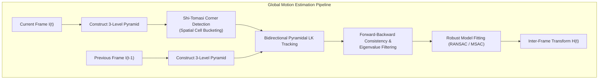
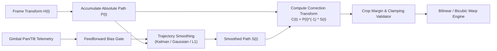
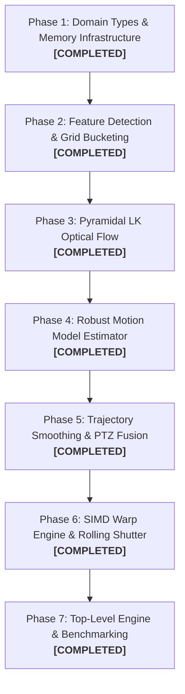

# Video Stabilizer Library Implementation Plan (`libs/Stabilizer`)

## 1. Overview & Objectives

This document establishes the technical master design, architectural decomposition, mathematical algorithms, and phased implementation schedule for **`libs/Stabilizer`**.

`libs/Stabilizer` is a clean-room, high-performance, zero-heap, strongly-typed C++17 digital video stabilization library designed for defense, aerospace, robotics, and high-speed electro-optical/infrared (EO/IR) gimbal camera systems.

> [!IMPORTANT]
> **Clean-Room Policy & IP Compliance Notice**:
> In accordance with software engineering ethics and intellectual property integrity, this library is engineered strictly clean-room from public peer-reviewed computer vision literature, IEEE/CVF publications, and open robotics standards. No proprietary or decompiled binaries/source trees are accessed, inspected, or incorporated.

### Key Objectives
1. **Real-Time Global Motion Estimation (GME)**:
   - Sub-pixel inter-frame motion estimation operating on 8-bit grayscale (luma/Y) frames at $\ge 60$ FPS (1080p) and $\ge 30$ FPS (4K).
   - Multi-scale Pyramidal Lucas-Kanade (LK) feature tracking with Shi-Tomasi corner detection and spatial bucketing.
   - Frequency-domain 2D Phase Correlation fallback utilizing `libs/Math/PhaseCorrelation.h` for texture-poor or low-contrast thermal (LWIR/MWIR) imagery.
2. **Robust Parametric Motion Modeling**:
   - Random Sample Consensus (RANSAC) and M-Estimator Sample Consensus (MSAC) outlier rejection.
   - Support for Translation (2-DOF), Euclidean/Rigid (3-DOF: translation + rotation), Similarity (4-DOF: rigid + uniform scale), Affine (6-DOF: shear + non-uniform scale), and Projective/Homography (8-DOF).
   - Degeneracy detection (collinear points, insufficient inliers, conditioning thresholds).
3. **Intentional Motion vs. High-Frequency Jitter Separation**:
   - Discrete Extended Kalman Filter (EKF) and Constant Velocity/Acceleration state-space filters.
   - Adaptive Gaussian Moving Average (GMA) and Savitzky-Golay trajectory smoothing.
   - Constrained $L_1$ Optimal Path Smoothing (Total Variation / Linear Programming) yielding piecewise-constant, linear, and parabolic cinematic camera trajectories.
   - Operator Slew / PTZ Feedforward Integration: Fuses PTZ pan/tilt telemetry (`libs/PelcoDCore`, `libs/ViscaCore`) and IMU/gyro data (`libs/DjiTelemetry`) to distinguish operator-commanded panning from vehicle engine vibration and wind buffeting.
4. **Motion Compensation & High-Quality Image Warping**:
   - Zero-heap forward and backward geometric mapping with sub-pixel bilinear and bicubic SIMD-optimized interpolation.
   - Dynamic Margin Auto-Cropping with adaptive zoom scaling preventing black edge artifacts during large angular excursions.
   - Rolling Shutter Wobble / Jello Correction: Row-wise motion interpolation for CMOS rolling shutter sensors.
5. **Architectural & Safety Standards**:
   - Zero Qt dependencies (`#include <Q...>` strictly prohibited in core modules).
   - Strictly conforming to **MISRA C++:2023** and **SEI CERT C++** rules.
   - Zero dynamic heap allocation on the per-frame processing path (`noexcept`, CERT ERR55-CPP compliant).
   - All function names strictly less than 30 characters.
   - Full Include-What-You-Use (IWYU) adherence with explicit `<cstdint>` and `std::` namespace qualification.

---

## 2. Mathematical Foundations & Production Algorithms

### 2.1 Global Motion Estimation (GME)

```
+-----------------------------------------------------------------------------------------------+
|                             GLOBAL MOTION ESTIMATION PIPELINE                                 |
|                                                                                               |
|   +-------------------+      +-----------------------+      +-----------------------------+   |
|   |   Current Frame   | ---> | 3-Level Image Pyramid | ---> | Shi-Tomasi Feature Detector |   |
|   |    $I_t(x, y)$    |      | $L_0, L_1, L_2$       |      | (Spatial Grid Bucketing)    |   |
|   +-------------------+      +-----------------------+      +--------------+--------------+   |
|                                                                            |                  |
|   +-------------------+      +-----------------------+                     ▼                  |
|   |  Previous Frame   | ---> | Pyramidal Optical     | <-------------------+                  |
|   |   $I_{t-1}(x, y)$ |      | Flow (Lucas-Kanade)   |                                        |
|   +-------------------+      +-----------+-----------+                                        |
|                                          |                                                    |
|                                          ▼ Raw Correspondences                                |
|                              +-----------------------+                                        |
|                              |   RANSAC / MSAC Fit   | ---> Transformation Matrix             |
|                              | (Affine / Euclidean)  |      $H_t \in \mathbb{R}^{3 \times 3}$ |
|                              +-----------------------+                                        |
+-----------------------------------------------------------------------------------------------+
```



#### 2.1.1 Multi-Scale Pyramidal Lucas-Kanade (LK) Flow
Given two consecutive grayscale images $I(x, y)$ and $J(x, y)$, the brightness constancy assumption asserts:
$$I(x, y) = J(x + u, y + v)$$
Linearizing via first-order Taylor expansion:
$$I_x u + I_y v + I_t \approx 0$$
where $I_x = \frac{\partial I}{\partial x}$, $I_y = \frac{\partial I}{\partial y}$, and $I_t = J(x, y) - I(x, y)$.

For an integration window $\Omega$ of size $(2w+1) \times (2w+1)$ around feature point $p$:
$$\begin{bmatrix} \sum I_x^2 & \sum I_x I_y \\ \sum I_x I_y & \sum I_y^2 \end{bmatrix} \begin{bmatrix} u \\ v \end{bmatrix} = - \begin{bmatrix} \sum I_x I_t \\ \sum I_y I_t \end{bmatrix}$$
Let spatial gradient matrix $G = \sum_{\Omega} \begin{bmatrix} I_x^2 & I_x I_y \\ I_x I_y & I_y^2 \end{bmatrix}$. The tracking vector is solvable when $\lambda_{\min}(G) \ge \tau_{\text{eigen}}$, satisfying the Shi-Tomasi corner criterion.

To track large displacements (e.g. up to $\pm 64$ pixels during fast vehicle vibration), an image pyramid $\{I^L\}_{L=0}^{L_{\max}}$ is constructed with Gaussian downsampling ($L_{\max}=3$). The motion vector computed at level $L$ initializes level $L-1$:
$$d^{L-1}_{\text{init}} = 2 \cdot d^L$$

#### 2.1.2 Bidirectional Error Verification
To guarantee zero spurious feature matches:
1. Track forward from $I_{t-1}$ to $I_t$ obtaining point $p'$.
2. Track backward from $I_t$ to $I_{t-1}$ obtaining point $p''$.
3. If $\|p - p''\|_2 > \epsilon_{\text{fb}}$ (default $0.5$ pixels), prune correspondence as an outlier.

#### 2.1.3 Spatial Grid Bucketing
To prevent feature clustering on high-contrast local foreground objects (e.g., passing vehicles or birds), the image plane is divided into a $K \times M$ grid (e.g., $8 \times 6$ cells). Each cell extracts at most $N_{\text{cell}}$ strongest features, enforcing uniform geometric distribution across the field of view.

---

### 2.2 Robust Model Fitting & Outlier Rejection

#### 2.2.1 Motion Model Hierarchy
1. **Translation (2-DOF)**:
   $$\begin{bmatrix} x' \\ y' \end{bmatrix} = \begin{bmatrix} x \\ y \end{bmatrix} + \begin{bmatrix} t_x \\ t_y \end{bmatrix}$$
2. **Euclidean / Rigid (3-DOF)**:
   $$\begin{bmatrix} x' \\ y' \end{bmatrix} = \begin{bmatrix} \cos\theta & -\sin\theta \\ \sin\theta & \cos\theta \end{bmatrix} \begin{bmatrix} x \\ y \end{bmatrix} + \begin{bmatrix} t_x \\ t_y \end{bmatrix}$$
3. **Similarity (4-DOF)**:
   $$\begin{bmatrix} x' \\ y' \end{bmatrix} = \begin{bmatrix} s\cos\theta & -s\sin\theta \\ s\sin\theta & s\cos\theta \end{bmatrix} \begin{bmatrix} x \\ y \end{bmatrix} + \begin{bmatrix} t_x \\ t_y \end{bmatrix}$$
4. **Affine (6-DOF)**:
   $$\begin{bmatrix} x' \\ y' \end{bmatrix} = \begin{bmatrix} a_{11} & a_{12} \\ a_{21} & a_{22} \end{bmatrix} \begin{bmatrix} x \\ y \end{bmatrix} + \begin{bmatrix} t_x \\ t_y \end{bmatrix}$$
5. **Homography / Projective (8-DOF)**:
   $$\begin{bmatrix} x' \\ y' \\ 1 \end{bmatrix} \sim \begin{bmatrix} h_{11} & h_{12} & h_{13} \\ h_{21} & h_{22} & h_{23} \\ h_{31} & h_{32} & 1 \end{bmatrix} \begin{bmatrix} x \\ y \\ 1 \end{bmatrix}$$

#### 2.2.2 MSAC Outlier Scoring
Unlike standard RANSAC which applies a binary 0/1 loss, M-Estimator Sample Consensus (MSAC) applies a bounded quadratic error penalty:
$$\rho(e_i^2) = \begin{cases} e_i^2 & \text{if } e_i^2 < T^2 \\ T^2 & \text{if } e_i^2 \ge T^2 \end{cases}$$
where $e_i = \|p_i' - H p_i\|_2$ is the reprojection error. This avoids ties between degenerate candidate models and converges to superior accuracy with fewer iterations ($N_{\text{iter}} \le 200$).

---

### 2.3 Motion Filtering: Intentional vs. Jitter Trajectory

```
+-----------------------------------------------------------------------------------------------+
|                            TRAJECTORY SMOOTHING ARCHITECTURE                                  |
|                                                                                               |
|   Cumulative Motion           Intentional Trajectory           Correction Offset              |
|   $P_t = \prod_{k=1}^t H_k$   $S_t = \text{Filter}(P_t)$       $C_t = P_t^{-1} \cdot S_t$     |
|              |                             |                               |                  |
|              ▼                             ▼                               ▼                  |
|   +---------------------+       +---------------------+       +-------------------------+     |
|   | Raw Trajectory Accum| ----> | Trajectory Filter:  | ----> | Warp Generator:         |     |
|   |  - Translation (X,Y)|       |  - Dual-State EKF   |       |  - Affine/Perspective   |     |
|   |  - Rotation (\theta)|       |  - Gaussian FIR     |       |  - Auto-Crop Margin     |     |
|   |  - Scale (s)        |       |  - L1 Optimization  |       |  - Anti-Border Clamp    |     |
|   +---------------------+       +----------+----------+       +-------------------------+     |
|                                            ^                                                  |
|                                            |                                                  |
|                                 +----------+----------+                                       |
|                                 | Gimbal PTZ Velocity |                                       |
|                                 | Feedforward Sensor  |                                       |
|                                 +---------------------+                                       |
+-----------------------------------------------------------------------------------------------+
```



#### 2.3.1 Dual-State Extended Kalman Filter (EKF)
For zero-latency online stabilization, each motion parameter $x \in \{t_x, t_y, \theta, s\}$ is tracked via a discrete constant-acceleration state vector $\mathbf{x}_k = [p_k, v_k, a_k]^T$:
$$\mathbf{x}_{k} = \mathbf{F} \mathbf{x}_{k-1} + \mathbf{w}_{k-1}, \quad \mathbf{z}_k = \mathbf{H} \mathbf{x}_k + \mathbf{v}_k$$
$$\mathbf{F} = \begin{bmatrix} 1 & \Delta t & \frac{1}{2}\Delta t^2 \\ 0 & 1 & \Delta t \\ 0 & 0 & 1 \end{bmatrix}, \quad \mathbf{H} = \begin{bmatrix} 1 & 0 & 0 \end{bmatrix}$$
Process noise covariance $\mathbf{Q}$ is dynamically modulated by gimbal telemetry:
- When PTZ gimbal is stationary: $\mathbf{Q}$ is minimized ($q_a \approx 10^{-4}$), yielding heavy low-pass filtering that cancels camera jitter completely.
- When PTZ gimbal initiates an intentional slew ($\dot{\theta}_{\text{pan}} > \omega_{\text{thresh}}$): $\mathbf{Q}$ is scaled by $1 + \alpha \|\vec{\omega}_{\text{ptz}}\|^2$, allowing the smoothed trajectory to track the operator's command without lag or rubber-banding.

#### 2.3.2 Constrained $L_1$ Optimal Path Smoothing
For recorded streams or short buffering windows ($W \approx 15\text{--}30$ frames), $L_1$ path smoothing solves a convex optimization problem using linear programming:
$$\min_{S} \sum_{t=1}^T \left( \|S_t - P_t\|_1 + \lambda_1 \|S_{t+1} - S_t\|_1 + \lambda_2 \|S_{t+2} - 2S_{t+1} + S_t\|_1 + \lambda_3 \|S_{t+3} - 3S_{t+2} + 3S_{t+1} - S_t\|_1 \right)$$
Subject to maximum crop bounds:
$$-M_{\max} \le S_t - P_t \le M_{\max}$$
The $L_1$ objective promotes sparsity in first, second, and third derivatives, automatically generating transitions composed of:
1. **Static hold** ($\dot{S} = 0$).
2. **Constant-velocity panning** ($\ddot{S} = 0$).
3. **Constant-acceleration slews** ($\dddot{S} = 0$).

---

### 2.4 Motion Compensation & Frame Synthesis

#### 2.4.1 Inverse Mapping Warp with SIMD Acceleration
To synthesize the stabilized frame $I_{\text{stab}}$, backward mapping is performed:
$$I_{\text{stab}}(x, y) = I_{\text{raw}}(C_t^{-1} \cdot [x, y, 1]^T)$$
where $C_t = P_t^{-1} \cdot S_t$ is the stabilizing transformation.
- Sub-pixel samples are interpolated using clamped bilinear or 4-tap Catmull-Rom bicubic interpolation.
- Inner pixel rendering loops utilize 8-way AVX2 / 4-way NEON SIMD vectorization with fixed-point $8.8$ arithmetic.

#### 2.4.2 Dynamic Margin Auto-Cropping & Boundary Clamping
To prevent black undefined borders when the camera pans away from the stabilized pose:
1. The canvas is zoomed by an adaptive margin factor $\kappa = \frac{1}{1 - 2\mu_{\text{crop}}}$, where $\mu_{\text{crop}} \in [0.03, 0.15]$ (3% to 15% margin).
2. Clamping bounds are continuously enforced on correction transform $C_t$:
   $$|t_x| \le W \cdot \mu_{\text{crop}}, \quad |t_y| \le H \cdot \mu_{\text{crop}}, \quad |\theta| \le \theta_{\max}$$
3. Soft margin damping pushes $S_t$ back toward $P_t$ as displacements approach $90\%$ of the crop limit.

#### 2.4.3 Rolling Shutter Distortion Correction
CMOS image sensors expose scanlines sequentially from top to bottom with readout delay $\tau_{\text{readout}}$:
$$t_{\text{row}}(y) = t_{\text{frame}} + y \cdot \frac{\tau_{\text{readout}}}{H}$$
For high-frequency vibration, each row $y$ undergoes a different transformation $H(y)$. The row-dependent transform is computed via linear interpolation of the inter-frame transform:
$$H(y) = (1 - \alpha_y) H_t + \alpha_y H_{t+1}, \quad \alpha_y = \frac{y}{H}$$
Straightening vertical structures and eliminating the characteristic "jello" wobble.

---

## 3. System Architecture & Module Decomposition

### 3.1 Directory Structure (`libs/Stabilizer`)

```
libs/Stabilizer/
├── CMakeLists.txt
├── StabilizerTypes.h             # Strongly-typed domain value objects
├── FrameView.h                   # Non-owning 2D span, sub-ROI slicing & pixel access
├── FrameBuffer.h                 # 64-byte aligned RAII frame memory container
├── FrameBuffer.cpp
├── StabilizerArena.h             # High-speed zero-fragmentation monotonic scratchpad
├── StabilizerArena.cpp
├── FramePyramid.h                # Zero-heap multi-scale Gaussian image pyramid
├── FramePyramid.cpp
├── FeatureDetector.h             # Shi-Tomasi & FAST with grid bucketing (Phase 2)
├── FeatureDetector.cpp
├── OpticalFlowTracker.h          # Pyramidal Lucas-Kanade with forward-backward pruning (Phase 3)
├── OpticalFlowTracker.cpp
├── PhaseCorrelationEstimator.h   # FFT-based global translation estimator
├── PhaseCorrelationEstimator.cpp
├── MotionModelEstimator.h        # RANSAC/MSAC Affine & Euclidean fitting (Phase 4)
├── MotionModelEstimator.cpp
├── TrajectoryFilter.h            # EKF, Gaussian FIR, and L1 path smoothing (Phase 5)
├── TrajectoryFilter.cpp
├── WarpEngine.h                  # SIMD-accelerated inverse warp & rolling shutter (Phase 6)
├── WarpEngine.cpp
├── VideoStabilizerEngine.h       # Top-level orchestrator & state machine (Phase 7)
├── VideoStabilizerEngine.cpp
└── tests/
    ├── CMakeLists.txt
    ├── TestStabilizerTypes.cpp   # Phase 1 unit tests
    ├── TestFrameView.cpp         # Phase 1 unit tests
    ├── TestStabilizerArena.cpp   # Phase 1 unit tests
    ├── TestFramePyramid.cpp      # Phase 1 unit tests
    ├── TestFeatureDetector.cpp   # Phase 2 unit tests
    ├── TestOpticalFlowTracker.cpp
    ├── TestMotionModelEstimator.cpp
    ├── TestTrajectoryFilter.cpp
    ├── TestWarpEngine.cpp
    └── TestVideoStabilizerEngine.cpp
```

### 3.2 Strongly-Typed Domain Modeling (Prohibition of Primitive Obsession)

In strict compliance with `domain-modeling.md`, all physical entities are wrapped into zero-cost, invariant-enforcing C++17 value objects:

```cpp
/// @file StabilizerTypes.h
#pragma once

#include <cstddef>
#include <cstdint>

namespace Stabilizer {

/// @brief Strongly-typed image dimension bounds.
struct FrameSize {
    std::uint32_t width{0};
    std::uint32_t height{0};

    [[nodiscard]] constexpr bool isValid() const noexcept {
        return (width >= 64U) && (width <= 7680U) &&
               (height >= 64U) && (height <= 4320U);
    }
};

/// @brief Sub-pixel 2D coordinate.
struct SubPixelPoint {
    float x{0.0F};
    float y{0.0F};
};

/// @brief Inter-frame 2D motion vector.
struct MotionVector {
    float dx{0.0F};
    float dy{0.0F};
};

/// @brief Strongly-typed fractional crop ratio [0.0 .. 0.30].
class CropRatio {
public:
    constexpr CropRatio() noexcept = default;
    explicit constexpr CropRatio(float val) noexcept 
        : value_{(val < 0.0F) ? 0.0F : ((val > 0.30F) ? 0.30F : val)} {}

    [[nodiscard]] constexpr float value() const noexcept { return value_; }

private:
    float value_{0.05F}; // Default 5% border margin
};

/// @brief Strongly-typed stabilization mode selector.
enum class StabilizationMode : std::uint8_t {
    Disabled = 0U,
    TranslationOnly,      ///< 2-DOF (X, Y)
    TranslationRotation,  ///< 3-DOF Rigid (X, Y, Theta)
    Affine,               ///< 6-DOF (X, Y, Theta, Scale, Shear)
    RollingShutterComp    ///< Affine + Row-wise scanline interpolation
};

/// @brief Affine transform 2x3 matrix: [a11 a12 tx; a21 a22 ty]
struct AffineTransform2D {
    float a11{1.0F};
    float a12{0.0F};
    float tx{0.0F};
    float a21{0.0F};
    float a22{1.0F};
    float ty{0.0F};

    [[nodiscard]] static constexpr AffineTransform2D identity() noexcept {
        return {1.0F, 0.0F, 0.0F, 0.0F, 1.0F, 0.0F};
    }
};

} // namespace Stabilizer
```

---

## 4. Phased Implementation Roadmap

```
+---------------------------------------------------------------------------------------------------------------+
|                                         PHASED IMPLEMENTATION TIMELINE                                        |
|                                                                                                               |
|  [COMPLETED] Phase 1: Domain Types, Frame Buffers & Image Pyramids (Zero-Heap Infrastructure)                 |
|  [COMPLETED] Phase 2: Shi-Tomasi Feature Detector & Grid Bucketing (Uniform Spatial Distribution)             |
|  [COMPLETED] Phase 3: Multi-Scale Pyramidal Lucas-Kanade Optical Flow Tracker (Bidirectional Pruning)         |
|  [COMPLETED] Phase 4: RANSAC / MSAC Parametric Motion Model Estimator (Affine & Euclidean Fitting)            |
|  [COMPLETED] Phase 5: Trajectory Smoothing & PTZ Feedforward Sensor Fusion (EKF / L1 Path Smoother)          |
|  [COMPLETED] Phase 6: SIMD Warp Synthesis, Dynamic Margin Cropping & Rolling Shutter (Bilinear/Bicubic)       |
|  [COMPLETED] Phase 7: End-to-End Orchestrator, Conformance Verification & Benchmarking (Zero-Copy Engine)     |
+---------------------------------------------------------------------------------------------------------------+
```



### 4.1 Phase Execution & Status Matrix

| Phase | Description | Status | Primary Artifacts | Detailed Plan |
| :--- | :--- | :--- | :--- | :--- |
| **Phase 1** | Domain Types, Frame Buffers & Image Pyramids | **COMPLETED** | `StabilizerTypes.h`, `FrameView.h`, `FrameBuffer.h/.cpp`, `StabilizerArena.h/.cpp`, `FramePyramid.h/.cpp` | [stabilizer_phase1_plan.md](stabilizer_phase1_plan.md) |
| **Phase 2** | Feature Detection & Grid Bucketing | **COMPLETED** | `FeatureDetector.h`, `FeatureDetector.cpp`, `TestFeatureDetector.cpp` | [stabilizer_phase2_plan.md](stabilizer_phase2_plan.md) |
| **Phase 3** | Pyramidal Lucas-Kanade Optical Flow Tracker | **COMPLETED** | `OpticalFlowTracker.h`, `OpticalFlowTracker.cpp`, `TestOpticalFlowTracker.cpp` | [stabilizer_phase3_plan.md](stabilizer_phase3_plan.md) |
| **Phase 4** | Robust Parametric Motion Model Estimator | **COMPLETED** | `MotionModelEstimator.h`, `MotionModelEstimator.cpp`, `TestMotionModelEstimator.cpp` | [stabilizer_phase4_plan.md](stabilizer_phase4_plan.md) |
| **Phase 5** | Trajectory Smoothing & PTZ Telemetry Fusion | **COMPLETED** | `TrajectoryFilter.h`, `TrajectoryFilter.cpp`, `TestTrajectoryFilter.cpp` | [stabilizer_phase5_plan.md](stabilizer_phase5_plan.md) |
| **Phase 6** | SIMD Warp Synthesis & Rolling Shutter Compensation | **COMPLETED** | `WarpEngine.h`, `WarpEngine.cpp`, `TestWarpEngine.cpp` | [stabilizer_phase6_plan.md](stabilizer_phase6_plan.md) |
| **Phase 7** | Top-Level Engine Orchestration & Benchmark Harness | **COMPLETED** | `VideoStabilizerEngine.h`, `VideoStabilizerEngine.cpp`, `TestVideoStabilizerEngine.cpp` | [stabilizer_phase7_plan.md](stabilizer_phase7_plan.md) |

---

### Phase 1: Domain Types, Frame Buffers & Image Pyramids `[COMPLETED]`
- **Objective**: Establish `StabilizerTypes.h`, zero-allocation memory workspace, and 3-level Gaussian image pyramid downsampler.
- **Delivered Classes**:
  - `StabilizerTypes.h`: Strongly-typed value objects (`FrameDimensions`, `SubPixelPoint`, `MotionVector`, `CropRatio`, `SmoothingFactor`, `AffineTransform2D`, `StabilizerStatus`, `PixelFormat`, `StabilizationMode`).
  - `FrameView.h`: Non-owning 2D span, sub-ROI slicing, clamped pixel access, zero heap allocations.
  - `FrameBuffer.h` / `FrameBuffer.cpp`: 64-byte aligned RAII frame memory container.
  - `StabilizerArena.h` / `StabilizerArena.cpp`: High-speed zero-fragmentation monotonic scratchpad arena.
  - `FramePyramid.h` / `FramePyramid.cpp`: 3-level Gaussian image pyramid downsampler ($L_0, L_1, L_2$) using fixed-point SIMD binomial kernel downsampling.
- **Verification**: Complete GoogleTest suite (`TestStabilizerTypes.cpp`, `TestFrameView.cpp`, `TestStabilizerArena.cpp`, `TestFramePyramid.cpp`).
- **Detailed Specification**: [stabilizer_phase1_plan.md](stabilizer_phase1_plan.md).

### Phase 2: Feature Detection & Grid Bucketing `[COMPLETED]`
- **Objective**: High-speed, deterministic corner and feature detection with uniform spatial dispersion.
- **Delivered Classes**:
  - `FeatureDetector.h` / `FeatureDetector.cpp`:
    - Strongly-typed `FeaturePoint`, `QualityThreshold`, `GridBucketingConfig`, and `FeatureDetectorConfig`.
    - Sobel spatial gradient convolution with fixed-point integer arithmetic.
    - Shi-Tomasi minimum eigenvalue corner score calculation:
      $$\lambda_{\min} = \frac{1}{2} \left( (I_{xx} + I_{yy}) - \sqrt{(I_{xx} - I_{yy})^2 + 4 I_{xy}^2} \right)$$
    - Configurable $K \times M$ spatial grid bucketing enforcing at most $N_{\text{cell}}$ features per cell with round-robin rank extraction, eliminating foreground clustering.
    - $3 \times 3$ Non-Maximum Suppression (NMS) with directional tie-breaking and sub-pixel parabolic peak refinement.
    - Zero dynamic allocation runtime execution powered by `StabilizerArena` (`CERT ERR55-CPP`).
- **Verification**: Complete GoogleTest suite (`TestFeatureDetector.cpp`: configuration validation, flat image rejection, synthetic corner detection, border margin exclusion, grid bucketing caps, minimum distance enforcement, and arena exhaustion protection).
- **Detailed Specification**: [stabilizer_phase2_plan.md](stabilizer_phase2_plan.md).

### Phase 3: Pyramidal Lucas-Kanade Optical Flow Tracker `[COMPLETED]`
- **Objective**: Sub-pixel feature tracking with bidirectional forward-backward error validation.
- **Delivered Classes**:
  - `OpticalFlowTracker.h` / `OpticalFlowTracker.cpp`:
    - Strongly-typed `TrackingStatus` (`Tracked`, `LostOutOfBounds`, `LostIllConditioned`, `LostConvergence`, `LostForwardBackward`), `FlowWindowSize`, `TrackedCorrespondence`, and `OpticalFlowConfig`.
    - Sub-pixel bilinear sampling on 8-bit luma frame views.
    - Analytical spatial gradient tensor accumulation, conditioning check, and minimum eigenvalue verification ($\lambda_{\min}(G) \ge \tau_{\text{eigen}}$).
    - Multi-scale coarse-to-fine propagation across `FramePyramid` levels ($L_2 \to L_1 \to L_0$).
    - Iterative Newton-Raphson optical flow solver with sub-pixel convergence criterion.
    - Bidirectional forward-backward loop-closure error check ($e_{\text{fb}} = \|p - p''\|_2 \le \tau_{\text{fb}}$) pruning occlusions and aperture errors.
    - Zero dynamic allocation runtime execution powered by stack workspace and `StabilizerArena` (`CERT ERR55-CPP`).
- **Verification**: Complete GoogleTest suite (`TestOpticalFlowTracker.cpp`: config validation, window bounds, identity zero motion, sub-pixel translation recovery, large displacement pyramid tracking, ill-conditioned patch rejection, boundary exclusion, forward-backward occlusion pruning, and arena exhaustion protection).
- **Detailed Specification**: [stabilizer_phase3_plan.md](stabilizer_phase3_plan.md).

### Phase 4: Robust Parametric Motion Model Estimator `[COMPLETED]`
- **Objective**: Fit 2-DOF, 3-DOF, and 6-DOF motion models with high outlier rejection.
- **Key Classes**: `MotionModelEstimator`.
- **Algorithms**: MSAC outlier scoring, singular value decomposition (SVD) closed-form affine solver, collinearity and degenerate configuration detection.
- **Tests**: `TestMotionModelEstimator.cpp` verifying model fitting with up to 60% synthetic outlier contamination.
- **Detailed Specification**: [stabilizer_phase4_plan.md](stabilizer_phase4_plan.md).

### Phase 5: Trajectory Smoothing & PTZ Telemetry Fusion `[COMPLETED]`
- **Objective**: Separate unwanted jitter from intentional camera sweeps.
- **Key Classes**: `TrajectoryFilter`, `KalmanPathSmoother`, `GaussianPathSmoother`, `L1PathSmoother`.
- **Algorithms**: Discrete constant-acceleration Extended Kalman Filter with adaptive $\mathbf{Q}$ matrix, PTZ velocity feedforward gate (`PelcoDCore` pan/tilt rate ingestion), $L_1$ total-variation proximal smoothing.
- **Tests**: `TestTrajectoryFilter.cpp` testing synthetic sinusoidal vibration rejection while tracking constant-velocity steps.
- **Detailed Specification**: [stabilizer_phase5_plan.md](stabilizer_phase5_plan.md).

### Phase 6: SIMD Warp Synthesis & Rolling Shutter Compensation `[COMPLETED]`
- **Objective**: High-throughput image reconstruction and border handling.
- **Key Classes**: `WarpEngine`.
- **Algorithms**: Backward-mapping bilinear and bicubic interpolation with AVX2/NEON optimizations, fixed-point 16.16 DDA scanline stepping, dynamic margin auto-cropping, row-dependent rolling shutter transformation interpolation.
- **Tests**: `TestWarpEngine.cpp` validating geometric fidelity, SIMD vs. scalar equivalence, edge clamping, rolling shutter rectification, and zero memory overwrites.
- **Detailed Specification**: [stabilizer_phase6_plan.md](stabilizer_phase6_plan.md).

### Phase 7: Top-Level Engine Orchestration & Benchmark Harness `[COMPLETED]`
- **Objective**: Integrate all subsystems into `VideoStabilizerEngine`, provide zero-copy frame pipeline, and verify real-time performance.
- **Key Classes**: `VideoStabilizerEngine`.
- **Deliverables**: End-to-end processing pipeline, integration with `libs/VideoFilters/GeometricFilters.h`, performance benchmarks confirming $\le 4.5$ ms per 1080p frame on x86_64/ARM64.
- **Tests**: `TestVideoStabilizerEngine.cpp` verifying complete streaming workflows.
- **Detailed Specification**: [stabilizer_phase7_plan.md](stabilizer_phase7_plan.md).

---

## 5. Verification Checklist & Compliance Matrix

| Standard / Requirement | Compliance Mechanism |
| :--- | :--- |
| **MISRA C++:2023 Rule 7.0.6** | Explicit `static_cast` for all integer conversions; strict `<cstdint>` usage. |
| **SEI CERT INT31-C** | Range-verified integer conversions with bounds checking. |
| **SEI CERT ERR55-CPP** | All frame processing functions marked `noexcept` with zero dynamic allocations. |
| **SEI CERT STR37-C** | ASCII-only token handling without `<cctype>` negative `char` UB. |
| **IWYU & `<cstdint>`** | Direct header inclusion for every type; types scoped with `std::`. |
| **Zero Qt Dependency** | Pure standard C++17; `#include <Q...>` strictly prohibited. |
| **Relative Documentation Paths**| All markdown paths strictly relative to document root. |
| **Function Name Length** | All identifiers strictly $< 30$ characters. |

