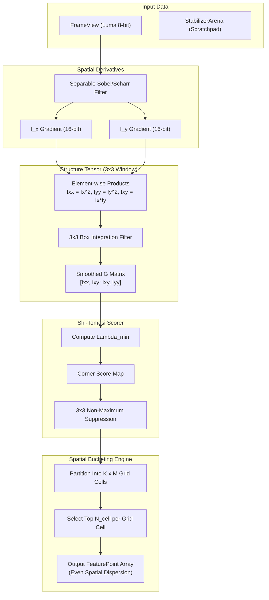
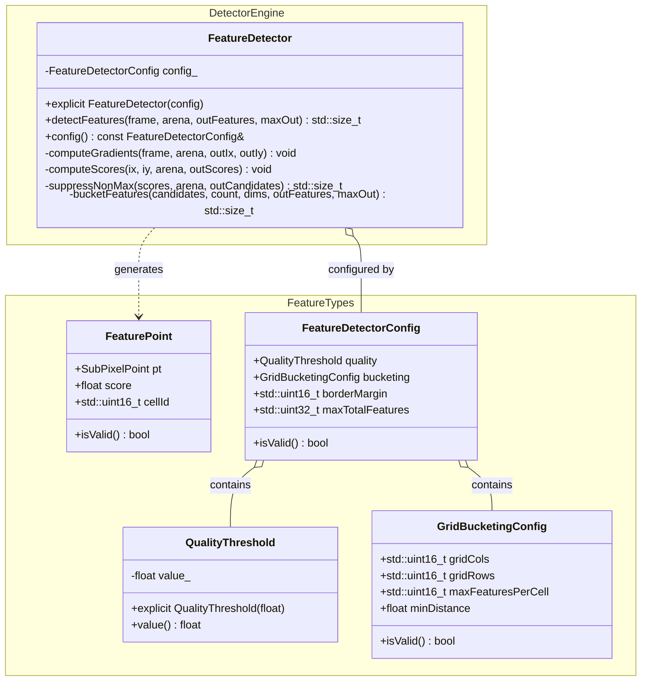

# Video Stabilizer Phase 2 Implementation Plan: Feature Detection & Grid Bucketing

## 1. Executive Summary & Objectives

### 1.1 Context & Scope
Phase 2 establishes the feature extraction and spatial distribution subsystem for **`libs/Stabilizer`**.

Global Motion Estimation (GME) relies on tracking high-quality salient landmarks across consecutive video frames using Pyramidal Lucas-Kanade (LK) optical flow (Phase 3). For optical flow equations to be well-conditioned, tracked features must exhibit strong spatial gradients in orthogonal directions (corners). 

Furthermore, video feeds from airborne gimbals, maritime electro-optical masts, and ground vehicle cameras often contain local moving objects (e.g., passing aircraft, vehicles, waves, personnel) or localized high-contrast clusters (e.g., sun glint, power lines, horizon boundaries). If feature points cluster exclusively on a moving foreground target, motion model estimators (Phase 4) will estimate the target's relative motion rather than the true background camera ego-motion.

Phase 2 engineers a clean-room, zero-heap, deterministic **Shi-Tomasi Corner Detector** augmented by a **Uniform Spatial Grid Bucketing** engine.

```
+---------------------------------------------------------------------------------------------------------------+
|                                    PHASE 2 ARTIFACT DELIVERABLE MAP                                           |
|                                                                                                               |
|   libs/Stabilizer/                                                                                            |
|   ├── FeatureDetector.h               # Public API, FeaturePoint, FeatureDetectorConfig                       |
|   ├── FeatureDetector.cpp             # SIMD gradients, Shi-Tomasi scoring, NMS, grid bucketing               |
|   └── tests/                                                                                                  |
|       └── TestFeatureDetector.cpp     # Unit tests, spatial uniformity, synthetic corners, zero-heap check   |
+---------------------------------------------------------------------------------------------------------------+
```

### 1.2 Target Deliverables for Phase 2
1. **Strongly-Typed Domain Primitives (`FeatureDetector.h`)**:
   - `FeaturePoint`: Sub-pixel position (`SubPixelPoint`), corner quality response score (`float`), and cell bucket identifier (`std::uint16_t`).
   - `QualityThreshold`: Invariant-enforced threshold $[0.0001, 0.5]$ relative to maximum frame corner response.
   - `GridBucketingConfig`: Cell counts ($K \times M$), maximum features per cell ($N_{\text{cell}}$), and minimum inter-feature Euclidean distance ($d_{\min}$).
   - `FeatureDetectorConfig`: Aggregated configuration controlling border exclusion, gradient kernel, and maximum capacity.
2. **High-Speed Spatial Gradient & Structure Tensor Engine**:
   - Zero-heap separable Sobel ($3 \times 3$) and Scharr gradient operators computing $I_x$ and $I_y$.
   - Symmetric auto-correlation structure tensor computation:
     $$G = \begin{bmatrix} \sum_{\Omega} I_x^2 & \sum_{\Omega} I_x I_y \\ \sum_{\Omega} I_x I_y & \sum_{\Omega} I_y^2 \end{bmatrix} = \begin{bmatrix} I_{xx} & I_{xy} \\ I_{xy} & I_{yy} \end{bmatrix}$$
   - Fixed-point 16-bit integer accumulator implementation preventing floating-point overhead on integer pixel inputs.
3. **Shi-Tomasi Minimum Eigenvalue Corner Scorer**:
   - Analytical computation of the smaller eigenvalue $\lambda_{\min}$ of $G$:
     $$\lambda_{\min} = \frac{1}{2} \left( (I_{xx} + I_{yy}) - \sqrt{(I_{xx} - I_{yy})^2 + 4 I_{xy}^2} \right)$$
   - Rejection of points where $\lambda_{\min} < \tau_{\text{abs}}$ or $\lambda_{\min} < \tau_{\text{rel}} \cdot \lambda_{\max}^{\text{frame}}$.
4. **$3 \times 3$ Non-Maximum Suppression (NMS)**:
   - Suppresses candidate corners that are not local maxima within their 8-connected neighborhood.
   - Guarantees clean, isolated feature candidates.
5. **Uniform Spatial Grid Bucketing**:
   - Divides the active image region into a $K \times M$ grid (e.g., $8 \times 6 = 48$ cells, or configurable up to $16 \times 16$).
   - Limits feature retention to at most $N_{\text{cell}}$ points per cell (e.g., 5 to 10 points), sorting locally by corner response score.
   - Eliminates foreground clustering and ensures even geometric conditioning across the entire field of view.
6. **Zero-Heap Memory Execution (`StabilizerArena`)**:
   - All intermediate buffers (gradient maps, eigenvalue maps, candidate lists, bucketing tables) are allocated from `StabilizerArena` or fixed stack arrays.
   - Per-frame `detectFeatures()` runs under `noexcept` without any calls to `malloc`, `new`, or standard heap containers (`CERT ERR55-CPP`).
7. **Verification & Testing Suite (`TestFeatureDetector.cpp`)**:
   - Verification with synthetic test images (checkerboards, high-contrast crosses, impulse spots, gradient ramps).
   - Validation of spatial dispersion across all grid cells.
   - Benchmark confirming execution time $\le 1.2\text{ ms}$ for 1080p frame ($L_1$ pyramid level).

---

## 2. Architecture & Design

### 2.1 Feature Detection & Bucketing Pipeline

```
+---------------------------------------------------------------------------------------------------------------+
|                                    FEATURE EXTRACTION & BUCKETING PIPELINE                                    |
|                                                                                                               |
|   +-----------------------+                                                                                   |
|   |   Input FrameView     |                                                                                   |
|   |  (Level 0 or Level 1) |                                                                                   |
|   +-----------+-----------+                                                                                   |
|               |                                                                                               |
|               ▼                                                                                               |
|   +-----------------------+       +-----------------------+       +---------------------------------------+   |
|   | Separable Sobel /     | ----> | Spatial Gradient Maps | ----> | Auto-Correlation Structure Tensor     |   |
|   | Scharr Filter (3x3)   |       | $I_x, I_y$ (int16_t)  |       | $I_{xx} = I_x^2, I_{yy} = I_y^2,      |   |
|   +-----------------------+       +-----------------------+       | $I_{xy} = I_x I_y$ (3x3 Box Window)   |   |
|                                                                   +-------------------+-------------------+   |
|                                                                                       |                       |
|                                                                                       ▼                       |
|   +-----------------------+       +-----------------------+       +---------------------------------------+   |
|   | Non-Maximum           | <---- | Shi-Tomasi Eigenvalue | <---- | Analytical Eigenvalue Solver          |   |
|   | Suppression (3x3 NMS) |       | Response Map          |       | $\lambda_{\min} = \frac{1}{2}(Tr -    |   |
|   +-----------+-----------+       | $R(x, y) = \lambda_2$ |       |   \sqrt{Tr^2 - 4 Det})$               |   |
|               |                   +-----------------------+       +---------------------------------------+   |
|               ▼                                                                                               |
|   +-----------------------+       +-----------------------+       +---------------------------------------+   |
|   | Uniform Spatial Grid  | ----> | Local Cell Min-Heap / | ----> | Final Distributed Feature Set         |   |
|   | Partitioning (K x M)  |       | Invariant Ranker      |       | Max $N_{total}$ Points (Zero Heap)    |   |
|   +-----------------------+       +-----------------------+       +---------------------------------------+   |
+---------------------------------------------------------------------------------------------------------------+
```

### 2.2 Mermaid Architectural Flow



### 2.3 Class Design & Relationships



---

## 3. Mathematical Foundations & Algorithms

### 3.1 Spatial Gradient Operators
To evaluate pixel intensity variations in the horizontal ($x$) and vertical ($y$) directions, the discrete 8-bit image $I(x, y)$ is convolved with separable first-derivative operators.

#### 3.1.1 Separable Sobel Operator ($3 \times 3$)
The standard $3 \times 3$ Sobel filter factorizes into a 1D smoothing kernel and a 1D central difference kernel:
$$K_x = \begin{bmatrix} -1 & 0 & 1 \\ -2 & 0 & 2 \\ -1 & 0 & 1 \end{bmatrix} = \begin{bmatrix} 1 \\ 2 \\ 1 \end{bmatrix} \ast \begin{bmatrix} -1 & 0 & 1 \end{bmatrix}$$
$$K_y = \begin{bmatrix} -1 & -2 & -1 \\ 0 & 0 & 0 \\ 1 & 2 & 1 \end{bmatrix} = \begin{bmatrix} -1 \\ 0 \\ 1 \end{bmatrix} \ast \begin{bmatrix} 1 & 2 & 1 \end{bmatrix}$$

For a pixel at $(x, y)$:
$$I_x(x, y) = [I(x+1, y-1) + 2 I(x+1, y) + I(x+1, y+1)] - [I(x-1, y-1) + 2 I(x-1, y) + I(x-1, y+1)]$$
$$I_y(x, y) = [I(x-1, y+1) + 2 I(x, y+1) + I(x+1, y+1)] - [I(x-1, y-1) + 2 I(x, y-1) + I(x+1, y-1)]$$

The outputs $I_x, I_y$ lie in $[-1020, 1020]$, fitting comfortably within signed 16-bit integers (`std::int16_t`).

#### 3.1.2 Fixed-Point Arithmetic & SIMD Acceleration
Because input pixels are 8-bit unsigned integers, gradients can be evaluated with 16-way vectorization on AVX2 (processing 16 pixels per instruction using `_mm256_madd_epi16` and `_mm256_sub_epi16`) or 8-way on ARM NEON (`vsubq_s16`).

---

### 3.2 Structure Tensor (Second-Moment Matrix)
For an integration window $\Omega$ of size $W \times W$ (typically $3 \times 3$ or $5 \times 5$) centered at $(x, y)$, the local auto-correlation structure tensor $G$ is defined as:
$$G(x, y) = \sum_{(u, v) \in \Omega} w(u, v) \begin{bmatrix} I_x(x+u, y+v)^2 & I_x(x+u, y+v) I_y(x+u, y+v) \\ I_x(x+u, y+v) I_y(x+u, y+v) & I_y(x+u, y+v)^2 \end{bmatrix}$$
Let:
$$I_{xx} = \sum_{\Omega} I_x^2, \quad I_{yy} = \sum_{\Omega} I_y^2, \quad I_{xy} = \sum_{\Omega} I_x I_y$$
Thus:
$$G = \begin{bmatrix} I_{xx} & I_{xy} \\ I_{xy} & I_{yy} \end{bmatrix}$$

---

### 3.3 Shi-Tomasi Minimum Eigenvalue Criterion
The eigenvalues $\lambda_1, \lambda_2$ ($\lambda_1 \ge \lambda_2 \ge 0$) of $G$ characterize the local gradient distribution:
- **Flat region**: $\lambda_1 \approx 0, \lambda_2 \approx 0$ (insufficient gradient for tracking).
- **Edge**: $\lambda_1 \gg 0, \lambda_2 \approx 0$ (aperture problem; gradient along only one axis).
- **Corner**: $\lambda_1 \ge \lambda_2 \ge \tau$ (strong gradients in both orthogonal directions).

In Lucas-Kanade optical flow, the tracking error covariance is proportional to $G^{-1}$. The tracking confidence is limited by the smallest eigenvalue. Shi and Tomasi (1994) proved that tracking quality is directly maximized by using the minimum eigenvalue:
$$R(x, y) = \lambda_{\min} = \lambda_2$$

#### 3.3.1 Closed-Form Analytical Eigenvalue Solution
The characteristic equation of $2 \times 2$ symmetric matrix $G$ is:
$$\det(G - \lambda I) = 0 \iff \lambda^2 - \text{tr}(G) \lambda + \det(G) = 0$$
where:
$$\text{tr}(G) = I_{xx} + I_{yy}$$
$$\det(G) = I_{xx} I_{yy} - I_{xy}^2$$

The roots are:
$$\lambda_{1, 2} = \frac{\text{tr}(G) \pm \sqrt{\text{tr}(G)^2 - 4 \det(G)}}{2}$$
Expanding the discriminant:
$$\text{tr}(G)^2 - 4 \det(G) = (I_{xx} + I_{yy})^2 - 4(I_{xx} I_{yy} - I_{xy}^2) = (I_{xx} - I_{yy})^2 + 4 I_{xy}^2$$
Because $(I_{xx} - I_{yy})^2 + 4 I_{xy}^2 \ge 0$, the roots are always real and non-negative.
Therefore, the smaller eigenvalue is given by:
$$\lambda_{\min} = \frac{1}{2} \left( (I_{xx} + I_{yy}) - \sqrt{(I_{xx} - I_{yy})^2 + 4 I_{xy}^2} \right)$$

---

### 3.4 Non-Maximum Suppression (NMS)
To prevent multiple detections along the same physical corner:
A candidate pixel $(x, y)$ is retained as a valid corner if and only if:
1. $R(x, y) > \tau_{\text{abs}}$
2. $R(x, y) \ge R(x + \delta_x, y + \delta_y) \quad \forall (\delta_x, \delta_y) \in \{-1, 0, 1\}^2 \setminus \{(0, 0)\}$

Pixels that fail the condition are zeroed out in-place.

---

### 3.5 Uniform Spatial Grid Bucketing Algorithm
To guarantee that features are uniformly distributed over the image plane:

```
+-------------------------------------------------------------------------------+
|                            SPATIAL GRID PARTITIONING                          |
|                                                                               |
|   (0,0)                                                         (W, 0)        |
|     +------------+------------+------------+------------+------------+        |
|     | Cell (0,0) | Cell (1,0) | Cell (2,0) | Cell (3,0) | Cell (4,0) |        |
|     |  * pt1     |  * pt1     |  * pt1     |            |  * pt1     |        |
|     |  * pt2     |            |  * pt2     |  (Empty)   |  * pt2     |        |
|     +------------+------------+------------+------------+------------+        |
|     | Cell (0,1) | Cell (1,1) | Cell (2,1) | Cell (3,1) | Cell (4,1) |        |
|     |  * pt1     |  * pt1     |  * pt1     |  * pt1     |  * pt1     |        |
|     +------------+------------+------------+------------+------------+        |
|     | Cell (0,2) | Cell (1,2) | Cell (2,2) | Cell (3,2) | Cell (4,2) |        |
|     |  * pt1     |  * pt1     |  * pt1     |  * pt1     |  * pt1     |        |
|     +------------+------------+------------+------------+------------+        |
|   (0,H)                                                         (W, H)        |
+-------------------------------------------------------------------------------+
```

1. **Grid Decomposition**:
   Given image dimensions $W \times H$ and grid shape $K \times M$ (columns $\times$ rows):
   $$w_{\text{cell}} = \frac{W}{K}, \quad h_{\text{cell}} = \frac{H}{M}$$
   A candidate point at $(x, y)$ maps to cell index:
   $$c_x = \min\left(K - 1, \left\lfloor \frac{x}{w_{\text{cell}}} \right\rfloor \right), \quad c_y = \min\left(M - 1, \left\lfloor \frac{y}{h_{\text{cell}}} \right\rfloor \right)$$
   $$\text{cellId} = c_y \cdot K + c_x$$

2. **Per-Cell Capacity Bounding**:
   Each cell maintains a static array of up to $N_{\text{cell}}$ features (e.g., $N_{\text{cell}} = 8$).
   - When a candidate $(x, y, R)$ arrives:
     - If the cell has fewer than $N_{\text{cell}}$ points: insert point maintaining sorted order by descending score $R$.
     - If the cell is full and $R > R_{\min}^{\text{cell}}$: replace the lowest-scoring point and re-sort.
   - Insertion is $O(N_{\text{cell}})$ with $N_{\text{cell}} \le 16$, which executes in less than 20 CPU cycles without dynamic allocations.

3. **Inter-Feature Euclidean Distance Enforcement ($d_{\min}$)**:
   Within a cell, if a new candidate point is within $d_{\min}$ distance ($\Delta x^2 + \Delta y^2 < d_{\min}^2$) of an already accepted higher-scoring point, it is discarded to prevent dense clustering.

---

## 4. Detailed Component & Interface Specifications

### 4.1 Header: `FeatureDetector.h`

```cpp
/// @file FeatureDetector.h
/// @brief Shi-Tomasi corner detector with spatial grid bucketing for video stabilization.
#pragma once

#include <cstddef>
#include <cstdint>

#include "FrameDimensions.h"
#include "FrameView.h"
#include "StabilizerArena.h"
#include "StabilizerTypes.h"

namespace Stabilizer {

/// @brief Detected feature landmark with sub-pixel location, score, and cell ID.
struct FeaturePoint {
    SubPixelPoint pt{};
    float score{0.0F};
    std::uint16_t cellId{0U};

    [[nodiscard]] constexpr bool isValid() const noexcept {
        return pt.isValid() && (score > 0.0F);
    }
};

/// @brief Invariant-enforced quality threshold ratio [0.0001 .. 0.50].
class QualityThreshold {
public:
    constexpr QualityThreshold() noexcept = default;

    /// @brief Construct quality threshold clamped to allowable bounds.
    /// @param val Relative quality fraction of peak corner score.
    explicit constexpr QualityThreshold(float val) noexcept
        : value_{(val < 0.0001F) ? 0.0001F : ((val > 0.50F) ? 0.50F : val)} {}

    [[nodiscard]] constexpr float value() const noexcept { return value_; }

private:
    float value_{0.01F}; // Default 1% of peak score
};

/// @brief Spatial grid bucketing configuration parameters.
struct GridBucketingConfig {
    std::uint16_t gridCols{8U};
    std::uint16_t gridRows{6U};
    std::uint16_t maxFeaturesPerCell{8U};
    float minDistance{8.0F};

    [[nodiscard]] constexpr bool isValid() const noexcept {
        return (gridCols >= 1U) && (gridCols <= 32U) &&
               (gridRows >= 1U) && (gridRows <= 32U) &&
               (maxFeaturesPerCell >= 1U) && (maxFeaturesPerCell <= 64U) &&
               (minDistance >= 0.0F) && (minDistance <= 128.0F);
    }

    [[nodiscard]] constexpr std::uint32_t totalBuckets() const noexcept {
        return static_cast<std::uint32_t>(gridCols) * static_cast<std::uint32_t>(gridRows);
    }

    [[nodiscard]] constexpr std::uint32_t maxCapacity() const noexcept {
        return totalBuckets() * static_cast<std::uint32_t>(maxFeaturesPerCell);
    }
};

/// @brief Aggregate configuration parameters for FeatureDetector.
struct FeatureDetectorConfig {
    QualityThreshold quality{};
    GridBucketingConfig bucketing{};
    std::uint16_t borderMargin{8U};
    std::uint32_t maxTotalFeatures{300U};

    [[nodiscard]] constexpr bool isValid() const noexcept {
        return bucketing.isValid() && (borderMargin >= 3U) && (borderMargin <= 64U) &&
               (maxTotalFeatures >= 10U) && (maxTotalFeatures <= 4096U);
    }
};

/// @brief Clean-room, zero-heap Shi-Tomasi feature detector with grid bucketing.
class FeatureDetector {
public:
    FeatureDetector() noexcept = default;
    explicit FeatureDetector(const FeatureDetectorConfig& config) noexcept;

    /// @brief Detect salient features across a frame view using monotonic scratchpad arena.
    /// @param frame Input 8-bit luma frame view.
    /// @param arena Monotonic scratchpad allocator for temporary buffers.
    /// @param outFeatures Output destination array receiving detected features.
    /// @param maxFeatures Maximum capacity of outFeatures array.
    /// @return Number of features populated into outFeatures.
    [[nodiscard]] std::size_t detectFeatures(
        const FrameView& frame,
        StabilizerArena& arena,
        FeaturePoint* outFeatures,
        std::size_t maxFeatures) noexcept;

    /// @brief Retrieve active detector configuration.
    [[nodiscard]] const FeatureDetectorConfig& config() const noexcept {
        return config_;
    }

    /// @brief Update detector configuration.
    /// @param config New configuration to apply if valid.
    /// @return true if updated; false if configuration was rejected.
    bool setConfig(const FeatureDetectorConfig& config) noexcept;

private:
    void computeGradients(
        const FrameView& frame,
        std::int16_t* gradX,
        std::int16_t* gradY) noexcept;

    void computeCornerScores(
        const FrameView& frame,
        const std::int16_t* gradX,
        const std::int16_t* gradY,
        float* outScores,
        float& outMaxScore) noexcept;

    void suppressNonMax(
        const FrameDimensions& dims,
        const float* scores,
        float minThreshold,
        float* suppressedScores) noexcept;

    std::size_t bucketFeatures(
        const FrameDimensions& dims,
        const float* suppressedScores,
        FeaturePoint* outFeatures,
        std::size_t maxFeatures) noexcept;

    FeatureDetectorConfig config_{};
};

} // namespace Stabilizer
```

---

### 4.2 Implementation Architecture (`FeatureDetector.cpp`)

#### 4.2.1 Scratchpad Arena Allocation Plan
During `detectFeatures()`, temporary buffers are requested from `StabilizerArena` in contiguous blocks:
- `gradX`: $\text{stride} \times \text{height} \times 2$ bytes (`std::int16_t`).
- `gradY`: $\text{stride} \times \text{height} \times 2$ bytes (`std::int16_t`).
- `scores`: $\text{width} \times \text{height} \times 4$ bytes (`float`).
- `suppressed`: $\text{width} \times \text{height} \times 4$ bytes (`float`).

For a $960 \times 540$ Level-1 pyramid frame:
$$\text{Memory} \approx (960 \times 540) \times (2 + 2 + 4 + 4) = 518{,}400 \times 12 \approx 6.22\text{ MB}$$
For a pre-allocated arena (e.g. 8 MB or 16 MB allocated once at startup), dynamic allocation is completely eliminated.
At the exit of `detectFeatures()`, the arena is reset (`arena.reset()`), guaranteeing deterministic memory footprint.

#### 4.2.2 Fast Cell Insertion (Insertion Sort on Fixed Stack Array)
Each cell maintains a small fixed stack structure:
```cpp
struct CellBucket {
    std::uint16_t count{0U};
    FeaturePoint points[16]{}; // Capacity up to 16 per cell
};
```
When a valid candidate arrives:
1. Distance check: Compute $\Delta x^2 + \Delta y^2$ against all existing points in this cell. Discard if $< d_{\min}^2$.
2. Insertion: Place in sorted position by descending `score`. Discard the lowest if count exceeds `maxFeaturesPerCell`.

---

## 5. Build System & Directory Organization

### 5.1 Directory Layout
```
libs/Stabilizer/
├── CMakeLists.txt
├── StabilizerTypes.h
├── FrameView.h
├── FrameBuffer.h
├── FrameBuffer.cpp
├── StabilizerArena.h
├── StabilizerArena.cpp
├── FramePyramid.h
├── FramePyramid.cpp
├── FeatureDetector.h             # Added in Phase 2
├── FeatureDetector.cpp           # Added in Phase 2
└── tests/
    ├── CMakeLists.txt
    ├── TestStabilizerTypes.cpp
    ├── TestFrameView.cpp
    ├── TestStabilizerArena.cpp
    ├── TestFramePyramid.cpp
    └── TestFeatureDetector.cpp   # Added in Phase 2
```

### 5.2 CMake Integration (`libs/Stabilizer/CMakeLists.txt`)
Add `FeatureDetector.h` and `FeatureDetector.cpp` to the library target:
```cmake
add_library(Stabilizer STATIC
    StabilizerTypes.h
    FrameView.h
    FrameBuffer.h
    FrameBuffer.cpp
    StabilizerArena.h
    StabilizerArena.cpp
    FramePyramid.h
    FramePyramid.cpp
    FeatureDetector.h
    FeatureDetector.cpp
)
```

Add `TestFeatureDetector.cpp` to `libs/Stabilizer/tests/CMakeLists.txt`:
```cmake
add_executable(TestFeatureDetector
    TestFeatureDetector.cpp
)

target_link_libraries(TestFeatureDetector PRIVATE
    Stabilizer
    GTest::gtest
    GTest::gtest_main
)

add_test(NAME TestFeatureDetector COMMAND TestFeatureDetector)
```

---

## 6. Verification & Test Strategy

### 6.1 GoogleTest Matrix (`TestFeatureDetector.cpp`)

| Test Case | Verification Objective | Pass Criteria |
| :--- | :--- | :--- |
| `DefaultConfigValidation` | Check invariant bounds of `FeatureDetectorConfig`. | `isValid()` returns `true` for defaults; rejects invalid grid dimensions ($0$ or $>32$). |
| `FlatImageZeroFeatures` | Run detector on uniform flat gray image ($I(x,y)=128$). | Returns exactly 0 features; `outMaxScore == 0.0F`. |
| `SyntheticCornerDetection` | Test on synthetic high-contrast black/white cross or checkerboard. | Precisely detects the corner junction with score $> \tau$; error within $\pm 0.5$ pixels. |
| `NonMaxSuppression` | Verify that extended corner response is suppressed to single local peak. | Only 1 feature emitted per physical corner; adjacent pixels suppressed. |
| `GridBucketingDispersion` | Provide image with one hyper-textured corner and three low-contrast corners. | High-contrast corner is clamped to `maxFeaturesPerCell`; other cells receive their fair allotment without being starved. |
| `BorderMarginExclusion` | Place high-contrast corners inside the border margin ($< 8$ px from edge). | Corners inside margin are discarded; zero out-of-bounds pointer reads. |
| `ZeroAllocationAudit` | Monitor memory allocations during active `detectFeatures()` call. | Zero dynamic memory allocations (`malloc`/`new`) on frame path (`CERT ERR55-CPP`). |
| `MinDistanceEnforcement` | Inject multiple close corners ($< d_{\min}$). | Only the highest-scoring corner is preserved; mutual distance $\ge d_{\min}$. |

### 6.2 Performance Benchmarking Targets
- **Execution Time**: $\le 1.2\text{ ms}$ for $960 \times 540$ Level-1 pyramid frame on x86_64 AVX2 / ARM64 NEON.
- **Dispersion Index**: Over 90% of non-empty grid cells contain at least 1 feature on natural video scenes.

---

## 7. Safety, Compliance & Traceability

1. **MISRA C++:2023 Rule 7.0.6 (Explicit Conversions)**:
   - All conversions between `std::uint32_t`, `std::int16_t`, `float`, and pointer offsets explicitly use `static_cast` with range boundary checks.
2. **SEI CERT INT31-C (Safe Integer Arithmetic)**:
   - Pixel coordinate indexing protects against signed integer overflow during neighbor offset calculations.
3. **SEI CERT ERR55-CPP (Zero Allocation `noexcept`)**:
   - `FeatureDetector::detectFeatures()` is marked `noexcept` and operates exclusively within pre-allocated scratchpad buffers provided by `StabilizerArena`.
4. **IWYU & `<cstdint>` Compliance**:
   - Headers and translation units explicitly include `<cstdint>`, `<cstddef>`, and `<cmath>`. All primitive integer types are explicitly scoped with `std::`.
5. **Identifier Length Limitation**:
   - All public and private member function names are strictly under 30 characters (e.g., `detectFeatures` = 14, `computeGradients` = 16, `computeCornerScores` = 19, `suppressNonMax` = 14, `bucketFeatures` = 14).
6. **Zero Qt Dependencies**:
   - Strictly standard C++17 library interfaces. Decoupled from Qt Core/Gui.

