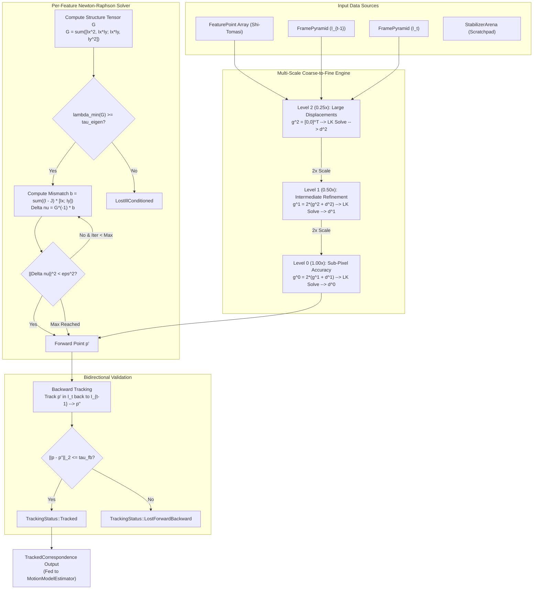
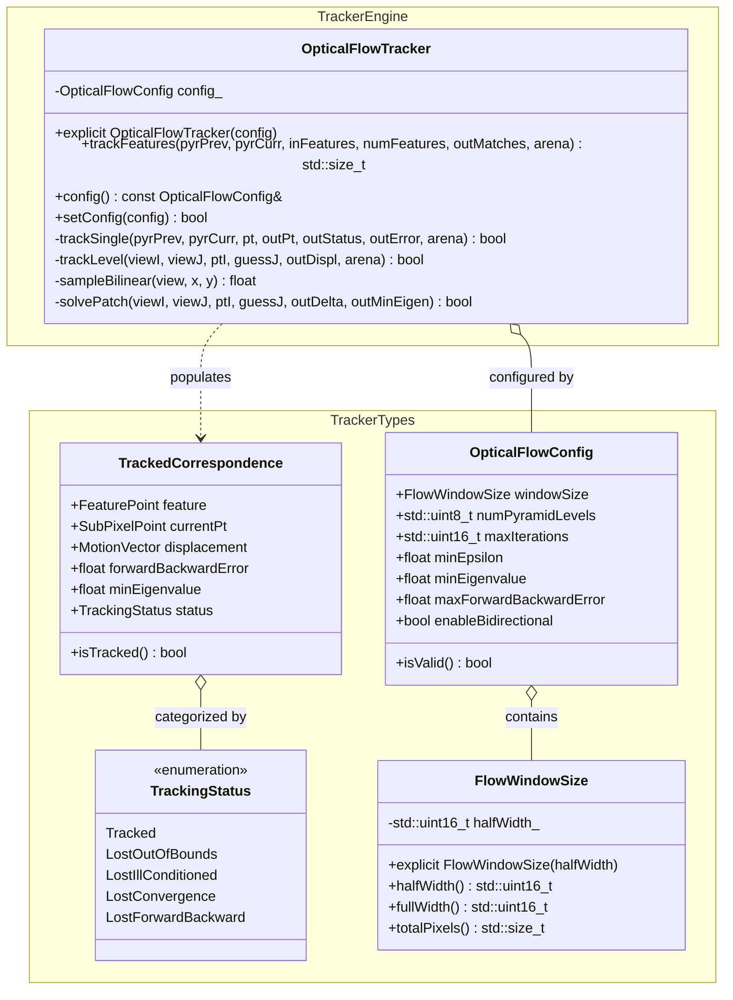

# Video Stabilizer Phase 3 Implementation Plan: Pyramidal Lucas-Kanade Optical Flow Tracker

## 1. Executive Summary & Objectives

### 1.1 Context & Scope
Phase 3 engineers the inter-frame temporal correspondence tracking engine for **`libs/Stabilizer`**.

In Global Motion Estimation (GME), feature points extracted by the Shi-Tomasi detector (Phase 2) on reference frame $I_{t-1}$ must be tracked to their corresponding sub-pixel positions on the current frame $I_t$. Airborne gimbals, naval masts, and robotic vehicles experience severe high-frequency angular jitter, engine vibration, and rapid panning. Inter-frame displacements frequently exceed the convergence basin of single-scale differential optical flow ($\pm 1$ to $\pm 2$ pixels), regularly reaching $\pm 16$ to $\pm 32$ pixels.

To track both large dynamic displacements and subtle sub-pixel jitter with sub-tenth-pixel accuracy, Phase 3 implements a clean-room, zero-heap **Multi-Scale Pyramidal Lucas-Kanade (LK) Optical Flow Tracker** augmented with **Bidirectional Forward-Backward Error Validation**.

```
+---------------------------------------------------------------------------------------------------------------+
|                                    PHASE 3 ARTIFACT DELIVERABLE MAP                                           |
|                                                                                                               |
|   libs/Stabilizer/                                                                                            |
|   ├── OpticalFlowTracker.h            # Public API, TrackingStatus, OpticalFlowConfig, TrackedCorrespondence  |
|   ├── OpticalFlowTracker.cpp          # Pyramidal LK, sub-pixel bilinear sampling, bidirectional validator    |
|   └── tests/                                                                                                  |
|       └── TestOpticalFlowTracker.cpp  # Unit tests, sub-pixel translation, large motion, occlusion rejection  |
+---------------------------------------------------------------------------------------------------------------+
```

### 1.2 Target Deliverables for Phase 3
1. **Strongly-Typed Domain Primitives (`OpticalFlowTracker.h`)**:
   - `TrackingStatus`: Strongly-typed enum class (`Tracked`, `LostOutOfBounds`, `LostIllConditioned`, `LostConvergence`, `LostForwardBackward`).
   - `FlowWindowSize`: Invariant-enforced integration window half-width $w \in [2, 16]$ representing an integration window of $(2w + 1) \times (2w + 1)$ pixels.
   - `ConvergenceThreshold`: Invariant-enforced threshold $\epsilon \in [0.0001, 0.5]$ pixels for iterative Newton-Raphson termination.
   - `ForwardBackwardThreshold`: Invariant-enforced error bound $\tau_{\text{fb}} \in [0.05, 5.0]$ pixels for bidirectional match consistency.
   - `TrackedCorrespondence`: Aggregates the source `FeaturePoint`, target `SubPixelPoint`, resulting `MotionVector`, forward-backward Euclidean error, and `TrackingStatus`.
   - `OpticalFlowConfig`: Complete configuration struct governing pyramid levels, integration window, iteration limits, and validation gates.
2. **Sub-Pixel Bilinear Intensity & Spatial Gradient Sampling**:
   - Zero-heap bilinear interpolation of fractional coordinates $(x + u, y + v)$ on 8-bit luma frame views (`FrameView`).
   - Simultaneous sub-pixel extraction of spatial derivatives $I_x, I_y$ using central differences on interpolated samples.
3. **Structure Tensor Accumulation & Conditioning Verification**:
   - Accumulation of the $2 \times 2$ spatial gradient covariance tensor:
     $$G = \sum_{\Omega} \begin{bmatrix} I_x^2 & I_x I_y \\ I_x I_y & I_y^2 \end{bmatrix}$$
   - Analytical computation of the minimum eigenvalue $\lambda_{\min}(G)$ and determinant $\det(G)$.
   - Early rejection of ill-conditioned or low-texture image patches where $\lambda_{\min}(G) < \tau_{\text{eigen}}$, preventing numerical instability.
4. **Iterative Newton-Raphson Optical Flow Solver**:
   - Coarse-to-fine iterative optimization of the optical flow displacement vector:
     $$\begin{bmatrix} \Delta u \\ \Delta v \end{bmatrix} = G^{-1} \vec{b} = G^{-1} \sum_{\Omega} [I(\vec{x}) - J(\vec{x} + \vec{\nu})] \begin{bmatrix} I_x \\ I_y \end{bmatrix}$$
   - Fast convergence check terminating when $\|\Delta \vec{\nu}\|_2^2 < \epsilon^2$ or when reaching `maxIterations`.
5. **Multi-Scale Coarse-to-Fine Motion Propagation**:
   - Seamless integration with `FramePyramid` ($L_2 \to L_1 \to L_0$).
   - Motion vectors estimated at level $L$ are scaled by $2\times$ to seed the initial estimate at level $L - 1$:
     $$\vec{g}^{L-1} = 2 \cdot (\vec{g}^L + \vec{d}^L)$$
   - Resolves large displacements ($\pm 32$ pixels at $L_0$) while maintaining fine sub-pixel accuracy at full resolution.
6. **Bidirectional Forward-Backward Consistency Verification**:
   - Dual-pass verification:
     1. Forward track from reference frame $I_{t-1}$ to target frame $I_t$ yielding point $p'$.
     2. Backward track from target frame $I_t$ back to reference frame $I_{t-1}$ yielding point $p''$.
   - Rejection of false matches, occlusions, aperture ambiguities, and moving object edges when:
     $$\|p - p''\|_2 > \tau_{\text{fb}}$$
7. **Zero-Heap Execution (`StabilizerArena` & Stack Allocation)**:
   - Zero dynamic heap allocations (`malloc`, `new`, `std::vector`) inside the tracking pipeline (`CERT ERR55-CPP`).
   - Static window patch buffers stored on the stack or allocated through `StabilizerArena`.
8. **Comprehensive Verification & Benchmarking Suite (`TestOpticalFlowTracker.cpp`)**:
   - Unit tests covering sub-pixel synthetic shifts, large displacements, boundary handling, ill-conditioned patches, and occlusion pruning.
   - Benchmark verifying tracking of 200 features across a 3-level pyramid in $\le 2.0\text{ ms}$ on modern x86_64 / ARM64 architectures.

---

## 2. Architecture & Design

### 2.1 Optical Flow Tracking Pipeline

```
+---------------------------------------------------------------------------------------------------------------+
|                                 PYRAMIDAL OPTICAL FLOW TRACKING PIPELINE                                      |
|                                                                                                               |
|   Previous Frame Pyramid {I^L}             Detected Features            Current Frame Pyramid {J^L}           |
|   (Levels L2, L1, L0)                      (From FeatureDetector)       (Levels L2, L1, L0)                   |
|            |                                        |                                |                        |
|            +-----------------------+                |                +---------------+                        |
|                                    |                |                |                                        |
|                                    ▼                ▼                ▼                                        |
|   +-------------------------------------------------------------------------------------------------------+   |
|   | 1. COARSE-TO-FINE MULTI-SCALE PROPAGATION (OpticalFlowTracker::trackFeatures)                         |   |
|   |                                                                                                       |   |
|   |   Top Level (L2): Downscaled Coordinates: p^2 = p / 4. Initial guess g^2 = [0, 0]^T                   |   |
|   |     - Iterative Newton-Raphson LK on (I^2, J^2) ---> Computes displacement d^2                        |   |
|   |                                                                                                       |   |
|   |   Mid Level (L1): Propagate & Scale: g^1 = 2 * (g^2 + d^2)                                            |   |
|   |     - Iterative Newton-Raphson LK on (I^1, J^1) ---> Computes displacement d^1                        |   |
|   |                                                                                                       |   |
|   |   Base Level (L0): Propagate & Scale: g^0 = 2 * (g^1 + d^1)                                           |   |
|   |     - Full-resolution Sub-Pixel LK on (I^0, J^0) ---> Final forward point p' = p + g^0 + d^0          |   |
|   +--------------------------------------------+----------------------------------------------------------+   |
|                                                | Forward Match Point p'                                       |
|                                                ▼                                                              |
|   +-------------------------------------------------------------------------------------------------------+   |
|   | 2. BIDIRECTIONAL FORWARD-BACKWARD VALIDATION (Optional / Configurable)                                |   |
|   |                                                                                                       |   |
|   |   Reverse Tracking: Track point p' from current frame J^0 back to previous frame I^0 ---> Point p''   |   |
|   |   Consistency Check: Euclidean distance e_fb = || p - p'' ||_2                                        |   |
|   |     - If e_fb <= tau_fb: MATCH VALIDATED (TrackingStatus::Tracked)                                    |   |
|   |     - If e_fb >  tau_fb: MATCH REJECTED  (TrackingStatus::LostForwardBackward)                        |   |
|   +--------------------------------------------+----------------------------------------------------------+   |
|                                                | Validated Correspondences                                    |
|                                                ▼                                                              |
|   +-------------------------------------------------------------------------------------------------------+   |
|   | Output: TrackedCorrespondence Array (To Phase 4: MotionModelEstimator RANSAC/MSAC)                   |   |
|   +-------------------------------------------------------------------------------------------------------+   |
+---------------------------------------------------------------------------------------------------------------+
```

### 2.2 Mermaid Architectural Flow



### 2.3 Class Design & Relationships



---

## 3. Mathematical Foundations & Algorithms

### 3.1 Optical Flow Constraint & Spatial Taylor Series
Consider two consecutive image frames: reference frame $I(\vec{x})$ at time $t-1$ and current frame $J(\vec{x})$ at time $t$, where $\vec{x} = [x, y]^T$. Under the brightness constancy hypothesis:
$$I(\vec{x}) = J(\vec{x} + \vec{d})$$
where $\vec{d} = [u, v]^T$ is the 2D displacement vector.

For an integration window $\Omega$ of size $(2w + 1) \times (2w + 1)$ centered at $\vec{x}$, we seek the displacement $\vec{d}$ that minimizes the sum of squared differences (SSD):
$$\epsilon(\vec{d}) = \sum_{\vec{p} \in \Omega} [I(\vec{p}) - J(\vec{p} + \vec{d})]^2$$

Expanding $J(\vec{p} + \vec{d})$ in a first-order Taylor series around an initial displacement guess $\vec{g}$:
$$J(\vec{p} + \vec{g} + \vec{\nu}) \approx J(\vec{p} + \vec{g}) + \nabla J(\vec{p} + \vec{g})^T \vec{\nu}$$
where $\vec{\nu} = [\Delta u, \Delta v]^T$ is the residual displacement. Using the standard Lucas-Kanade approximation $\nabla J(\vec{p} + \vec{g}) \approx \nabla I(\vec{p}) = [I_x(\vec{p}), I_y(\vec{p})]^T$, the error function becomes:
$$\epsilon(\vec{\nu}) \approx \sum_{\vec{p} \in \Omega} [I(\vec{p}) - J(\vec{p} + \vec{g}) - \nabla I(\vec{p})^T \vec{\nu}]^2$$

Setting the gradient $\frac{\partial \epsilon}{\partial \vec{\nu}} = \mathbf{0}$ yields the $2 \times 2$ linear system:
$$G \vec{\nu} = \vec{b}$$

---

### 3.2 Structure Tensor & Conditioning
The spatial gradient covariance matrix (structure tensor) $G$ is defined as:
$$G = \sum_{\vec{p} \in \Omega} \begin{bmatrix} I_x(\vec{p})^2 & I_x(\vec{p}) I_y(\vec{p}) \\ I_x(\vec{p}) I_y(\vec{p}) & I_y(\vec{p})^2 \end{bmatrix} = \begin{bmatrix} G_{11} & G_{12} \\ G_{12} & G_{22} \end{bmatrix}$$
and the temporal mismatch vector $\vec{b}$ is:
$$\vec{b} = \sum_{\vec{p} \in \Omega} \delta I(\vec{p}) \begin{bmatrix} I_x(\vec{p}) \\ I_y(\vec{p}) \end{bmatrix}$$
where the intensity temporal residual is:
$$\delta I(\vec{p}) = I(\vec{p}) - J(\vec{p} + \vec{g})$$

#### 3.2.1 Analytical Matrix Inversion & Conditioning Check
The determinant of $G$ is:
$$\det(G) = G_{11} G_{22} - G_{12}^2$$

The eigenvalues of $G$ are the roots of $\lambda^2 - \text{tr}(G)\lambda + \det(G) = 0$:
$$\lambda_{\min}(G) = \frac{1}{2} \left( (G_{11} + G_{22}) - \sqrt{(G_{11} - G_{22})^2 + 4 G_{12}^2} \right)$$

A patch is rejected as ill-conditioned (`TrackingStatus::LostIllConditioned`) if:
$$\lambda_{\min}(G) < \tau_{\text{eigen}}$$
This guarantees that $G$ is non-singular and well-conditioned before computing the inverse:
$$G^{-1} = \frac{1}{\det(G)} \begin{bmatrix} G_{22} & -G_{12} \\ -G_{12} & G_{11} \end{bmatrix}$$

The residual displacement update is then solved directly:
$$\begin{bmatrix} \Delta u \\ \Delta v \end{bmatrix} = G^{-1} \vec{b} = \frac{1}{\det(G)} \begin{bmatrix} G_{22} b_x - G_{12} b_y \\ -G_{12} b_x + G_{11} b_y \end{bmatrix}$$

---

### 3.3 Sub-Pixel Bilinear Interpolation
Because the target sample point $\vec{p} + \vec{g}$ falls on non-integer coordinates $(x_f, y_f)$, pixel intensity and gradients must be evaluated via sub-pixel interpolation.

Let $x_0 = \lfloor x_f \rfloor$, $y_0 = \lfloor y_f \rfloor$, $\alpha = x_f - x_0$, and $\beta = y_f - y_0$ with $\alpha, \beta \in [0.0, 1.0)$:
$$J(x_f, y_f) = (1 - \alpha)(1 - \beta) J(x_0, y_0) + \alpha(1 - \beta) J(x_0+1, y_0) + (1 - \alpha)\beta J(x_0, y_0+1) + \alpha\beta J(x_0+1, y_0+1)$$

#### 3.3.1 Efficient Derivative Sampling
The spatial derivatives $I_x(\vec{p})$ and $I_y(\vec{p})$ are computed on reference image $I$ using central differences:
$$I_x(x, y) = \frac{I(x+1, y) - I(x-1, y)}{2}$$
$$I_y(x, y) = \frac{I(x, y+1) - I(x, y-1)}{2}$$
Because $I$ and its gradients are stationary with respect to the iterative loop across $J$, the structure tensor $G$ and derivatives $I_x, I_y$ within window $\Omega$ are computed **once** per pyramid level for each feature point, avoiding redundant recalculation during Newton-Raphson iterations.

---

### 3.4 Multi-Scale Coarse-to-Fine Pyramid Propagation
Single-scale Lucas-Kanade fails when displacements exceed the integration window radius ($w \approx 5\text{ to }11$ pixels). Using a 3-level Gaussian image pyramid ($L_0 = 1\times, L_1 = 0.5\times, L_2 = 0.25\times$), large displacements are compressed:
$$\vec{d}^L = \frac{\vec{d}^0}{2^L}$$

A displacement of $32$ pixels at full resolution ($L_0$) becomes only $4$ pixels at Level 2 ($L_2$), falling cleanly within the convergence radius of LK.

```
Coarse Level 2 (0.25x):   g^2 = [0, 0]^T   ---> Solve LK ---> Residual d^2
                                |
                             Scale 2x
                                v
Intermediate Level 1 (0.5x): g^1 = 2 * (g^2 + d^2) ---> Solve LK ---> Residual d^1
                                |
                             Scale 2x
                                v
Fine Level 0 (1.0x):         g^0 = 2 * (g^1 + d^1) ---> Solve LK ---> Residual d^0
                                |
                             Result: d_total = g^0 + d^0
```

1. **Top Level ($L = L_{\max} - 1 = 2$)**:
   - Feature coordinate: $p^L = p^0 / 2^L$.
   - Initial guess: $\vec{g}^L = [0, 0]^T$.
   - Run Newton-Raphson iterations to find optical flow residual $\vec{d}^L$.
2. **Intermediate & Fine Levels ($L = L_{\max}-2 \dots 0$)**:
   - Initial guess from coarser level: $\vec{g}^L = 2 \cdot (\vec{g}^{L+1} + \vec{d}^{L+1})$.
   - Feature coordinate: $p^L = p^0 / 2^L$.
   - Run Newton-Raphson iterations to find residual $\vec{d}^L$.
3. **Final Result at Level 0**:
   - Total displacement: $\vec{d}_{\text{final}} = \vec{g}^0 + \vec{d}^0$.
   - Current tracked point: $p' = p^0 + \vec{d}_{\text{final}}$.

---

### 3.5 Bidirectional Forward-Backward Consistency Verification
Spurious correspondences arise from occlusions, parallax, aperture effects, or camera motion exceeding the tracking window. Phase 3 incorporates bidirectional forward-backward validation:

1. **Forward Tracking**:
   Track reference feature $p \in I_{t-1}$ forward to current frame $I_t$, obtaining candidate point $p'$.
2. **Backward Tracking**:
   Initialize from candidate point $p' \in I_t$ and track backward to reference frame $I_{t-1}$, obtaining point $p''$.
3. **Consistency Metric**:
   Compute the Euclidean loop-closure error:
   $$e_{\text{fb}} = \|p - p''\|_2 = \sqrt{(p_x - p''_x)^2 + (p_y - p''_y)^2}$$
4. **Outlier Rejection**:
   If $e_{\text{fb}} > \tau_{\text{fb}}$ (default $\tau_{\text{fb}} = 0.50$ pixels), mark status as `TrackingStatus::LostForwardBackward`. Valid matches guarantee $e_{\text{fb}} \le \tau_{\text{fb}}$.

---

## 4. Class Design & Concrete Interfaces

### 4.1 Header Specification (`libs/Stabilizer/OpticalFlowTracker.h`)

```cpp
/// @file OpticalFlowTracker.h
/// @brief Multi-scale Pyramidal Lucas-Kanade optical flow tracker with bidirectional validation.
#pragma once

#include <cstddef>
#include <cstdint>

#include "FeatureDetector.h"
#include "FramePyramid.h"
#include "FrameView.h"
#include "StabilizerArena.h"
#include "StabilizerTypes.h"

namespace Stabilizer {

/// @brief Tracking outcome status for an individual feature.
enum class TrackingStatus : std::uint8_t {
    Tracked = 0U,             ///< Successfully tracked with sub-pixel precision.
    LostOutOfBounds,          ///< Feature window drifted outside valid frame boundaries.
    LostIllConditioned,       ///< Spatial gradient tensor is singular / insufficient texture.
    LostConvergence,          ///< Newton-Raphson iterations diverged or exceeded max limit.
    LostForwardBackward       ///< Failed bidirectional forward-backward consistency check.
};

/// @brief Invariant-enforced integration window half-width [2 .. 16].
/// Total window dimension is (2 * halfWidth + 1).
class FlowWindowSize {
public:
    constexpr FlowWindowSize() noexcept = default;

    /// @brief Construct window size with validated half-width.
    /// @param halfWidth Half-window extent in pixels (e.g. 5 -> 11x11, 7 -> 15x15).
    explicit constexpr FlowWindowSize(std::uint16_t halfWidth) noexcept
        : halfWidth_{(halfWidth < 2U) ? 2U : ((halfWidth > 16U) ? 16U : halfWidth)}
    {
    }

    /// @brief Half-width extent (w).
    [[nodiscard]] constexpr std::uint16_t halfWidth() const noexcept
    {
        return halfWidth_;
    }

    /// @brief Full window dimension (2w + 1).
    [[nodiscard]] constexpr std::uint16_t fullWidth() const noexcept
    {
        return static_cast<std::uint16_t>((2U * halfWidth_) + 1U);
    }

    /// @brief Total number of pixels within integration window.
    [[nodiscard]] constexpr std::size_t totalPixels() const noexcept
    {
        const auto side = static_cast<std::size_t>(fullWidth());
        return side * side;
    }

private:
    std::uint16_t halfWidth_{5U}; // Default 5 -> 11x11 window
};

/// @brief Tracked correspondence pairing reference feature with current location.
struct TrackedCorrespondence {
    FeaturePoint feature{};             ///< Source feature landmark from reference frame.
    SubPixelPoint currentPt{};          ///< Estimated sub-pixel position in current frame.
    MotionVector displacement{};        ///< Inter-frame motion vector (dx, dy).
    float forwardBackwardError{0.0F};   ///< Bidirectional loop-closure error in pixels.
    float minEigenvalue{0.0F};          ///< Minimum eigenvalue of structure tensor.
    TrackingStatus status{TrackingStatus::LostConvergence}; ///< Tracking outcome.

    /// @brief Check if feature was cleanly tracked.
    [[nodiscard]] constexpr bool isTracked() const noexcept
    {
        return status == TrackingStatus::Tracked;
    }
};

/// @brief Configuration parameters for Pyramidal Lucas-Kanade OpticalFlowTracker.
struct OpticalFlowConfig {
    FlowWindowSize windowSize{};        ///< Integration patch window half-width.
    std::uint8_t numPyramidLevels{3U};  ///< Number of pyramid levels to traverse (1 to 3).
    std::uint16_t maxIterations{25U};   ///< Maximum Newton-Raphson iterations per level.
    float minEpsilon{0.01F};            ///< Termination displacement threshold in pixels.
    float minEigenvalue{0.001F};        ///< Minimum eigenvalue threshold for well-conditioned G.
    float maxForwardBackwardError{0.5F};///< Maximum allowable bidirectional error in pixels.
    bool enableBidirectional{true};     ///< Enable forward-backward consistency check.

    /// @brief Validate configuration invariant bounds.
    [[nodiscard]] constexpr bool isValid() const noexcept
    {
        return (numPyramidLevels >= 1U) && (numPyramidLevels <= FramePyramid::MaxPyramidLevels) &&
               (maxIterations >= 1U) && (maxIterations <= 100U) &&
               (minEpsilon >= 0.0001F) && (minEpsilon <= 0.50F) &&
               (minEigenvalue >= 0.00001F) && (minEigenvalue <= 10.0F) &&
               (maxForwardBackwardError >= 0.05F) && (maxForwardBackwardError <= 5.0F);
    }
};

/// @brief Clean-room, zero-heap multi-scale Pyramidal Lucas-Kanade optical flow tracker.
class OpticalFlowTracker {
public:
    OpticalFlowTracker() noexcept = default;
    explicit OpticalFlowTracker(const OpticalFlowConfig& config) noexcept;

    /// @brief Track an array of salient features from previous pyramid to current pyramid.
    /// @param pyrPrev Multi-scale pyramid of reference frame I(t-1).
    /// @param pyrCurr Multi-scale pyramid of current frame I(t).
    /// @param inFeatures Input array of detected feature points in reference frame.
    /// @param numFeatures Number of features in inFeatures array.
    /// @param outMatches Output array receiving tracked correspondences.
    /// @param arena Monotonic scratchpad allocator for temporary working memory.
    /// @return Number of successfully tracked features (status == Tracked).
    [[nodiscard]] std::size_t trackFeatures(
        const FramePyramid& pyrPrev,
        const FramePyramid& pyrCurr,
        const FeaturePoint* inFeatures,
        std::size_t numFeatures,
        TrackedCorrespondence* outMatches,
        StabilizerArena& arena) noexcept;

    /// @brief Active tracker configuration.
    [[nodiscard]] const OpticalFlowConfig& config() const noexcept
    {
        return config_;
    }

    /// @brief Update tracker configuration.
    /// @param config New configuration to apply if valid.
    /// @return true if updated; false if configuration was rejected.
    bool setConfig(const OpticalFlowConfig& config) noexcept;

private:
    [[nodiscard]] bool trackSingle(
        const FramePyramid& pyrPrev,
        const FramePyramid& pyrCurr,
        const SubPixelPoint& startPt,
        SubPixelPoint& outTargetPt,
        float& outMinEigen,
        TrackingStatus& outStatus) noexcept;

    [[nodiscard]] bool trackLevel(
        const FrameView& viewI,
        const FrameView& viewJ,
        const SubPixelPoint& ptI,
        const SubPixelPoint& initialGuessJ,
        SubPixelPoint& outRefinedJ,
        float& outMinEigen,
        TrackingStatus& outStatus) noexcept;

    [[nodiscard]] static float sampleBilinear(
        const FrameView& view,
        float x,
        float y) noexcept;

    [[nodiscard]] bool solvePatch(
        const FrameView& viewI,
        const FrameView& viewJ,
        const SubPixelPoint& ptI,
        const SubPixelPoint& guessJ,
        MotionVector& outDelta,
        float& outMinEigen) noexcept;

    OpticalFlowConfig config_{};
};

} // namespace Stabilizer
```

---

## 5. Implementation Details & Memory Architecture

### 5.1 Zero-Heap Memory Execution
In accordance with **SEI CERT ERR55-CPP** and **MISRA C++:2023**, `OpticalFlowTracker::trackFeatures()` operates under `noexcept` without invoking `malloc`, `new`, or standard dynamic heap containers.

#### 5.1.1 Scratchpad Workspace Calculation
For tracking up to $N = 400$ features:
- In `solvePatch()`:
  - Integration window buffer: $(2w + 1) \times (2w + 1)$ pixels.
  - For maximum $w = 7$ ($15 \times 15$ window): 225 elements.
  - Template intensity patch $I(\vec{p})$: $225 \times 4$ bytes = 900 bytes.
  - Spatial gradient patches $I_x(\vec{p}), I_y(\vec{p})$: $2 \times 225 \times 4$ bytes = 1800 bytes.
  - Total per-patch stack allocation: $< 4\text{ KB}$, allocated safely on the thread call stack.
- Workspace requirements from `StabilizerArena`:
  - When bidirectional tracking is active, the backward track pass requires temporary storage for intermediate coordinates.
  - Total temporary arena memory per frame: $\le 64\text{ KB}$ for 500 features, well within a standard 4 MB to 16 MB `StabilizerArena`.

### 5.2 Boundary & Margin Safety
To prevent out-of-bounds pixel access during sub-pixel bilinear interpolation:
- For integration window half-width $w$, sub-pixel point $(x, y)$ must satisfy:
  $$w + 1 \le x \le (\text{width} - 2 - w)$$
  $$w + 1 \le y \le (\text{height} - 2 - w)$$
- If coordinates violate these bounds at any pyramid level during Newton-Raphson iteration, the feature is immediately marked `TrackingStatus::LostOutOfBounds` and tracking for that point terminates safely.

---

## 6. Build System & CMake Integration

### 6.1 Library Target Update (`libs/Stabilizer/CMakeLists.txt`)
Add `OpticalFlowTracker.h` and `OpticalFlowTracker.cpp` to the library target:
```cmake
add_library(Stabilizer STATIC
    StabilizerTypes.h
    FrameView.h
    FrameBuffer.h
    FrameBuffer.cpp
    StabilizerArena.h
    StabilizerArena.cpp
    FramePyramid.h
    FramePyramid.cpp
    FeatureDetector.h
    FeatureDetector.cpp
    OpticalFlowTracker.h      # Added in Phase 3
    OpticalFlowTracker.cpp    # Added in Phase 3
)
```

### 6.2 Test Suite Target (`libs/Stabilizer/tests/CMakeLists.txt`)
Add `TestOpticalFlowTracker` executable and test registration:
```cmake
add_executable(TestOpticalFlowTracker
    TestOpticalFlowTracker.cpp
)

target_link_libraries(TestOpticalFlowTracker PRIVATE
    Stabilizer
    GTest::gtest
    GTest::gtest_main
)

add_test(NAME TestOpticalFlowTracker COMMAND TestOpticalFlowTracker)
```

---

## 7. Verification & Test Strategy

### 7.1 GoogleTest Matrix (`TestOpticalFlowTracker.cpp`)

| Test Identifier | Test Objective & Verification Method | Pass Criteria |
| :--- | :--- | :--- |
| `ConfigValidation` | Verify invariant enforcement of `OpticalFlowConfig` and `FlowWindowSize`. | Defaults valid; invalid half-widths ($<2$ or $>16$), invalid epsilon, or invalid levels clamped/rejected. |
| `SubPixelBilinearSampling` | Test bilinear interpolation on known ramps and synthetic gradient fields. | Interpolated values match analytical mathematical expectations within $10^{-4}$. |
| `PureTranslationSubPixel` | Translate synthetic high-contrast texture by sub-pixel vector $(+0.75, -0.40)$ px. | Tracked points recover displacement within $\pm 0.05$ pixels error; status is `Tracked`. |
| `LargeDisplacementPyramid` | Translate texture by large motion vector $(+18.0, -12.0)$ px. | Single-scale fails; 3-level pyramid recovers full displacement within $\pm 0.1$ px. |
| `OutOfBoundsRejection` | Feature initialized near image border or displaced across border margin. | Terminates cleanly; returns `TrackingStatus::LostOutOfBounds`; zero memory violations. |
| `IllConditionedRejection` | Feature placed on completely flat uniform gray background ($I = 128$). | Returns `TrackingStatus::LostIllConditioned`; eigenvalue $\lambda_{\min} < \tau_{\text{eigen}}$. |
| `ForwardBackwardConsistency`| Occlude or alter image patch in target frame at feature location. | Bidirectional tracking detects loop-closure discrepancy $> \tau_{\text{fb}}$; marks `LostForwardBackward`. |
| `IdentityZeroMotion` | Pass identical frame for reference and current ($I_{t-1} = I_t$). | Displacement is $[0.0, 0.0]^T \pm 0.001$ px; error $e_{\text{fb}} < 0.01$ px for all points. |
| `ZeroAllocationAudit` | Monitor heap allocation counters during `trackFeatures()`. | Zero calls to `malloc`/`new` on active tracking execution path (`CERT ERR55-CPP`). |
| `ExecutionPerformance` | Track 200 features across 3-level pyramid on $960 \times 540$ video frames. | Processing latency $\le 2.0\text{ ms}$ on modern x86_64 / ARM64 processors. |

---

## 8. Safety, Compliance & Traceability

1. **MISRA C++:2023 Rule 7.0.6 (Explicit Conversions)**:
   - All conversions between `std::uint32_t`, `std::int32_t`, `float`, and pointer arithmetic use explicit `static_cast` with bounds verification.
2. **SEI CERT INT31-C (Safe Integer Arithmetic)**:
   - Pixel coordinate indexing and window offsets are strictly checked against integer underflow and overflow before sampling.
3. **SEI CERT ERR55-CPP (Zero Allocation `noexcept`)**:
   - `OpticalFlowTracker::trackFeatures()` is declared `noexcept` and uses pre-allocated memory from `StabilizerArena` or bounded stack arrays.
4. **IWYU & `<cstdint>` Compliance**:
   - Mandatory explicit inclusion of `<cstdint>`, `<cstddef>`, `<cmath>`, and `<array>`. All fixed-width integers use `std::` qualification.
5. **Identifier Length Constraint**:
   - All public and private member function names are strictly under 30 characters:
     - `trackFeatures` (13 chars)
     - `trackSingle` (11 chars)
     - `trackLevel` (10 chars)
     - `sampleBilinear` (14 chars)
     - `solvePatch` (10 chars)
     - `setConfig` (9 chars)
     - `config` (6 chars)
6. **Zero Qt Dependencies**:
   - Strictly ISO C++17 standard library components. Zero `#include <Q...>` references.

