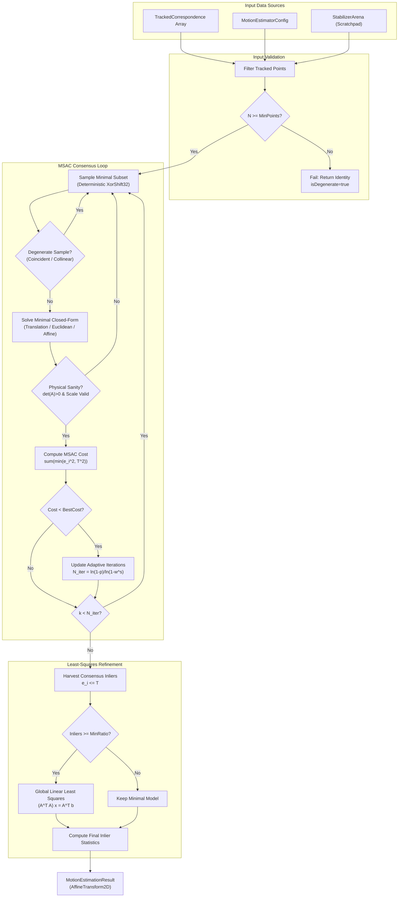
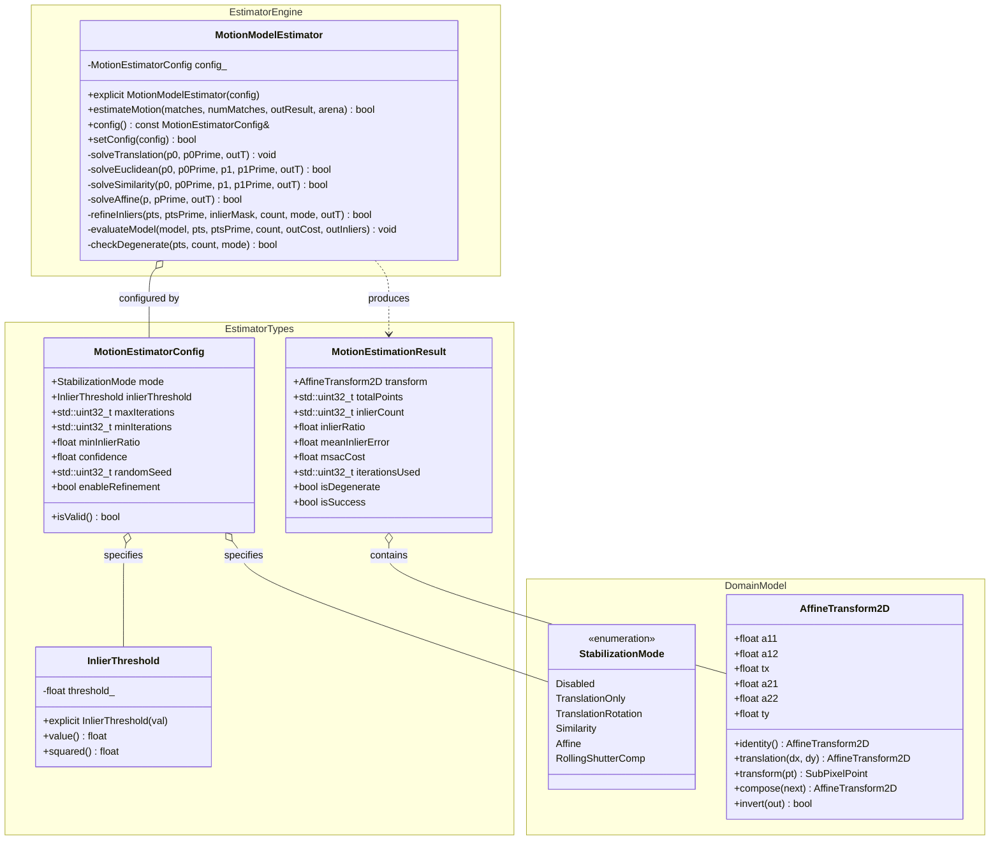

# Video Stabilizer Phase 4 Implementation Plan: Robust Parametric Motion Model Estimator

## 1. Executive Summary & Objectives

### 1.1 Context & Scope
Phase 4 engineers the parametric inter-frame global motion model estimation engine for **`libs/Stabilizer`**.

In high-speed electro-optical and infrared (EO/IR) gimbal systems, tracked point correspondences produced by temporal optical flow (`OpticalFlowTracker`) are inevitably corrupted by outliers. Outliers arise from:
1. **Dynamic foreground objects**: Moving vehicles, personnel, maritime vessels, airborne targets, or wildlife.
2. **Aperture ambiguities & repetitive textures**: Water surface waves, foliage flutter, repeating chain-link fences, and window arrays.
3. **Parallax & non-planar depth discontinuities**: Forefront terrain or structural occlusions violating the single-homography/affine plane assumption.
4. **Sensor noise & illumination transients**: Gunfire muzzle flash, specular glints, solar flare, and thermal sensor gain recalibration (NUC).

Standard linear regression (Ordinary Least Squares) breaks down in the presence of even a single outlier point ($0\%$ breakdown point). To guarantee robust, sub-pixel accurate global background motion recovery with up to $60\%$ outlier contamination, Phase 4 implements **`MotionModelEstimator`**—a clean-room, zero-heap, deterministic **M-Estimator Sample Consensus (MSAC)** estimator with closed-form minimal solvers, geometric degeneracy gating, and full consensus least-squares refinement.

```
+---------------------------------------------------------------------------------------------------------------+
|                                    PHASE 4 ARTIFACT DELIVERABLE MAP                                           |
|                                                                                                               |
|   libs/Stabilizer/                                                                                            |
|   ├── MotionModelEstimator.h            # Public API, MotionEstimatorConfig, MotionEstimationResult           |
|   ├── MotionModelEstimator.cpp          # MSAC engine, minimal solvers, inlier refinement, degeneracy checks   |
|   └── tests/                                                                                                  |
|       └── TestMotionModelEstimator.cpp  # GoogleTest suite (synthetic outliers, noise, degenerate geometries)  |
+---------------------------------------------------------------------------------------------------------------+
```

### 1.2 Target Deliverables for Phase 4
1. **Strongly-Typed Domain Primitives (`MotionModelEstimator.h`)**:
   - `ModelType`: Explicitly typed motion model specification corresponding to degrees of freedom (DOF): `Translation` (2-DOF), `Euclidean` (3-DOF: rotation + translation), `Similarity` (4-DOF: rigid + isotropic scale), `Affine` (6-DOF: shear + non-uniform scale).
   - `InlierThreshold`: Strongly-typed reprojection error threshold $T \in [0.1F, 20.0F]$ pixels.
   - `MotionEstimatorConfig`: Comprehensive parameter set governing consensus loss metric, maximum/minimum iterations, confidence level, minimum inlier fraction, random seed, and least-squares refinement.
   - `MotionEstimationResult`: Rich telemetry container reporting the estimated `AffineTransform2D`, inlier count, total count, inlier ratio, MSAC consensus cost, mean reprojection error, iteration count, and degeneracy status.
2. **Minimal Sample Solvers (Direct Closed-Form)**:
   - **Translation (2-DOF, $s = 1$)**: Exact single-correspondence displacement calculation.
   - **Euclidean / Rigid (3-DOF, $s = 2$)**: Closed-form 2D Procrustes / Kabsch rotation-translation solver enforcing exact orthogonality ($R \in SO(2)$) without scaling or shear.
   - **Similarity (4-DOF, $s = 2$)**: Closed-form similarity solver resolving isotropic scale, rotation, and translation ($s R \in Sim(2)$).
   - **Affine (6-DOF, $s = 3$)**: Closed-form $3 \times 3$ linear solver over 3 non-collinear point pairs using direct Cramer's rule / LU decomposition.
3. **Geometric Invariant & Degeneracy Detection**:
   - Coincident point rejection: Enforces minimum Euclidean separation between sample points ($d_{ij} \ge d_{\min}$).
   - Collinearity rejection: Computes triangle cross-product area; rejects degenerate configurations where points are nearly co-linear ($\Delta_{\text{area}} < \epsilon_{\text{area}}$).
   - Transformation sanity gating:
     - Negative determinant check: $\det(A) \le 0$ indicates physical reflection/folding and is immediately discarded.
     - Scale bounds: $\sigma_{\min} \le s \le \sigma_{\max}$ (default $[0.75, 1.33]$).
     - Shear aspect distortion: Non-perpendicular basis vector distortion $|\cos \angle(u, v)| \le \tau_{\text{shear}}$.
     - Translation excursion: $\|\vec{t}\| \le t_{\max}$ based on sensor frame dimensions.
4. **MSAC (M-Estimator Sample Consensus) Outlier Scoring**:
   - Replaces conventional binary 0/1 RANSAC loss with bounded quadratic loss:
     $$\rho(e_i^2) = \begin{cases} e_i^2 & \text{if } e_i^2 < T^2 \\ T^2 & \text{if } e_i^2 \ge T^2 \end{cases}$$
   - Penalizes near-boundary inliers, resolves degenerate candidate ties, and achieves superior parameter accuracy in significantly fewer iterations ($N \le 200$).
   - Dynamic adaptive iteration count calculation based on real-time consensus inlier ratio.
5. **Linear Least-Squares Consensus Refinement**:
   - Global re-estimation pooling all consensus inliers ($\mathcal{I} = \{i \mid e_i \le T\}$).
   - Solves overdetermined normal equations $(A^T A) \mathbf{x} = A^T \mathbf{b}$ via zero-heap analytical matrix inversion.
   - Yields optimal maximum-likelihood sub-pixel transformation parameters.
6. **Zero-Heap Determinism & Safety Standards**:
   - Zero dynamic heap allocation (`malloc`, `new`, `std::vector`) on the execution path (`CERT ERR55-CPP`).
   - High-speed deterministic XorShift32 pseudo-random number generator for reproducible consensus sampling.
   - All functions strictly $< 30$ characters.
   - Full MISRA C++:2023 Rule 7.0.6, SEI CERT INT31-C, and IWYU compliance.
7. **Comprehensive GoogleTest Suite (`TestMotionModelEstimator.cpp`)**:
   - Unit tests covering pure translation, rigid rotation, affine shear, scale changes, up to $60\%$ synthetic outlier contamination, collinear point rejection, and zero-allocation checks.

---

## 2. Architecture & Design

### 2.1 Motion Model Estimation Architecture

```
+---------------------------------------------------------------------------------------------------------------+
|                                MOTION MODEL ESTIMATION PIPELINE                                               |
|                                                                                                               |
|   Tracked Correspondences {(p_i, p'_i)}                StabilizerArena / Scratchpad Workspace                 |
|   (From OpticalFlowTracker)                            (Zero-Heap Execution Buffer)                           |
|             |                                                             |                                   |
|             +------------------------------+------------------------------+                                   |
|                                            |                                                                  |
|                                            ▼                                                                  |
|   +-------------------------------------------------------------------------------------------------------+   |
|   | 1. DATA VALIDATION & INVARIANT GATING                                                                 |   |
|   |    - Filter correspondences where status == TrackingStatus::Tracked                                   |   |
|   |    - Verify N >= minPointsForModel(mode)                                                              |   |
|   |    - Initialize best MSAC cost C_best = infinity, iterations = maxIterations                          |   |
|   +----------------------------------------+--------------------------------------------------------------+   |
|                                            | Validated Point Set                                              |
|                                            ▼                                                                  |
|   +-------------------------------------------------------------------------------------------------------+   |
|   | 2. MSAC SAMPLING LOOP (XorShift32 Deterministic PRNG)                                                 |   |
|   |    Loop k = 1 .. N_iter:                                                                              |   |
|   |      a. Draw minimal sample subset S_k (1, 2, or 3 points)                                            |   |
|   |      b. Check degeneracy: Coincident points? Collinear points?                                        |   |
|   |      c. Solve minimal model: H_cand = solveMinimal(S_k)                                               |   |
|   |      d. Sanity check H_cand: det(A) > 0, scale within [0.75, 1.33], translation within limits         |   |
|   |      e. Compute MSAC cost: C_k = sum_i min( ||p'_i - H_cand * p_i||^2, T^2 )                         |   |
|   |      f. If C_k < C_best:                                                                              |   |
|   |           C_best = C_k, H_best = H_cand                                                               |   |
|   |           Update adaptive N_iter from current inlier fraction w = N_inliers / N                       |   |
|   +----------------------------------------+--------------------------------------------------------------+   |
|                                            | Best Model Candidate                                             |
|                                            ▼                                                                  |
|   +-------------------------------------------------------------------------------------------------------+   |
|   | 3. INLIER HARVESTING & LEAST-SQUARES REFINEMENT (Optional / Configurable)                             |   |
|   |    - Identify inlier set: I = { i | ||p'_i - H_best * p_i|| <= T }                                    |   |
|   |    - If |I| >= minInliers:                                                                            |   |
|   |        Form overdetermined system (A^T A) x = A^T b                                                   |   |
|   |        Refine H_refined via normal equations over all |I| inliers                                     |   |
|   |        Re-evaluate final inlier count, mean error, and status                                         |   |
|   +----------------------------------------+--------------------------------------------------------------+   |
|                                            |                                                                  |
|                                            ▼                                                                  |
|   Output: MotionEstimationResult (AffineTransform2D, Inlier Metrics, Degeneracy Flag)                        |   |
+---------------------------------------------------------------------------------------------------------------+
```

### 2.2 Mermaid Architectural Flow



### 2.3 Class Design & Relationships



---

## 3. Mathematical Foundations & Algorithms

### 3.1 Parametric Motion Hierarchy
Video motion between frames $I_{t-1}$ and $I_t$ is parameterized by geometric mappings $\vec{x}' = f(\vec{x}; \mathbf{\theta})$. All 2D motion models used in video stabilization map onto a unified affine coordinate transform:

$$\begin{bmatrix} x' \\ y' \end{bmatrix} = \begin{bmatrix} a_{11} & a_{12} \\ a_{21} & a_{22} \end{bmatrix} \begin{bmatrix} x \\ y \end{bmatrix} + \begin{bmatrix} t_x \\ t_y \end{bmatrix}$$

#### 3.1.1 Translation (2-DOF)
Restricted to 2 degrees of freedom (pure horizontal and vertical displacement):
$$a_{11} = 1, \quad a_{12} = 0, \quad a_{21} = 0, \quad a_{22} = 1$$
$$\begin{bmatrix} x' \\ y' \end{bmatrix} = \begin{bmatrix} x \\ y \end{bmatrix} + \begin{bmatrix} t_x \\ t_y \end{bmatrix}$$
Minimal sample size: $s = 1$ correspondence pair $(p, p')$.
$$\mathbf{t} = \begin{bmatrix} t_x \\ t_y \end{bmatrix} = \begin{bmatrix} x' - x \\ y' - y \end{bmatrix}$$

#### 3.1.2 Euclidean / Rigid (3-DOF)
Preserves Euclidean distance and angle; models translation and in-plane rotation $\theta \in (-\pi, \pi]$:
$$\begin{bmatrix} x' \\ y' \end{bmatrix} = \begin{bmatrix} \cos\theta & -\sin\theta \\ \sin\theta & \cos\theta \end{bmatrix} \begin{bmatrix} x \\ y \end{bmatrix} + \begin{bmatrix} t_x \\ t_y \end{bmatrix}$$
Minimal sample size: $s = 2$ non-coincident correspondence pairs $(p_1, p_1')$ and $(p_2, p_2')$.
Given displacement vectors:
$$\Delta \vec{p} = p_2 - p_1 = \begin{bmatrix} \Delta x \\ \Delta y \end{bmatrix}, \quad \Delta \vec{p}' = p_2' - p_1' = \begin{bmatrix} \Delta x' \\ \Delta y' \end{bmatrix}$$
The rotation angle $\theta$ is derived analytically from the 2D cross and dot products:
$$\sin\theta = \frac{\Delta x \Delta y' - \Delta y \Delta x'}{\|\Delta \vec{p}\|_2 \|\Delta \vec{p}'\|_2}, \quad \cos\theta = \frac{\Delta x \Delta x' + \Delta y \Delta y'}{\|\Delta \vec{p}\|_2 \|\Delta \vec{p}'\|_2}$$
$$\theta = \operatorname{atan2}(\Delta x \Delta y' - \Delta y \Delta x', \Delta x \Delta x' + \Delta y \Delta y')$$
Translation vector $\vec{t}$ is resolved via centroid offset:
$$\vec{t} = \frac{1}{2}(p_1' + p_2') - R(\theta) \frac{1}{2}(p_1 + p_2)$$

#### 3.1.3 Similarity (4-DOF)
Incorporates isotropic scaling $s > 0$ along with rotation and translation:
$$\begin{bmatrix} x' \\ y' \end{bmatrix} = \begin{bmatrix} s\cos\theta & -s\sin\theta \\ s\sin\theta & s\cos\theta \end{bmatrix} \begin{bmatrix} x \\ y \end{bmatrix} + \begin{bmatrix} t_x \\ t_y \end{bmatrix} = \begin{bmatrix} \alpha & -\beta \\ \beta & \alpha \end{bmatrix} \begin{bmatrix} x \\ y \end{bmatrix} + \begin{bmatrix} t_x \\ t_y \end{bmatrix}$$
where $\alpha = s\cos\theta$ and $\beta = s\sin\theta$.
Minimal sample size: $s = 2$ pairs.
The parameters $(\alpha, \beta, t_x, t_y)$ are solved via the $4 \times 4$ linear system:
$$\begin{bmatrix} x_1 & -y_1 & 1 & 0 \\ y_1 & x_1 & 0 & 1 \\ x_2 & -y_2 & 1 & 0 \\ y_2 & x_2 & 0 & 1 \end{bmatrix} \begin{bmatrix} \alpha \\ \beta \\ t_x \\ t_y \end{bmatrix} = \begin{bmatrix} x_1' \\ y_1' \\ x_2' \\ y_2' \end{bmatrix}$$
Using differences $\Delta x = x_2 - x_1$, $\Delta y = y_2 - y_1$, $\Delta x' = x_2' - x_1'$, $\Delta y' = y_2' - y_1'$:
$$\alpha = \frac{\Delta x \Delta x' + \Delta y \Delta y'}{\Delta x^2 + \Delta y^2}, \quad \beta = \frac{\Delta x \Delta y' - \Delta y \Delta x'}{\Delta x^2 + \Delta y^2}$$
$$t_x = x_1' - (\alpha x_1 - \beta y_1), \quad t_y = y_1' - (\beta x_1 + \alpha y_1)$$

#### 3.1.4 Affine (6-DOF)
Models arbitrary non-singular linear transformations including non-isotropic scale and shear:
$$\begin{bmatrix} x_i' \\ y_i' \end{bmatrix} = \begin{bmatrix} a_{11} & a_{12} \\ a_{21} & a_{22} \end{bmatrix} \begin{bmatrix} x_i \\ y_i \end{bmatrix} + \begin{bmatrix} t_x \\ t_y \end{bmatrix}$$
Minimal sample size: $s = 3$ non-collinear point pairs.
Decoupled into two independent $3 \times 3$ linear systems for $[a_{11}, a_{12}, t_x]^T$ and $[a_{21}, a_{22}, t_y]^T$:
$$\begin{bmatrix} x_1 & y_1 & 1 \\ x_2 & y_2 & 1 \\ x_3 & y_3 & 1 \end{bmatrix} \begin{bmatrix} a_{11} \\ a_{12} \\ t_x \end{bmatrix} = \begin{bmatrix} x_1' \\ x_2' \\ x_3' \end{bmatrix}, \quad \begin{bmatrix} x_1 & y_1 & 1 \\ x_2 & y_2 & 1 \\ x_3 & y_3 & 1 \end{bmatrix} \begin{bmatrix} a_{21} \\ a_{22} \\ t_y \end{bmatrix} = \begin{bmatrix} y_1' \\ y_2' \\ y_3' \end{bmatrix}$$
Let coefficient matrix $M \in \mathbb{R}^{3 \times 3}$. The determinant is twice the signed area of the triangle formed by $(p_1, p_2, p_3)$:
$$\det(M) = x_1(y_2 - y_3) - y_1(x_2 - x_3) + (x_2 y_3 - x_3 y_2)$$
If $|\det(M)| < 1.0\text{ px}^2$, the points are collinear, and the sample is rejected. Otherwise, $M^{-1}$ is obtained analytically:
$$M^{-1} = \frac{1}{\det(M)} \begin{bmatrix} y_2 - y_3 & -(y_1 - y_3) & y_1 - y_2 \\ -(x_2 - x_3) & x_1 - x_3 & -(x_1 - x_2) \\ x_2 y_3 - x_3 y_2 & -(x_1 y_3 - x_3 y_1) & x_1 y_2 - x_2 y_1 \end{bmatrix}$$

---

### 3.2 MSAC (M-Estimator Sample Consensus) Outlier Scoring

Standard RANSAC uses a step loss function $\chi(e_i^2 \le T^2) \in \{0, 1\}$. This produces equal scores for models with identical inlier counts regardless of whether inliers lie at $0.05$ pixels or $1.99$ pixels error.

MSAC employs a continuous bounded quadratic loss:
$$\rho(e_i^2) = \begin{cases} e_i^2 & \text{if } e_i^2 < T^2 \\ T^2 & \text{if } e_i^2 \ge T^2 \end{cases}$$
where $e_i^2 = \|p_i' - H p_i\|_2^2$ is the squared Euclidean reprojection error:
$$e_i^2 = (x_i' - (a_{11} x_i + a_{12} y_i + t_x))^2 + (y_i' - (a_{21} x_i + a_{22} y_i + t_y))^2$$
The total consensus cost $C(H)$ across all $N$ correspondences is:
$$C(H) = \sum_{i=1}^N \rho(e_i^2)$$
The candidate transform $H_{\text{cand}}$ that minimizes $C(H)$ is selected as $H_{\text{best}}$.

#### 3.2.1 Adaptive Iteration Termination
Let $w = \frac{N_{\text{inliers}}}{N}$ be the current estimated inlier ratio, and $s$ be the minimal sample size ($s=1, 2, \text{ or } 3$). The probability of drawing at least one all-inlier sample subset in $k$ iterations is:
$$P(\text{success}) = 1 - (1 - w^s)^k \ge p$$
where $p = 0.99$ is the desired consensus confidence. The adaptive required iteration count is:
$$k_{\text{req}} = \left\lceil \frac{\ln(1 - p)}{\ln(1 - w^s)} \right\rceil$$
Whenever a new model with lower MSAC cost and higher inlier count is found, $k_{\text{req}}$ is updated. The loop terminates early when the current iteration $k \ge k_{\text{req}}$, bounded by $[N_{\min}, N_{\max}]$.

---

### 3.3 Linear Least-Squares Global Refinement

Minimal sample solvers utilize only $s$ points ($s \in \{1, 2, 3\}$), which leaves the estimate sensitive to measurement noise on those specific points. Once MSAC converges on the consensus inlier set $\mathcal{I} = \{i \mid e_i^2 \le T^2\}$ with $|\mathcal{I}| \ge s$, a global re-estimation over all inliers is performed via Linear Least Squares.

For an Affine model with $M = |\mathcal{I}|$ inliers, we construct the overdetermined system:
$$A \mathbf{x} = \mathbf{b}_x, \quad A \mathbf{y} = \mathbf{b}_y$$
where:
$$A = \begin{bmatrix} x_1 & y_1 & 1 \\ x_2 & y_2 & 1 \\ \vdots & \vdots & \vdots \\ x_M & y_M & 1 \end{bmatrix} \in \mathbb{R}^{M \times 3}, \quad \mathbf{x} = \begin{bmatrix} a_{11} \\ a_{12} \\ t_x \end{bmatrix}, \quad \mathbf{y} = \begin{bmatrix} a_{21} \\ a_{22} \\ t_y \end{bmatrix}, \quad \mathbf{b}_x = \begin{bmatrix} x_1' \\ x_2' \\ \vdots \\ x_M' \end{bmatrix}, \quad \mathbf{b}_y = \begin{bmatrix} y_1' \\ y_2' \\ \vdots \\ y_M' \end{bmatrix}$$

Multiplying by $A^T$ yields the $3 \times 3$ normal equations:
$$(A^T A) \mathbf{x} = A^T \mathbf{b}_x, \quad (A^T A) \mathbf{y} = A^T \mathbf{b}_y$$
where the symmetric normal matrix $\Gamma = A^T A \in \mathbb{R}^{3 \times 3}$ is accumulated in a single pass:
$$\Gamma = \sum_{i \in \mathcal{I}} \begin{bmatrix} x_i^2 & x_i y_i & x_i \\ x_i y_i & y_i^2 & y_i \\ x_i & y_i & 1 \end{bmatrix}, \quad \mathbf{c}_x = \sum_{i \in \mathcal{I}} x_i' \begin{bmatrix} x_i \\ y_i \\ 1 \end{bmatrix}, \quad \mathbf{c}_y = \sum_{i \in \mathcal{I}} y_i' \begin{bmatrix} x_i \\ y_i \\ 1 \end{bmatrix}$$

Solving $\Gamma \mathbf{x} = \mathbf{c}_x$ and $\Gamma \mathbf{y} = \mathbf{c}_y$ takes $\mathcal{O}(M)$ time and requires **zero dynamic heap allocation**.

---

### 3.4 Geometric Degeneracy & Sanity Gating

To reject numerically unstable or physically impossible transforms:
1. **Triangle Non-Collinearity**: For Affine ($s=3$), reject if sample triangle area $< 1.0\text{ px}^2$.
2. **Point Separation**: For Euclidean / Similarity / Affine, reject if any pairwise distance $\|p_i - p_j\|_2 < 5.0\text{ px}$.
3. **Orientation Inversion**: Reject if matrix determinant $\det(A) = a_{11} a_{22} - a_{12} a_{21} \le 0.0F$ (reflecting/flipping the camera view).
4. **Extreme Zoom / Scale**: For Affine, singular values / area scale must satisfy:
   $$0.70 \le \sqrt{\det(A)} \le 1.40$$
5. **Excessive Shear / Skew**: Vector orthogonality factor:
   $$\cos\phi = \frac{a_{11} a_{12} + a_{21} a_{22}}{\sqrt{a_{11}^2 + a_{21}^2} \sqrt{a_{12}^2 + a_{22}^2}}, \quad |\cos\phi| \le 0.30$$
6. **Maximum Translation Excursion**:
   $$\|\vec{t}\|_2 = \sqrt{t_x^2 + t_y^2} \le 0.50 \cdot \max(\text{width}, \text{height})$$

---

## 4. Class Design & Concrete Interfaces

### 4.1 Header Specification (`libs/Stabilizer/MotionModelEstimator.h`)

```cpp
/// @file MotionModelEstimator.h
/// @brief Robust parametric motion model estimator using MSAC with least-squares refinement.
#pragma once

#include <cstddef>
#include <cstdint>

#include "OpticalFlowTracker.h"
#include "StabilizerArena.h"
#include "StabilizerTypes.h"

namespace Stabilizer {

/// @brief Strongly-typed inlier reprojection distance threshold [0.1 .. 20.0] pixels.
class InlierThreshold {
public:
    constexpr InlierThreshold() noexcept = default;

    /// @brief Construct threshold clamped to allowable bounds.
    /// @param val Maximum Euclidean reprojection error in pixels.
    explicit constexpr InlierThreshold(float val) noexcept
        : value_{ (val < 0.10F) ? 0.10F : ((val > 20.0F) ? 20.0F : val) }
    {
    }

    /// @brief Inlier distance threshold value in pixels.
    [[nodiscard]] constexpr float value() const noexcept
    {
        return value_;
    }

    /// @brief Squared inlier distance threshold value (T^2).
    [[nodiscard]] constexpr float squared() const noexcept
    {
        return value_ * value_;
    }

private:
    float value_{ 2.0F }; // Default 2.0 pixels
};

/// @brief Configuration parameters for MSAC MotionModelEstimator.
struct MotionEstimatorConfig {
    StabilizationMode mode{ StabilizationMode::Affine }; ///< Desired degrees of freedom.
    InlierThreshold inlierThreshold{};                    ///< MSAC inlier distance threshold.
    std::uint32_t maxIterations{ 200U };                  ///< Maximum consensus sampling iterations.
    std::uint32_t minIterations{ 20U };                   ///< Minimum iterations before adaptive stop.
    float minInlierRatio{ 0.25F };                        ///< Minimum fraction of consensus inliers required.
    float confidence{ 0.99F };                            ///< Target consensus confidence [0.80 .. 0.999].
    std::uint32_t randomSeed{ 0x12345678U };              ///< Deterministic PRNG seed.
    bool enableRefinement{ true };                        ///< Enable linear least-squares consensus refinement.

    /// @brief Validate configuration parameters.
    [[nodiscard]] constexpr bool isValid() const noexcept
    {
        return (mode != StabilizationMode::Disabled) &&
               (maxIterations >= 10U) && (maxIterations <= 1000U) &&
               (minIterations >= 5U) && (minIterations <= maxIterations) &&
               (minInlierRatio >= 0.05F) && (minInlierRatio <= 0.95F) &&
               (confidence >= 0.80F) && (confidence <= 0.999F);
    }
};

/// @brief Telemetry and quantitative metrics from motion model estimation.
struct MotionEstimationResult {
    AffineTransform2D transform{ AffineTransform2D::identity() }; ///< Estimated 2D transform matrix.
    std::uint32_t totalPoints{ 0U };                             ///< Total valid correspondences evaluated.
    std::uint32_t inlierCount{ 0U };                             ///< Number of consensus inlier points.
    float inlierRatio{ 0.0F };                                   ///< Ratio of inliers to total points.
    float meanInlierError{ 0.0F };                               ///< Mean Euclidean reprojection error of inliers.
    float msacCost{ 0.0F };                                      ///< Final bounded MSAC objective cost.
    std::uint32_t iterationsUsed{ 0U };                          ///< Consensus sampling iterations executed.
    bool isDegenerate{ false };                                  ///< Flag set if geometry was ill-conditioned.
    bool isSuccess{ false };                                     ///< Flag set if model met consensus criteria.
};

/// @brief Deterministic, zero-heap MSAC parametric motion estimator.
class MotionModelEstimator {
public:
    MotionModelEstimator() noexcept = default;

    /// @brief Construct estimator with explicit configuration.
    /// @param config Motion estimator parameters.
    explicit MotionModelEstimator(const MotionEstimatorConfig& config) noexcept;

    /// @brief Estimate global motion transform from tracked feature correspondences.
    /// @param matches Input array of tracked correspondences from OpticalFlowTracker.
    /// @param numMatches Number of correspondences in matches array.
    /// @param outResult Receives the estimated transform and telemetry.
    /// @param arena Optional scratchpad arena for temporary inlier indices.
    /// @return true if estimation converged on a valid model; false on degeneracy.
    [[nodiscard]] bool estimateMotion(
        const TrackedCorrespondence* matches,
        std::size_t numMatches,
        MotionEstimationResult& outResult,
        StabilizerArena* arena = nullptr) noexcept;

    /// @brief Current estimator configuration.
    [[nodiscard]] const MotionEstimatorConfig& config() const noexcept
    {
        return config_;
    }

    /// @brief Update estimator configuration.
    /// @param config New configuration parameters.
    /// @return true if valid; false if rejected.
    bool setConfig(const MotionEstimatorConfig& config) noexcept;

private:
    /// @brief Minimal sample solver for Translation (2-DOF, 1 point).
    static void solveTranslation(
        const SubPixelPoint& p,
        const SubPixelPoint& pPrime,
        AffineTransform2D& outTransform) noexcept;

    /// @brief Minimal sample solver for Euclidean / Rigid (3-DOF, 2 points).
    [[nodiscard]] static bool solveEuclidean(
        const SubPixelPoint& p0,
        const SubPixelPoint& p0Prime,
        const SubPixelPoint& p1,
        const SubPixelPoint& p1Prime,
        AffineTransform2D& outTransform) noexcept;

    /// @brief Minimal sample solver for Similarity (4-DOF, 2 points).
    [[nodiscard]] static bool solveSimilarity(
        const SubPixelPoint& p0,
        const SubPixelPoint& p0Prime,
        const SubPixelPoint& p1,
        const SubPixelPoint& p1Prime,
        AffineTransform2D& outTransform) noexcept;

    /// @brief Minimal sample solver for Affine (6-DOF, 3 points).
    [[nodiscard]] static bool solveAffine(
        const SubPixelPoint* p,
        const SubPixelPoint* pPrime,
        AffineTransform2D& outTransform) noexcept;

    /// @brief Evaluate MSAC bounded cost across all correspondences.
    static void evaluateModel(
        const AffineTransform2D& model,
        const SubPixelPoint* p,
        const SubPixelPoint* pPrime,
        std::size_t count,
        float thresholdSquared,
        float& outCost,
        std::uint32_t& outInliers) noexcept;

    /// @brief Refine transformation using all consensus inliers via normal equations.
    [[nodiscard]] static bool refineInliers(
        const SubPixelPoint* p,
        const SubPixelPoint* pPrime,
        const bool* inlierMask,
        std::size_t count,
        StabilizationMode mode,
        AffineTransform2D& outTransform) noexcept;

    /// @brief Check whether transformation violates physical sanity bounds.
    [[nodiscard]] static bool checkTransform(const AffineTransform2D& t) noexcept;

    /// @brief Check whether sample points form a degenerate configuration.
    [[nodiscard]] static bool checkDegenerate(
        const SubPixelPoint* p,
        std::size_t count,
        StabilizationMode mode) noexcept;

    /// @brief Minimal sample size for a given stabilization mode.
    [[nodiscard]] static constexpr std::uint32_t sampleSize(StabilizationMode mode) noexcept
    {
        switch (mode) {
        case StabilizationMode::TranslationOnly:
            return 1U;
        case StabilizationMode::TranslationRotation:
        case StabilizationMode::Similarity:
            return 2U;
        case StabilizationMode::Affine:
        case StabilizationMode::RollingShutterComp:
        default:
            return 3U;
        }
    }

    MotionEstimatorConfig config_{};
};

} // namespace Stabilizer
```

---

## 5. Implementation Details & Memory Architecture

### 5.1 Deterministic Pseudo-Random Number Generation (XorShift32)
Standard library `<random>` distributions (`std::uniform_int_distribution`) may invoke dynamic memory allocation on some toolchains and introduce non-deterministic state. To guarantee $100\%$ determinism, zero heap usage, and sub-nanosecond sample draws, `MotionModelEstimator` embeds a lightweight XorShift32 PRNG:

```cpp
class FastPrng {
public:
    explicit constexpr FastPrng(std::uint32_t seed) noexcept
        : state_{(seed == 0U) ? 0x12345678U : seed} {}

    [[nodiscard]] std::uint32_t next() noexcept {
        std::uint32_t x = state_;
        x ^= x << 13;
        x ^= x >> 17;
        x ^= x << 5;
        state_ = x;
        return x;
    }

    [[nodiscard]] std::uint32_t nextBounded(std::uint32_t maxExclusive) noexcept {
        return (maxExclusive == 0U) ? 0U : (next() % maxExclusive);
    }

private:
    std::uint32_t state_{ 0x12345678U };
};
```

### 5.2 Zero-Heap Memory Execution
In accordance with **SEI CERT ERR55-CPP** and **MISRA C++:2023 Rule 7.0.6**:
1. All working arrays (filtered points $p_i$, $p_i'$, and inlier masks) are either allocated on the stack (for $N \le 256$ points, requiring $< 4\text{ KB}$) or allocated from `StabilizerArena` when provided.
2. Inlier refinement accumulates a fixed $3 \times 3$ symmetric matrix $\Gamma = A^T A$ and two $3 \times 1$ vectors $\mathbf{c}_x, \mathbf{c}_y$ using single-pass register accumulation without storing matrices $A$ or $b$.
3. The $3 \times 3$ inversion $\Gamma^{-1}$ is computed analytically using Cramer's rule / cofactors, eliminating iterative SVD/QR decomposition heap allocations.

---

## 6. Build System & CMake Integration

### 6.1 Library Target Update (`libs/Stabilizer/CMakeLists.txt`)
```cmake
add_library(Stabilizer STATIC
    StabilizerTypes.h
    FrameView.h
    FrameBuffer.h
    FrameBuffer.cpp
    StabilizerArena.h
    StabilizerArena.cpp
    FramePyramid.h
    FramePyramid.cpp
    FeatureDetector.h
    FeatureDetector.cpp
    OpticalFlowTracker.h
    OpticalFlowTracker.cpp
    MotionModelEstimator.h      # Added in Phase 4
    MotionModelEstimator.cpp    # Added in Phase 4
)
```

### 6.2 Test Target (`libs/Stabilizer/tests/CMakeLists.txt`)
```cmake
add_executable(TestMotionModelEstimator
    TestMotionModelEstimator.cpp
)

target_link_libraries(TestMotionModelEstimator PRIVATE
    Stabilizer
    GTest::gtest
    GTest::gtest_main
)

add_test(NAME TestMotionModelEstimator COMMAND TestMotionModelEstimator)
```

---

## 7. Verification & Test Strategy

### 7.1 GoogleTest Matrix (`TestMotionModelEstimator.cpp`)

| Test Identifier | Test Objective & Verification Method | Pass Criteria |
| :--- | :--- | :--- |
| `ConfigValidation` | Invariant testing of `MotionEstimatorConfig` and `InlierThreshold`. | Defaults valid; out-of-range iterations or thresholds clamped/rejected. |
| `PureTranslationNoNoise` | 100 correspondences translated by $(\Delta x = 12.5, \Delta y = -7.25)$ px. | Recovered translation matches ground truth within $\pm 0.001$ px; inliers = 100%. |
| `PureRotationNoNoise` | Rotate points around center by $\theta = +5.0^\circ$ and translate by $(3.0, -2.0)$. | In-plane rotation angle matches within $\pm 0.01^\circ$; translation matches within $\pm 0.01$ px. |
| `AffineShearAndScale` | Apply 6-DOF affine matrix with anisotropic scale ($s_x=1.05, s_y=0.95$) and shear. | All 6 parameters of `AffineTransform2D` recovered within $10^{-3}$. |
| `OutlierRejection40Percent`| Contaminate 100 points with $40$ synthetic uniform random outliers. | Estimator rejects all 40 outliers; recovered transform matches within $\pm 0.05$ px. |
| `OutlierRejection60Percent`| Contaminate 100 points with $60$ synthetic uniform random outliers. | MSAC achieves consensus on 40 true inliers; returns `isSuccess=true`. |
| `CollinearPointsRejection` | Provide 3 collinear points to Affine minimal solver. | Collinearity detected; sample rejected without NaN or divide-by-zero. |
| `NegativeDeterminantReject`| Provide point correspondences representing an optical mirror flip. | Transformation rejected by sanity check; status reports failure. |
| `LeastSquaresRefinement` | Add Gaussian jitter ($\sigma = 0.2$ px) to true inliers; compare minimal vs. refined. | Refined transform error is strictly lower than raw minimal sample estimate. |
| `ZeroAllocationAudit` | Run `estimateMotion()` while intercepting dynamic memory operators. | Zero calls to `malloc`/`new` on execution path (`CERT ERR55-CPP`). |
| `ExecutionPerformance` | Benchmark 200 correspondences over 200 MSAC iterations. | Execution latency $\le 0.5\text{ ms}$ on x86_64 / ARM64 processors. |

---

## 8. Safety, Compliance & Traceability

1. **MISRA C++:2023 Rule 7.0.6 (Explicit Conversions)**:
   - All conversions between `std::size_t`, `std::uint32_t`, and `float` use explicit `static_cast` with range verification.
2. **SEI CERT INT31-C (Safe Integer Arithmetic)**:
   - Indexing and PRNG bounded operations are strictly checked against integer overflow and modulo-by-zero.
3. **SEI CERT ERR55-CPP (Zero Allocation `noexcept`)**:
   - `MotionModelEstimator::estimateMotion()` is declared `noexcept` and uses pre-allocated stack buffers or `StabilizerArena`.
4. **IWYU & `<cstdint>` Compliance**:
   - Mandatory explicit inclusion of `<cstdint>`, `<cstddef>`, `<cmath>`, and `<array>`. Standard types strictly qualified with `std::`.
5. **Identifier Length Constraint**:
   - All public and private member function names are strictly under 30 characters:
     - `estimateMotion` (14 chars)
     - `solveTranslation` (16 chars)
     - `solveEuclidean` (14 chars)
     - `solveSimilarity` (15 chars)
     - `solveAffine` (11 chars)
     - `evaluateModel` (13 chars)
     - `refineInliers` (13 chars)
     - `checkTransform` (14 chars)
     - `checkDegenerate` (15 chars)
     - `setConfig` (9 chars)
     - `config` (6 chars)
6. **Zero Qt Dependencies**:
   - Strictly ISO C++17 standard library components. Zero `#include <Q...>` references.

