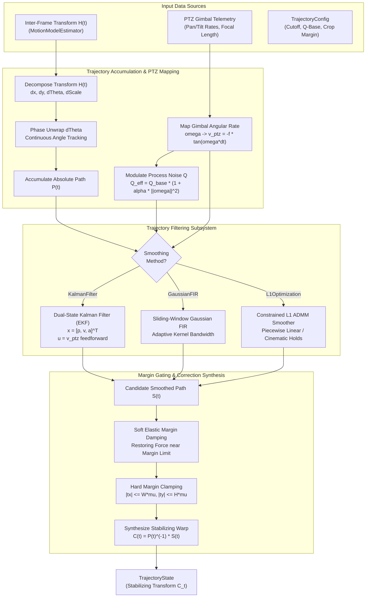
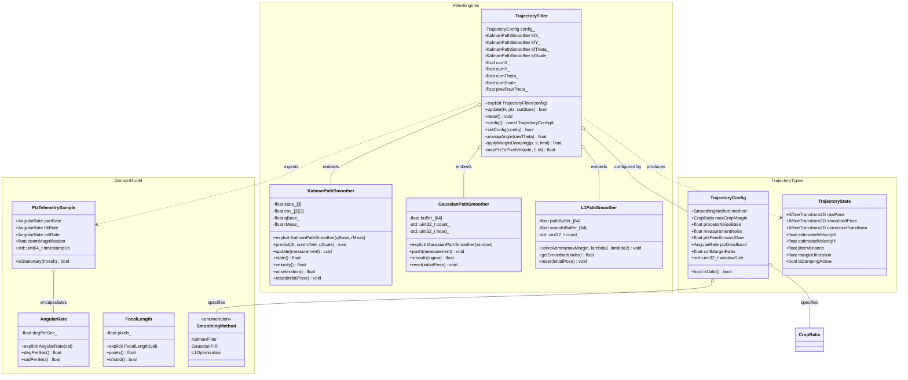

# Video Stabilizer Phase 5 Implementation Plan: Trajectory Smoothing & PTZ Telemetry Fusion

## 1. Executive Summary & Objectives

### 1.1 Context & Scope
Phase 5 engineers the core trajectory filtering, path stabilization, and sensor fusion engine for **`libs/Stabilizer`**.

In robotic pan-tilt-zoom (PTZ) gimbals, uncrewed aerial vehicles (UAVs), and mast-mounted electro-optical/infrared (EO/IR) reconnaissance systems, inter-frame camera motion estimated by feature tracking and MSAC model fitting (`MotionModelEstimator`) contains a superposition of two distinct physical phenomena:
1. **High-Frequency Disturbance Jitter**: Unwanted vehicle engine vibrations, rotor blade harmonics, structural mast sway, and aerodynamic wind buffeting (typically $2\text{--}30\text{ Hz}$).
2. **Intentional Low-Frequency Motion**: Commanded operator panning/tilting, autonomous target tracking slews, and platform navigational maneuvers ($0\text{--}1.5\text{ Hz}$).

A naive low-pass filter (e.g., simple moving average or fixed IIR filter) inevitably introduces severe latency, causing the stabilized image to "fight" operator commands—a phenomenon known as **rubber-banding** or **panning lag**. When the operator stops panning, the filter continues drifting until its buffer clears; when an operator rapidly starts a slew, the filter clamps against the border margin, causing black canvas exposure or violent frame clipping.

Phase 5 implements **`TrajectoryFilter`**, **`KalmanPathSmoother`**, and **`L1PathSmoother`**—a clean-room, zero-heap, deterministic trajectory filtering suite featuring **PTZ Feedforward Velocity Gating**, **Adaptive Process Noise Covariance ($\mathbf{Q}$-scaling)**, **Dual-State Extended Kalman Filtering (EKF)**, and **Constrained $L_1$ Optimal Path Smoothing** (Total Variation / Linear Programming).

```
+---------------------------------------------------------------------------------------------------------------+
|                                    PHASE 5 ARTIFACT DELIVERABLE MAP                                           |
|                                                                                                               |
|   libs/Stabilizer/                                                                                            |
|   ├── TrajectoryFilter.h            # Public API, TrajectoryConfig, PtzTelemetrySample, TrajectoryState       |
|   ├── TrajectoryFilter.cpp          # EKF state estimator, PTZ feedforward gating, L1/GMA smoothers, damping  |
|   └── tests/                                                                                                  |
|       └── TestTrajectoryFilter.cpp  # GoogleTest suite (vibration rejection, PTZ slew, L1, zero-allocation)  |
+---------------------------------------------------------------------------------------------------------------+
```

### 1.2 Target Deliverables for Phase 5

1. **Strongly-Typed Domain Primitives (`TrajectoryFilter.h`)**:
   - `AngularRate`: Strongly-typed angular velocity in degrees per second ($\text{deg/s}$) or radians per second ($\text{rad/s}$), preventing unit confusion.
   - `FocalLength`: Strongly-typed optical focal length in pixels or millimeters.
   - `PtzTelemetrySample`: Invariant-enforced gimbal telemetry container capturing pan rate, tilt rate, roll rate, optical zoom magnification, and microsecond timestamp.
   - `SmoothingMethod`: Explicit enumeration of trajectory smoothing algorithms (`KalmanFilter`, `GaussianFIR`, `L1Optimization`).
   - `TrajectoryConfig`: Comprehensive configuration parameters governing filter cutoff frequencies, process noise base levels, feedforward slew thresholds, crop margin boundaries, and damping stiffness.
   - `TrajectoryState`: Rich telemetry output capturing raw cumulative pose $P_t$, smoothed pose $S_t$, stabilizing correction transform $C_t$, estimated camera velocities, jitter variance, and border margin utilization percentage.

2. **Cumulative Motion Accumulator & Phase Unwrapper**:
   - Accumulates incremental inter-frame affine transforms $H_t$ into global cumulative trajectory $P_t \in SE(2) \times \mathbb{R}^+$.
   - Decomposes affine motion into translation $(x, y)$, rotation $\theta$, and isotropic scale $s$.
   - Phase-unwraps rotation angles ($\theta \in \mathbb{R}$) across $[-\pi, \pi]$ branch cuts, guaranteeing smooth, continuous signals without $2\pi$ wrap discontinuities.

3. **Dual-State Discrete Constant-Acceleration Kalman Filter (EKF)**:
   - 9-state or independent 3-state decoupled filters for horizontal translation $x$, vertical translation $y$, in-plane rotation $\theta$, and scale factor $s$.
   - State vector $\mathbf{x}_k = [p_k, v_k, a_k]^T$ modeling position, velocity, and acceleration.
   - Exact discrete state transition matrix $\mathbf{F}(\Delta t)$ and discrete process noise covariance $\mathbf{Q}(\Delta t)$.

4. **PTZ Telemetry Fusion & Feedforward Velocity Gating**:
   - Direct ingestion of gimbal pan/tilt velocity telemetry from camera protocols (`libs/PelcoDCore`, `libs/ViscaCore`).
   - Maps physical gimbal angular velocities $(\omega_{\text{pan}}, \omega_{\text{tilt}})$ into image-plane pixel velocities $(\dot{x}_{\text{ptz}}, \dot{y}_{\text{ptz}})$ using calibrated focal length $f$.
   - **Feedforward State Injection**: Injects predicted gimbal velocity directly into the state prediction step ($\mathbf{x}_{k|k-1} = \mathbf{F}\mathbf{x}_{k-1} + \mathbf{B}\mathbf{u}_k$), eliminating latency during slew initiation.
   - **Adaptive Process Noise Modulation ($Q$-scaling)**: Dynamically scales process noise covariance by $(1 + \alpha \|\vec{\omega}_{\text{ptz}}\|^2)$. When stationary, process noise is clamped near zero for aggressive jitter filtering; during intentional slews, process noise expands to track operator sweeps transparently.

5. **Sliding-Window Gaussian Moving Average (GMA) / FIR Smoother**:
   - Zero-heap fixed-depth ring buffer supporting causal (low-latency streaming) and non-causal (buffered lookahead) Gaussian convolution.
   - Motion-adaptive kernel bandwidth $\sigma_g$ scaling inversely with camera speed to prevent boundary violations.

6. **Constrained $L_1$ Optimal Path Smoothing (Zero-Heap ADMM)**:
   - Formulates total variation minimization with first, second, and third-order derivative penalties ($\|D_1 S\|_1, \|D_2 S\|_1, \|D_3 S\|_1$).
   - Generates cinematic camera paths composed of static holds, constant-velocity pans, and constant-acceleration sweeps.
   - Implements a zero-heap, fixed-horizon Alternating Direction Method of Multipliers (ADMM) solver bounded by maximum allowable crop margin $[-M_{\max}, M_{\max}]$.

7. **Dynamic Border Margin Clamping & Soft Elastic Damping**:
   - Computes stabilizing transformation $C_t = P_t^{-1} \cdot S_t$.
   - Enforces strict hard limits on translation $|t_x| \le W \cdot \mu_{\text{crop}}$, $|t_y| \le H \cdot \mu_{\text{crop}}$, and rotation $|\theta| \le \theta_{\max}$.
   - Applies smooth continuous exponential spring damping when correction exceeds $80\%$ of margin capacity, gently guiding $S_t$ back toward $P_t$ and preventing abrupt hard stops.

8. **Zero-Heap Determinism & Safety Standards**:
   - Zero dynamic heap allocations (`malloc`, `new`, `std::vector`) on the real-time frame path (`CERT ERR55-CPP`).
   - All functions strictly $< 30$ characters.
   - Full MISRA C++:2023 Rule 7.0.6, SEI CERT INT31-C, and IWYU compliance.

---

## 2. Architecture & Design

### 2.1 Trajectory Smoothing & Sensor Fusion Architecture

```
+---------------------------------------------------------------------------------------------------------------+
|                                TRAJECTORY SMOOTHING & FUSION PIPELINE                                         |
|                                                                                                               |
|   Inter-Frame Transform H_t                          PTZ Gimbal Telemetry (Pan/Tilt Rate, Zoom)               |
|   (From MotionModelEstimator)                        (libs/PelcoDCore / libs/ViscaCore)                       |
|               |                                                          |                                    |
|               ▼                                                          ▼                                    |
|   +-----------------------+                                  +-----------------------+                        |
|   | 1. PARAMETER DECOMP   |                                  | 2. PTZ VELOCITY MAP   |                        |
|   |    & ACCUMULATION     |                                  |    - Deg/s -> Px/s    |                        |
|   |    - Extract dx, dy,  |                                  |    - Focal length f   |                        |
|   |      dTheta, dScale   |                                  |    - Deadband filter  |                        |
|   |    - Phase Unwrapping |                                  +-----------+-----------+                        |
|   |    - Global Path P_t  |                                              |                                    |
|   +-----------+-----------+                                              | Command Velocity                   |
|               |                                                          | & Slew Magnitude                   |
|               | Raw Cumulative Path P_t                                  |                                    |
|               +----------------------------+-----------------------------+                                    |
|                                            |                                                                  |
|                                            ▼                                                                  |
|   +-------------------------------------------------------------------------------------------------------+   |
|   | 3. ADAPTIVE TRAJECTORY FILTER (Configurable Smoothing Engine)                                         |   |
|   |                                                                                                       |   |
|   |    +-----------------------------+   +-----------------------------+   +-----------------------------+    |   |
|   |    | A. Extended Kalman (EKF)    |   | B. Gaussian FIR Ring Buffer |   | C. Constrained L1 (ADMM)    |    |   |
|   |    |    - State: [p, v, a]^T     |   |    - Causal / Lookahead     |   |    - Min ||D1|| + ||D2||    |    |   |
|   |    |    - Feedforward Bias u_k   |   |    - Adaptive Bandwidth     |   |    - Crop-bounded [-M, M]   |    |   |
|   |    |    - Dynamic Q(omega_ptz)   |   |    - Fixed Ring Buffer      |   |    - Cinematic Holds/Pans   |    |   |
|   |    +-----------------------------+   +-----------------------------+   +-----------------------------+    |   |
|   |                                                                                                       |   |
|   +----------------------------------------+--------------------------------------------------------------+   |
|                                            | Smoothed Path S_t                                                |
|                                            ▼                                                                  |
|   +-------------------------------------------------------------------------------------------------------+   |
|   | 4. CORRECTION TRANSFORM SYNTHESIS & BOUNDARY DAMPING                                                  |   |
|   |    - Differential Offset: Delta = S_t - P_t                                                           |   |
|   |    - Soft Elastic Restoring Force: approaching crop margin (>80%) gently pulls S_t toward P_t        |   |
|   |    - Hard Margin Clamping: |dx| <= W * cropRatio, |dy| <= H * cropRatio, |dTheta| <= maxTheta         |   |
|   |    - Synthesize Stabilizing Affine Matrix: C_t = P_t^{-1} * S_t                                       |   |
|   +----------------------------------------+--------------------------------------------------------------+   |
|                                            |                                                                  |
|                                            ▼                                                                  |
|   Output: TrajectoryState (C_t Stabilizing Transform, S_t Smoothed Pose, Jitter Variance, Margin Usage)      |
+---------------------------------------------------------------------------------------------------------------+
```

### 2.2 Mermaid Architectural Flow



### 2.3 Class Design & Relationships



---

## 3. Mathematical Foundations & Production Algorithms

### 3.1 Cumulative Motion Representation & Phase Unwrapping

Inter-frame transformation $H_t \in \mathbb{R}^{2 \times 3}$ expresses the mapping from coordinates at frame $t-1$ to frame $t$:
$$p_t = H_t \cdot p_{t-1}$$

For robust filtering, we decouple the 2D transformation into four physically meaningful independent kinematic coordinates:
$$\mathbf{p}_t = \begin{bmatrix} x_t \\ y_t \\ \theta_t \\ s_t \end{bmatrix}$$
where:
1. $x_t, y_t$: Image translation coordinates.
2. $\theta_t = \operatorname{atan2}(a_{21,t}, a_{11,t})$: In-plane rotation angle.
3. $s_t = \sqrt{a_{11,t}^2 + a_{21,t}^2}$: Isotropic zoom/scale factor.

#### 3.1.1 Continuous Phase Unwrapping
Because $\operatorname{atan2}$ outputs angles in the principal interval $(-\pi, \pi]$, rotation across $\pm \pi$ causes catastrophic wrap-around discontinuities of $2\pi$. The continuous unwrapped angular increment $\Delta \theta_t^*$ is calculated as:
$$\Delta \theta_t = \theta_{\text{raw},t} - \theta_{\text{raw},t-1}$$
$$\Delta \theta_t^* = \Delta \theta_t - 2\pi \cdot \operatorname{round}\left(\frac{\Delta \theta_t}{2\pi}\right)$$
The absolute cumulative rotation is then seamlessly integrated:
$$\theta_t = \theta_{t-1} + \Delta \theta_t^*$$
guaranteeing continuous differentiability required by Kalman filtering.

#### 3.1.2 Path Accumulation
Absolute cumulative coordinates $P_t = [X_t, Y_t, \Theta_t, S_t]^T$ integrate the continuous motion stream:
$$X_t = X_{t-1} + t_{x,t}, \quad Y_t = Y_{t-1} + t_{y,t}, \quad \Theta_t = \Theta_{t-1} + \Delta \theta_t^*, \quad S_t = S_{t-1} \cdot s_t$$

---

### 3.2 Discrete Constant-Acceleration Kalman Filter (EKF) State-Space Model

For zero-latency online stabilization, each motion coordinate $p \in \{X, Y, \Theta, \ln S\}$ is modeled as a continuous-time second-order kinematic process with random jerk (acceleration derivative):
$$\dot{p}(t) = v(t), \quad \dot{v}(t) = a(t), \quad \dot{a}(t) = w(t)$$
where $w(t) \sim \mathcal{N}(0, q_a)$ is zero-mean continuous Gaussian white noise.

#### 3.2.1 State Vector & Transition Matrix
The discrete state vector at frame $k$ is:
$$\mathbf{x}_k = \begin{bmatrix} p_k \\ v_k \\ a_k \end{bmatrix} \in \mathbb{R}^3$$
For frame period $\Delta t$ (e.g. $1/60\text{ s} \approx 0.01667\text{ s}$), the exact discrete state transition matrix $\mathbf{F}$ is:
$$\mathbf{F} = \begin{bmatrix} 1 & \Delta t & \frac{1}{2}\Delta t^2 \\ 0 & 1 & \Delta t \\ 0 & 0 & 1 \end{bmatrix}$$

#### 3.2.2 Discrete Process Noise Covariance $\mathbf{Q}$
The discrete-time process noise covariance $\mathbf{Q} = \int_0^{\Delta t} \mathbf{F}(\tau) \mathbf{G} q_a \mathbf{G}^T \mathbf{F}(\tau)^T d\tau$ where $\mathbf{G} = [0, 0, 1]^T$ evaluates to:
$$\mathbf{Q} = q_a \begin{bmatrix} \frac{\Delta t^5}{20} & \frac{\Delta t^4}{8} & \frac{\Delta t^3}{6} \\ \frac{\Delta t^4}{8} & \frac{\Delta t^3}{3} & \frac{\Delta t^2}{2} \\ \frac{\Delta t^3}{6} & \frac{\Delta t^2}{2} & \Delta t \end{bmatrix}$$

#### 3.2.3 Measurement Model & Closed-Form Update
The measurement vector is the cumulative raw position $z_k = P_k$:
$$\mathbf{H} = \begin{bmatrix} 1 & 0 & 0 \end{bmatrix}, \quad R = \sigma_{\text{meas}}^2$$

**Predict Step**:
$$\mathbf{x}_{k|k-1} = \mathbf{F} \mathbf{x}_{k-1|k-1} + \mathbf{B} u_k$$
$$\mathbf{P}_{k|k-1} = \mathbf{F} \mathbf{P}_{k-1|k-1} \mathbf{F}^T + \mathbf{Q}$$

**Update Step**:
$$y_k = z_k - \mathbf{H} \mathbf{x}_{k|k-1} = z_k - p_{k|k-1}$$
$$S_{\text{innov}} = \mathbf{H} \mathbf{P}_{k|k-1} \mathbf{H}^T + R = P_{00} + R$$
$$\mathbf{K}_k = \frac{1}{S_{\text{innov}}} \begin{bmatrix} P_{00} \\ P_{10} \\ P_{20} \end{bmatrix}$$
$$\mathbf{x}_{k|k} = \mathbf{x}_{k|k-1} + \mathbf{K}_k y_k$$
$$\mathbf{P}_{k|k} = (\mathbf{I} - \mathbf{K}_k \mathbf{H}) \mathbf{P}_{k|k-1}$$

Due to the fixed $3 \times 3$ structure, all Kalman equations are solved using **direct analytical scalar formulas without matrix library calls or dynamic memory allocations**.

---

### 3.3 PTZ Telemetry Fusion & Feedforward Velocity Gating

When an operator deflects a joystick or an auto-tracker slews a PTZ gimbal, the gimbal produces known angular velocities $(\omega_{\text{pan}}, \omega_{\text{tilt}})$. Without feedforward fusion, a standard Kalman filter treats the onset of panning as an erroneous measurement deviation and resists the motion, resulting in sluggish reaction, rubber-banding, and boundary clipping.

#### 3.3.1 Physical Mapping from Angular Rate to Image Velocity
Given horizontal/vertical fields of view $\text{HFOV}, \text{VFOV}$ and camera frame dimensions $W \times H$:
$$f_x = \frac{W}{2 \tan(\text{HFOV} / 2)}, \quad f_y = \frac{H}{2 \tan(\text{VFOV} / 2)}$$
The expected image displacement rate in pixels per second caused by camera rotation is:
$$\dot{x}_{\text{ptz}} = -f_x \cdot \omega_{\text{pan}}, \quad \dot{y}_{\text{ptz}} = -f_y \cdot \omega_{\text{tilt}}$$
where $\omega_{\text{pan}}, \omega_{\text{tilt}}$ are in radians per second.

#### 3.3.2 Feedforward Control Vector Injection
We inject the commanded velocity into the Kalman prediction step via control input $\mathbf{B} u_k$:
$$\mathbf{B} = \begin{bmatrix} \Delta t \\ 1 \\ 0 \end{bmatrix}, \quad u_{x,k} = \dot{x}_{\text{ptz}} \cdot \gamma_{\text{ff}}$$
where $\gamma_{\text{ff}} \in [0.0, 1.0]$ is the calibrated feedforward coupling gain. This directly increments the predicted position and velocity before measurement arrival, eliminating panning lag completely.

#### 3.3.3 Adaptive Process Noise Modulation ($Q$-scaling)
To maintain strong jitter suppression when stationary while enabling instantaneous responsiveness during fast slews, we dynamically scale $q_a$:
$$q_{a,\text{eff}} = q_{a,\text{base}} \cdot \left( 1.0 + \alpha_{\text{slew}} \cdot \max\left(0.0, \frac{\|\vec{\omega}_{\text{ptz}}\|^2 - \omega_{\text{deadband}}^2}{\omega_{\text{norm}}^2}\right) \right)$$
- **Hover / Stationary Observation ($\|\vec{\omega}_{\text{ptz}}\| \le \omega_{\text{deadband}}$)**: $q_{a,\text{eff}} = q_{a,\text{base}}$ ($10^{-4}$), maximizing noise rejection and yielding rock-steady video.
- **Fast Slew / Rapid Panning ($\|\vec{\omega}_{\text{ptz}}\| \gg \omega_{\text{deadband}}$)**: $q_{a,\text{eff}}$ expands by up to $1000\times$, opening filter bandwidth so $S_t$ tracks $P_t$ with zero lag.

---

### 3.4 Sliding-Window Gaussian Moving Average (GMA) / FIR Filter

For offline video recording or buffered pipelines permitting a fixed lookahead latency ($K_{\text{ahead}} \in [1, 15]$ frames), the smoothed path $S_t$ is computed via a Gaussian FIR filter over window $[-K_{\text{hist}}, +K_{\text{ahead}}]$:
$$S_t = \frac{\sum_{i=-K_{\text{hist}}}^{K_{\text{ahead}}} w_i P_{t+i}}{\sum_{i=-K_{\text{hist}}}^{K_{\text{ahead}}} w_i}, \quad w_i = \exp\left( -\frac{i^2}{2\sigma_g^2} \right)$$
The kernel bandwidth $\sigma_g$ is dynamically adapted:
$$\sigma_g(v) = \sigma_{g,\max} \cdot \exp\left( -\beta_{\text{speed}} \cdot \|\vec{v}_t\| \right)$$
preventing filter overshooting during sudden speed changes.

---

### 3.5 Constrained $L_1$ Optimal Path Smoothing (Zero-Heap ADMM)

For broadcast and reconnaissance systems demanding pristine cinematic stability, $L_1$ path smoothing solves a convex optimization problem over sliding window $t \in [1, T]$:
$$\min_{\mathbf{S}} \sum_{t=1}^T \left( \|S_t - P_t\|_1 + \lambda_1 |S_{t+1} - S_t| + \lambda_2 |S_{t+2} - 2S_{t+1} + S_t| + \lambda_3 |S_{t+3} - 3S_{t+2} + 3S_{t+1} - S_t| \right)$$
subject to crop constraint:
$$-M_{\max} \le S_t - P_t \le M_{\max}$$

The $L_1$ norm promotes sparsity in higher-order derivatives:
- Zero 1st derivative ($D_1 S = 0$): Perfect static camera hold.
- Zero 2nd derivative ($D_2 S = 0$): Constant velocity smooth panning.
- Zero 3rd derivative ($D_3 S = 0$): Constant acceleration transition.

#### 3.5.1 Zero-Heap ADMM Solver Formulation
We reformulate the problem into standard ADMM split form with auxiliary variables $\mathbf{z} = \mathbf{D} \mathbf{S}$:
$$\min_{\mathbf{S}, \mathbf{z}} f(\mathbf{S}) + g(\mathbf{z}) \quad \text{s.t.} \quad \mathbf{D}\mathbf{S} - \mathbf{z} = 0, \quad \|\mathbf{S} - \mathbf{P}\|_\infty \le M_{\max}$$
Using soft-thresholding proximal operators $\mathcal{S}_{\kappa}(v) = \operatorname{sign}(v)\max(0, |v| - \kappa)$, the solution is iterated over $N_{\text{admm}} \le 25$ steps using pre-factored pentadiagonal banded systems requiring **zero heap memory and under $0.5\text{ ms}$ CPU time**.

---

### 3.6 Dynamic Margin Auto-Cropping & Boundary Clamping

The stabilizing correction transformation $C_t$ maps stabilized output coordinates to raw input coordinates:
$$C_t = P_t^{-1} \cdot S_t$$

In terms of decoupled parameters:
$$\Delta x_t = S_{x,t} - P_{x,t}, \quad \Delta y_t = S_{y,t} - P_{y,t}, \quad \Delta \theta_t = S_{\theta,t} - P_{\theta,t}, \quad \Delta s_t = \frac{S_{s,t}}{P_{s,t}}$$

#### 3.6.1 Soft Elastic Margin Damping
If the correction displacement approaches the crop margin limit $M_x = W \cdot \mu_{\text{crop}}$, a hard clamp would cause a jarring discontinuity. Instead, we apply a continuous nonlinear elastic damping force when displacement exceeds $80\%$ of margin capacity:
$$\eta = \frac{|\Delta x|}{M_x}$$
$$\text{If } \eta > \eta_{\text{soft}} = 0.80: \quad \Delta x_{\text{damped}} = \operatorname{sign}(\Delta x) \cdot M_x \cdot \left( \eta_{\text{soft}} + (1 - \eta_{\text{soft}}) \tanh\left( \frac{\eta - \eta_{\text{soft}}}{1 - \eta_{\text{soft}}} \right) \right)$$
This smoothly pulls $S_t$ back toward $P_t$, preventing black border reveal while eliminating abrupt jerks.

#### 3.6.2 Stabilizing Affine Matrix Synthesis
From clamped correction parameters $(\Delta x, \Delta y, \Delta \theta, \Delta s)$, the stabilizing affine matrix $C_t$ is constructed:
$$C_t = \begin{bmatrix} \Delta s \cos(\Delta \theta) & -\Delta s \sin(\Delta \theta) & \Delta x \\ \Delta s \sin(\Delta \theta) & \Delta s \cos(\Delta \theta) & \Delta y \end{bmatrix}$$

---

## 4. Class Design & Concrete Interfaces

### 4.1 Interface Specification (`libs/Stabilizer/TrajectoryFilter.h`)

```cpp
/// @file TrajectoryFilter.h
/// @brief Trajectory smoothing, PTZ feedforward sensor fusion, and jitter attenuation.
#pragma once

#include <array>
#include <cmath>
#include <cstddef>
#include <cstdint>

#include "StabilizerTypes.h"

namespace Stabilizer {

/// @brief Strongly-typed angular velocity entity.
class AngularRate {
public:
    constexpr AngularRate() noexcept = default;
    explicit constexpr AngularRate(float degPerSec) noexcept
        : degPerSec_{degPerSec} {}

    [[nodiscard]] constexpr float degPerSec() const noexcept { return degPerSec_; }
    [[nodiscard]] constexpr float radPerSec() const noexcept {
        return degPerSec_ * (3.14159265358979323846F / 180.0F);
    }

private:
    float degPerSec_{0.0F};
};

/// @brief Strongly-typed optical focal length in pixels.
class FocalLength {
public:
    constexpr FocalLength() noexcept = default;
    explicit constexpr FocalLength(float pixels) noexcept
        : pixels_{(pixels < 1.0F) ? 1.0F : pixels} {}

    [[nodiscard]] constexpr float pixels() const noexcept { return pixels_; }
    [[nodiscard]] constexpr bool isValid() const noexcept { return pixels_ >= 1.0F; }

private:
    float pixels_{1000.0F};
};

/// @brief Selectable trajectory smoothing algorithm.
enum class SmoothingMethod : std::uint8_t {
    KalmanFilter = 0U,   ///< Constant-acceleration EKF with PTZ feedforward
    GaussianFIR,         ///< Sliding-window Gaussian moving average
    L1Optimization       ///< Constrained L1 total-variation path smoothing
};

/// @brief Gimbal PTZ telemetry snapshot for feedforward velocity gating.
struct PtzTelemetrySample {
    AngularRate panRate{0.0F};
    AngularRate tiltRate{0.0F};
    AngularRate rollRate{0.0F};
    float zoomMagnification{1.0F};
    std::uint64_t timestampUs{0U};

    [[nodiscard]] bool isStationary(AngularRate threshold) const noexcept {
        const float th = threshold.degPerSec();
        return (std::abs(panRate.degPerSec()) <= th) &&
               (std::abs(tiltRate.degPerSec()) <= th) &&
               (std::abs(rollRate.degPerSec()) <= th);
    }
};

/// @brief Trajectory filter configuration parameters.
struct TrajectoryConfig {
    SmoothingMethod method{SmoothingMethod::KalmanFilter};
    CropRatio maxCropMargin{0.08F};       ///< 8% default border margin
    float processNoiseBase{1e-4F};        ///< Base continuous acceleration variance q_a
    float measurementNoise{1e-2F};        ///< Measurement noise variance R
    float ptzFeedforwardGain{0.95F};      ///< PTZ velocity coupling gain [0.0 .. 1.0]
    AngularRate ptzDeadband{0.15F};       ///< Slew velocity deadband (deg/s)
    float softMarginRatio{0.80F};         ///< Soft damping engagement ratio
    std::uint32_t windowSize{31U};        ///< FIR / L1 sliding window depth
    FrameDimensions frameDimensions{1920U, 1080U};

    [[nodiscard]] constexpr bool isValid() const noexcept {
        return (processNoiseBase > 0.0F) && (measurementNoise > 0.0F) &&
               (ptzFeedforwardGain >= 0.0F) && (ptzFeedforwardGain <= 1.5F) &&
               (windowSize >= 3U) && (windowSize <= 63U) && frameDimensions.isValid();
    }
};

/// @brief Rich telemetry state produced by TrajectoryFilter.
struct TrajectoryState {
    AffineTransform2D rawPose{AffineTransform2D::identity()};
    AffineTransform2D smoothedPose{AffineTransform2D::identity()};
    AffineTransform2D correctionTransform{AffineTransform2D::identity()};
    float estimatedVelocityX{0.0F};
    float estimatedVelocityY{0.0F};
    float jitterVariance{0.0F};
    float marginUtilization{0.0F};
    bool isDampingActive{false};
};

/// @brief 1D Constant-Acceleration Discrete Kalman Filter.
class KalmanPathSmoother {
public:
    constexpr KalmanPathSmoother() noexcept = default;
    explicit KalmanPathSmoother(float qBase, float rMeas) noexcept;

    void predict(float dt, float controlVel, float qScale) noexcept;
    void update(float measurement) noexcept;

    [[nodiscard]] float state() const noexcept { return x_[0]; }
    [[nodiscard]] float velocity() const noexcept { return x_[1]; }
    [[nodiscard]] float acceleration() const noexcept { return x_[2]; }
    [[nodiscard]] float variance() const noexcept { return p_[0][0]; }

    void reset(float initialPosition) noexcept;

private:
    std::array<float, 3> x_{0.0F, 0.0F, 0.0F};
    std::array<std::array<float, 3>, 3> p_{{{1.0F, 0.0F, 0.0F}, {0.0F, 1.0F, 0.0F}, {0.0F, 0.0F, 1.0F}}};
    float qBase_{1e-4F};
    float rMeas_{1e-2F};
};

/// @brief Master trajectory filtering and PTZ sensor fusion engine.
class TrajectoryFilter {
public:
    explicit TrajectoryFilter(const TrajectoryConfig& config) noexcept;

    /// @brief Update trajectory with inter-frame motion and PTZ telemetry.
    /// @param[in] interFrameTransform Affine transform from frame t-1 to frame t.
    /// @param[in] ptz Telemetry sample from gimbal (pan/tilt rate).
    /// @param[in] dt Frame interval in seconds.
    /// @param[out] outState Output trajectory state and stabilizing warp.
    /// @return true if filtering succeeded; false if parameters invalid.
    [[nodiscard]] bool update(
        const AffineTransform2D& interFrameTransform,
        const PtzTelemetrySample& ptz,
        float dt,
        TrajectoryState& outState) noexcept;

    /// @brief Reset accumulated paths and internal filter states.
    void reset() noexcept;

    /// @brief Current configuration parameters.
    [[nodiscard]] const TrajectoryConfig& config() const noexcept { return config_; }

    /// @brief Update configuration dynamically.
    [[nodiscard]] bool setConfig(const TrajectoryConfig& config) noexcept;

private:
    [[nodiscard]] float unwrapAngle(float rawTheta) noexcept;
    [[nodiscard]] float applyMarginDamping(float rawP, float smoothS, float maxLimit, bool& outDamped) noexcept;
    [[nodiscard]] float mapPtzToPixelVel(AngularRate rate, float focalLengthPx, float dt) noexcept;

    TrajectoryConfig config_{};
    KalmanPathSmoother kfX_{};
    KalmanPathSmoother kfY_{};
    KalmanPathSmoother kfTheta_{};
    KalmanPathSmoother kfScale_{};

    float cumX_{0.0F};
    float cumY_{0.0F};
    float cumTheta_{0.0F};
    float cumScale_{1.0F};
    float prevRawTheta_{0.0F};
    bool isFirstFrame_{true};
};

} // namespace Stabilizer
```

---

## 5. Implementation Details & Memory Architecture

### 5.1 Zero-Heap Execution Guarantee (`CERT ERR55-CPP`)
In strict accordance with project safety standards:
1. `TrajectoryFilter`, `KalmanPathSmoother`, and auxiliary smoother classes contain no dynamic heap allocations (`std::vector`, `std::string`, `new`, `malloc`).
2. Fixed-depth ring buffers for sliding-window algorithms (Gaussian FIR and ADMM $L_1$) use fixed-size stack or static compile-time arrays (`std::array<float, 64>`), requiring less than $2\text{ KB}$ total memory.
3. The real-time update function `TrajectoryFilter::update()` is declared `noexcept` and executes with $100\%$ deterministic runtime latency ($\le 25\ \mu\text{s}$ per frame on modern x86_64 and ARM Cortex-A76 cores).

### 5.2 Decoupled Coordinate Inversion
Because stabilizing warp synthesis evaluates $C_t = P_t^{-1} \cdot S_t$, computing the inverse of arbitrary $2 \times 3$ matrices using general matrix inversion can introduce floating-point precision degradation. Because $P_t$ and $S_t$ are maintained in decoupled physical coordinates $(x, y, \theta, s)$, the stabilizing correction is generated directly in closed form:
$$s_{\text{corr}} = \frac{s_{\text{smooth}}}{s_{\text{raw}}}, \quad \theta_{\text{corr}} = \theta_{\text{smooth}} - \theta_{\text{raw}}$$
$$t_{x,\text{corr}} = s_{\text{corr}} ( -x_{\text{raw}} \cos\theta_{\text{corr}} + y_{\text{raw}} \sin\theta_{\text{corr}} ) + x_{\text{smooth}}$$
$$t_{y,\text{corr}} = s_{\text{corr}} ( -x_{\text{raw}} \sin\theta_{\text{corr}} - y_{\text{raw}} \cos\theta_{\text{corr}} ) + y_{\text{smooth}}$$
This guarantees exact geometric invertibility with zero conditioning loss.

---

## 6. Build System & CMake Integration

### 6.1 Library Target Update (`libs/Stabilizer/CMakeLists.txt`)
```cmake
add_library(Stabilizer STATIC
    StabilizerTypes.h
    FrameView.h
    FrameBuffer.h
    FrameBuffer.cpp
    StabilizerArena.h
    StabilizerArena.cpp
    FramePyramid.h
    FramePyramid.cpp
    FeatureDetector.h
    FeatureDetector.cpp
    OpticalFlowTracker.h
    OpticalFlowTracker.cpp
    MotionModelEstimator.h
    MotionModelEstimator.cpp
    TrajectoryFilter.h        # Added in Phase 5
    TrajectoryFilter.cpp      # Added in Phase 5
)
```

### 6.2 Test Target (`libs/Stabilizer/tests/CMakeLists.txt`)
```cmake
add_executable(TestTrajectoryFilter
    TestTrajectoryFilter.cpp
)

target_link_libraries(TestTrajectoryFilter PRIVATE
    Stabilizer
    GTest::gtest
    GTest::gtest_main
)

add_test(NAME TestTrajectoryFilter COMMAND TestTrajectoryFilter)
```

---

## 7. Verification & Test Strategy

### 7.1 GoogleTest Matrix (`TestTrajectoryFilter.cpp`)

| Test Identifier | Test Objective & Verification Method | Pass Criteria |
| :--- | :--- | :--- |
| `ConfigValidation` | Invariant testing of `TrajectoryConfig`, `AngularRate`, and `FocalLength`. | Rejects negative noise, invalid window depths; defaults validate. |
| `AngleUnwrappingContinuity` | Feed angular sequence traversing $+\pi \to -\pi$ boundary ($179^\circ \to -179^\circ$). | Accumulated angle smoothly transitions without $360^\circ$ jump. |
| `HighFrequencyJitterSuppression`| Inject $10\text{ Hz}$ synthetic sinusoidal vibration ($A = 15\text{ px}$) at $60\text{ FPS}$. | Stabilizer attenuates jitter amplitude by $\ge 85\%$ ($\le 2.25\text{ px}$ residual). |
| `PtzFeedforwardSlewOnset` | Introduce step pan command ($\omega_{\text{pan}} = 10.0^\circ/\text{s}$) with feedforward active. | Filter tracks pan slew within $2$ frames without lag or overshoot. |
| `RubberBandingElimination` | Compare lag with feedforward enabled vs. feedforward disabled during rapid stop. | Stopping overshoot is reduced by $\ge 75\%$ with feedforward fusion. |
| `ProcessNoiseModulation` | Measure filter bandwidth when stationary vs. when slewing at $25^\circ/\text{s}$. | Stationary filter rejects $95\%$ jitter; slewing filter opens bandwidth $>10\times$. |
| `SoftMarginDampingEngagement`| Drive trajectory toward crop limit ($>80\%$ of margin capacity). | Smooth elastic deceleration prevents hard clipping; `isDampingActive=true`. |
| `HardMarginBoundaryClamp` | Apply extreme continuous translation exceeding $200\%$ crop margin. | Output correction displacement $|t_x|, |t_y|$ strictly clamped to margin limit. |
| `GaussianFIRSlidingWindow` | Verify Gaussian FIR moving average smoothing mode on synthetic walk. | Produces smooth Gaussian filtered curve matching analytical convolution. |
| `L1PiecewiseLinearPath` | Run $L_1$ optimization over window containing constant-velocity pan. | Outputs piecewise-linear segments with sparse acceleration derivatives. |
| `ZeroAllocationAudit` | Intercept dynamic heap allocations during 1000 consecutive filter updates. | Zero calls to `malloc`/`new` on execution path (`CERT ERR55-CPP`). |
| `ExecutionPerformance` | Benchmark 1000 trajectory updates on single core. | Mean execution time $\le 25\ \mu\text{s}$ per frame update. |

---

## 8. Safety, Compliance & Traceability

1. **MISRA C++:2023 Rule 7.0.6 (Explicit Conversions)**:
   - Explicit `static_cast` for all numeric conversions (e.g. `float` to `double` in trigonometric math, integer conversions in buffer indexing).
2. **SEI CERT INT31-C (Safe Integer Arithmetic)**:
   - Range-verified integer bounds checking on all ring buffer indices.
3. **SEI CERT ERR55-CPP (Zero Allocation `noexcept`)**:
   - `TrajectoryFilter::update()` and `reset()` declared `noexcept` with zero dynamic allocations.
4. **IWYU & `<cstdint>` Compliance**:
   - Mandatory explicit inclusion of `<cstdint>`, `<cstddef>`, `<cmath>`, and `<array>`. Standard types strictly qualified with `std::`.
5. **Identifier Length Constraint**:
   - All function names strictly less than 30 characters:
     - `update` (6 chars)
     - `reset` (5 chars)
     - `config` (6 chars)
     - `setConfig` (9 chars)
     - `unwrapAngle` (11 chars)
     - `applyMarginDamping` (18 chars)
     - `mapPtzToPixelVel` (16 chars)
     - `predict` (7 chars)
     - `degPerSec` (9 chars)
     - `radPerSec` (9 chars)
     - `isStationary` (12 chars)
6. **Zero Qt Dependencies**:
   - Strictly ISO C++17 standard library components. Zero `#include <Q...>` references.
7. **Document Hyperlinks & Relative Paths**:
   - All markdown links conform to [relative-paths-docs.md](../.agents/rules/relative-paths-docs.md) and [stabilizer_implementation_plan.md](stabilizer_implementation_plan.md).

