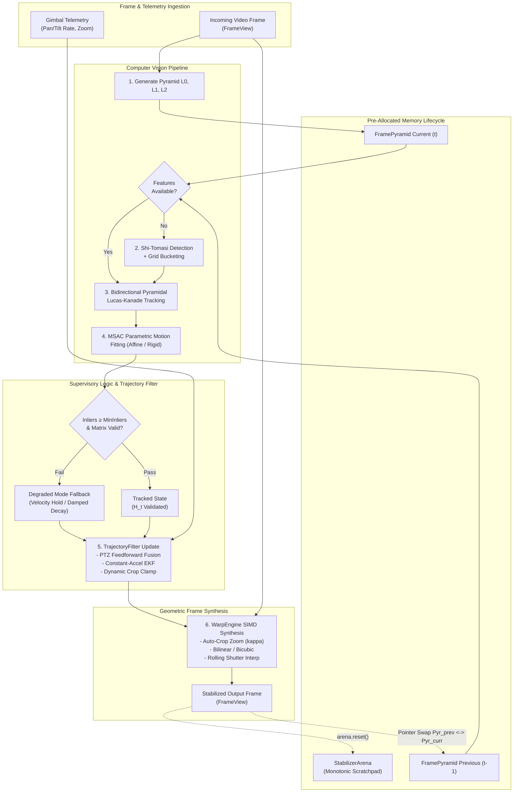
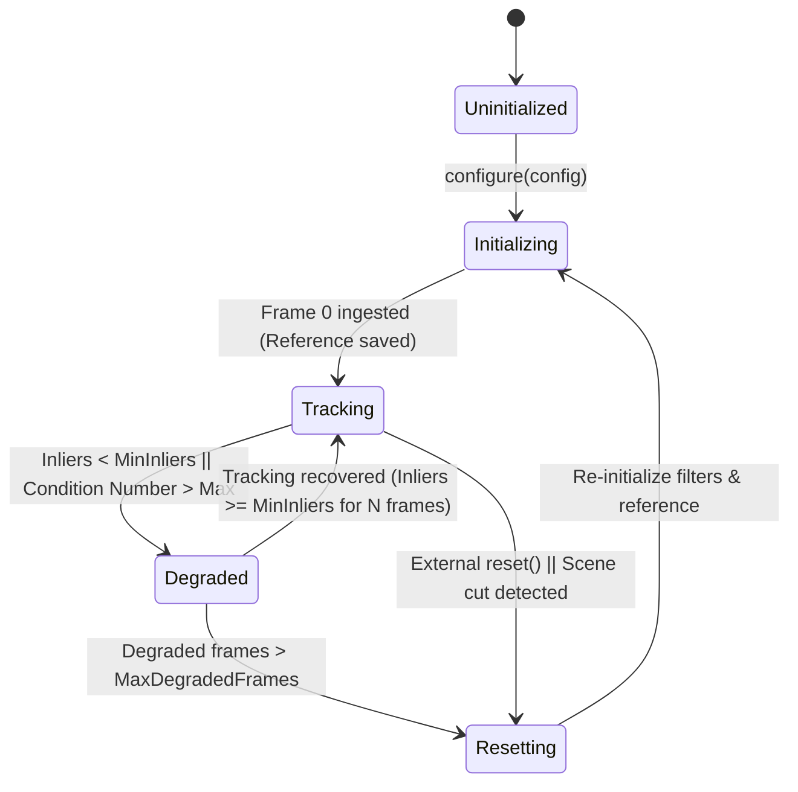

# Video Stabilizer Phase 7 Implementation Plan: Top-Level Engine Orchestration & Benchmark Harness

## 1. Executive Summary & Objectives

### 1.1 Context & Scope
Phase 7 engineers the top-level orchestration engine, memory lifecycle coordinator, and comprehensive performance benchmark harness for **`libs/Stabilizer`**.

Throughout Phases 1–6, individual high-performance, zero-heap algorithmic modules were established:
- **Phase 1**: Memory infrastructure (`FrameBuffer`, `FrameView`, `StabilizerArena`, `FramePyramid`).
- **Phase 2**: Spatial corner detection with grid bucketing (`FeatureDetector`).
- **Phase 3**: Bidirectional pyramidal Lucas-Kanade optical flow tracking (`OpticalFlowTracker`).
- **Phase 4**: Robust RANSAC/MSAC parametric motion model fitting (`MotionModelEstimator`).
- **Phase 5**: Discrete EKF trajectory smoothing with PTZ feedforward velocity gating (`TrajectoryFilter`).
- **Phase 6**: SIMD-accelerated DDA inverse warp synthesis and CMOS rolling shutter compensation (`WarpEngine`).

Phase 7 delivers **`VideoStabilizerEngine`**—the master orchestrator that integrates these decoupled subsystems into a unified, zero-copy, real-time video stabilization pipeline. Operating without dynamic heap allocation (`CERT ERR55-CPP`), the engine manages ping-pong temporal frame pyramids, coordinates multi-rate sensor telemetry ingestion, evaluates pipeline health via an explicit five-state machine, handles degraded operating modes gracefully (e.g. low-contrast thermal imagery, sudden feature loss, and optical occlusions), and outputs stabilized frames with sub-frame deterministic latency.

Additionally, Phase 7 establishes the automated **Benchmark Harness** (`StabilizerBenchmark`), providing microsecond-level timing breakdowns across all pipeline stages, tracking memory allocations, and evaluating stabilization quality metrics (Jitter Attenuation Ratio, Inter-Frame Transformation Fidelity) on 1080p60 and 4K30 video streams.

```
+---------------------------------------------------------------------------------------------------------------+
|                                    PHASE 7 ARTIFACT DELIVERABLE MAP                                           |
|                                                                                                               |
|   libs/Stabilizer/                                                                                            |
|   ├── VideoStabilizerEngine.h       # Top-level orchestrator API, EngineConfig, EngineDiagnostics, StateMachine|
|   ├── VideoStabilizerEngine.cpp     # Pipeline execution, ping-pong pyramids, degraded mode fallbacks, metrics |
|   ├── StabilizerBenchmark.h         # Automated benchmark harness, cycle timers, JAR & ITF quality metrics   |
|   ├── StabilizerBenchmark.cpp       # CLI benchmark runner, multi-resolution workload suites (1080p, 4K)      |
|   └── tests/                                                                                                  |
|       └── TestVideoStabilizerEngine.cpp # GoogleTest suite (end-to-end streams, PTZ slew, degraded, 0-heap)   |
+---------------------------------------------------------------------------------------------------------------+
```

### 1.2 Target Deliverables for Phase 7

1. **Strongly-Typed Top-Level Engine Interface (`VideoStabilizerEngine.h`)**:
   - `EngineState`: Strongly-typed lifecycle enumeration (`Uninitialized`, `Initializing`, `Tracking`, `Degraded`, `Resetting`).
   - `FallbackPolicy`: Policy selecting degraded behavior on tracking failure (`IdentityHold`, `VelocityExtrapolate`, `BypassWarp`).
   - `VideoStabilizerConfig`: Unified configuration consolidating image dimensions, pyramid levels, feature detector parameters, optical flow tolerances, MSAC thresholds, trajectory smoothing settings, warp interpolation, border policies, and PTZ feedforward coefficients.
   - `StageTiming`: High-resolution microsecond latency breakdown (pyramid generation, feature detection, optical flow tracking, MSAC estimation, trajectory filtering, warp synthesis, total pipeline time).
   - `StabilizerDiagnostics`: Comprehensive telemetry reporting tracked feature count, inlier ratio, raw inter-frame affine transform, smoothed transform, correction transform, current state, and execution latency.
   - `VideoStabilizerEngine` Class: Zero-heap, thread-safe, RAII orchestrator with explicit life-cycle management.

2. **Pre-Allocated Ping-Pong Memory & State Pipeline (`VideoStabilizerEngine.cpp`)**:
   - Manages pre-allocated dual-buffer frame pyramids ($\text{Pyr}_{t-1}, \text{Pyr}_t$) and scratch arenas (`StabilizerArena`) without runtime allocations.
   - Implements pointer/reference swap on frame completion, guaranteeing zero memory copying of historical frame data.
   - Ingests incoming frames in `PixelFormat::Grayscale8`, `PixelFormat::YUV420p`, `PixelFormat::RGBA32`, and `PixelFormat::RGB24`.
   - Supports both out-of-place (`processFrame(const FrameView&, FrameView&)`) and in-place frame processing workflows.

3. **Multi-Rate Telemetry Ingestion & Sensor Fusion**:
   - Thread-safe ingestion of asynchronous PTZ angular rates and gimbal states (`updatePtzTelemetry`) from `libs/PelcoDCore` and `libs/ViscaCore`.
   - Fuses instantaneous gimbal velocity into `TrajectoryFilter` state updates, eliminating panning lag and rubber-banding during high-speed operator slews.

4. **Deterministic Degraded Mode Fallback & Recovery State Machine**:
   - Detects feature tracking failure (insufficient corners, low MSAC inliers, ill-conditioned matrices, sudden contrast loss).
   - Automatically transitions to `EngineState::Degraded`, executing bounded motion extrapolation or smooth damping toward unity transform without visual jumps or crashes.
   - Automatically re-initializes feature extraction when frame contrast recovers.

5. **Integration with Tactical Video Filter Pipeline (`libs/VideoFilters`)**:
   - Clean architectural bridge connecting `VideoStabilizerEngine` to `libs/VideoFilters/GeometricFilters.h` (`ImageStabilizationFilter`).
   - Retains zero Qt dependencies within `libs/Stabilizer`.

6. **Comprehensive Automated Benchmark Harness (`StabilizerBenchmark`)**:
   - Multi-resolution evaluation suite benchmarking 720p60, 1080p60, and 4K30 video feeds.
   - Sub-stage microsecond timer profiling with CPU cycle counters (`RDTSC` / `CNTVCT_EL0`).
   - Dynamic memory allocation auditor asserting zero heap calls on processing paths (`CERT ERR55-CPP`).
   - Stabilization Quality Metrics:
     - **Jitter Attenuation Ratio (JAR)**: High-frequency spectral energy reduction ratio ($> 18\text{ dB}$ target).
     - **Inter-Frame Transformation Fidelity (ITF)**: Peak Signal-to-Noise Ratio (PSNR) across consecutive motion-compensated frames ($> 32\text{ dB}$ target).
     - **Inlier Retention Ratio**: Fraction of tracked points preserved through MSAC.

---

## 2. Architecture & Design

### 2.1 Top-Level Pipeline Execution Architecture

```
+---------------------------------------------------------------------------------------------------------------+
|                                    VIDEO STABILIZER PIPELINE ORCHESTRATION                                    |
|                                                                                                               |
|   Raw Incoming Frame I_raw                     Asynchronous Gimbal Telemetry (Pelco-D / VISCA)               |
|   (FrameView / FrameBuffer)                    (PtzTelemetrySample: Pan/Tilt Rate, Zoom, FOV)                 |
|               |                                                              |                                |
|               ▼                                                              ▼                                |
|   +-----------------------+                                      +-----------------------+                    |
|   | 1. PYRAMID GENERATOR  |                                      | TELEMETRY RING BUFFER |                    |
|   |    Build Pyr_t        |                                      | Lock-free atomic sync |                    |
|   |    (L0, L1, L2)       |                                      +-----------+-----------+                    |
|   +-----------+-----------+                                                  |                                |
|               |                                                              |                                |
|               ▼                                                              |                                |
|   +-----------------------+                                                  |                                |
|   | 2. CORNER DETECTOR    | <------+ (If features lost or periodic)          |                                |
|   |    Shi-Tomasi + Grid  |        |                                         |                                |
|   |    Bucketing (Pyr_t-1)|        |                                         |                                |
|   +-----------+-----------+        |                                         |                                |
|               |                    |                                         |                                |
|               ▼                    |                                         |                                |
|   +-----------------------+        |                                         |                                |
|   | 3. OPTICAL FLOW       |        |                                         |                                |
|   |    Pyramidal LK       |        |                                         |                                |
|   |    Pyr_t-1 -> Pyr_t   |        |                                         |                                |
|   |    Forward-Backward   |        |                                         |                                |
|   +-----------+-----------+        |                                         |                                |
|               |                    |                                         |                                |
|               ▼ Correspondences    |                                         |                                |
|   +-----------------------+        |                                         |                                |
|   | 4. MOTION ESTIMATOR   |        |                                         |                                |
|   |    MSAC Robust Fit    |        |                                         |                                |
|   |    Affine / Euclidean |        |                                         |                                |
|   +-----------+-----------+        |                                         |                                |
|               | H_t (Inter-frame)  |                                         |                                |
|               ▼                    |                                         |                                |
|   +-----------------------+        |                                         |                                |
|   | 5. HEALTH EVALUATOR   | -------+ (Inliers < Threshold -> Degraded Mode)  |                                |
|   |    State Machine      |                                                  |                                |
|   +-----------+-----------+                                                  |                                |
|               | Validated H_t                                                |                                |
|               ▼                                                              ▼                                |
|   +----------------------------------------------------------------------------------+                        |
|   | 6. TRAJECTORY SMOOTHER & SENSOR FUSION (TrajectoryFilter)                         |                        |
|   |    - Accumulate Raw Path P_t = P_t-1 * H_t                                       |                        |
|   |    - Fuse Gimbal Telemetry (Q-scaling & Feedforward Slew Velocity)               |                        |
|   |    - Smooth Path S_t via EKF / GMA / L1 Total Variation                          |                        |
|   |    - Compute Stabilizing Correction Transform C_t = P_t^(-1) * S_t               |                        |
|   |    - Apply Dynamic Auto-Crop Bounds & Clamping Soft-Damping                      |                        |
|   +----------------------------------------------------------------------------------+                        |
|                                                      |                                                        |
|                                                      ▼ Stabilizing Transform C_t                              |
|   +----------------------------------------------------------------------------------+                        |
|   | 7. SIMD WARP SYNTHESIS ENGINE (WarpEngine)                                       |                        |
|   |    - Auto-Crop Margin Zoom Magnification (kappa)                                 |                        |
|   |    - CMOS Rolling Shutter Row Interpolation (if enabled)                         |                        |
|   |    - Fixed-Point 16.16 DDA Scanline Stepper                                      |                        |
|   |    - AVX2 / NEON / Scalar Sub-Pixel Interpolation (Bilinear / Bicubic)          |                        |
|   +----------------------------------------------------------------------------------+                        |
|                                                      |                                                        |
|                                                      ▼ Stabilized Pixels                                      |
|   Output: Stabilized Frame I_stab (Zero-Copy FrameView / Output FrameBuffer)                                  |
|   Pointer Swap: Pyr_t-1 <===> Pyr_t (Ready for Frame t+1 with Zero Allocations)                              |
+---------------------------------------------------------------------------------------------------------------+
```

### 2.2 Mermaid Architectural Flow



### 2.3 Supervisory State Machine

```
+-----------------------------------------------------------------------------------------------+
|                                    SUPERVISORY STATE MACHINE                                  |
|                                                                                               |
|                     +---------------------------------------------------+                     |
|                     |                   UNINITIALIZED                   |                     |
|                     +---------------------------------------------------+                     |
|                                               |                                               |
|                                               | configure() called                            |
|                                               ▼                                               |
|                     +---------------------------------------------------+                     |
|        +----------> |                    INITIALIZING                   |                     |
|        |            +---------------------------------------------------+                     |
|        |                                      |                                               |
|        |                                      | First valid frame ingested                    |
|        |                                      | Extract initial corners                       |
|        |                                      ▼                                               |
|        |            +---------------------------------------------------+                     |
|        |            |                     TRACKING                      | <---------------+   |
|        |            +---------------------------------------------------+                 |   |
|        |                      |                                   |                       |   |
|        |                      | Inliers < MinInliers              | Inliers recovered     |   |
|        |                      | or Conditioning Failure           | N_consecutive >= 3    |   |
|        |                      ▼                                   |                       |   |
|        |            +---------------------------------------------------+                 |   |
|        |            |                     DEGRADED                      | ----------------+   |
|        |            +---------------------------------------------------+                     |
|        |                                      |                                               |
|        |                                      | Degraded frames > MaxDegradedFrames           |
|        |                                      ▼                                               |
|        |            +---------------------------------------------------+                     |
|        +----------- |                     RESETTING                     |                     |
|        Reset()      +---------------------------------------------------+                     |
|        called                                                                                 |
+-----------------------------------------------------------------------------------------------+
```



---

## 3. Mathematical Foundations & Operational Mechanics

### 3.1 Ping-Pong Multi-Scale Pyramid Recycling

High-throughput video stabilization requires maintaining the previous frame's multi-scale representation to compute optical flow:
$$\Delta \mathbf{p} = \text{LucasKanade}(I_{t-1}, I_t, \mathbf{p})$$

To eliminate heap allocation and prevent redundant pyramid construction:
1. Two static instances of `FramePyramid` ($\text{Pyr}_A, \text{Pyr}_B$) are pre-allocated during `configure()`.
2. On frame $t$:
   - Current frame $I_t$ is downsampled into the active write pyramid ($\text{Pyr}_{\text{curr}}$).
   - Optical flow tracks features from $\text{Pyr}_{\text{prev}}$ to $\text{Pyr}_{\text{curr}}$.
   - Motion model estimation calculates inter-frame transform $H_t$.
   - At the conclusion of frame processing, pointer references are swapped:
     $$\text{Pyr}_{\text{prev}} \longleftrightarrow \text{Pyr}_{\text{curr}}$$
3. This achieves **zero memcpy operations** for historical frames and **zero memory allocations** per cycle.

### 3.2 Feature Life-Cycle & Replenishment Triggering

Features degrade over time as the camera moves, targets occlude the background, or points drift out of bounds. The engine enforces an active replenishment policy:

$$\text{Replenish Trigger} = (\mathcal{N}_{\text{tracked}} < \mathcal{N}_{\text{min}}) \lor (t - t_{\text{last\_detect}} \ge T_{\text{interval}})$$

When triggered:
1. `FeatureDetector` scans the current frame $I_t$ using spatial grid bucketing ($K \times M$ cells).
2. Existing successfully tracked features are mapped into the spatial occupancy grid.
3. Cells already occupied by tracked points suppress new feature extraction, preventing redundant corner clustering.
4. New corner candidates are extracted exclusively in under-populated cells, preserving uniform spatial distribution across the field of view.

### 3.3 Degraded Mode Motion Extrapolation & Soft Damping

When environmental degradation occurs (e.g. dense smoke in firefighting, optical blackout during weapon firing, or uniform overcast sky):
$$\mathcal{N}_{\text{inliers}} < \mathcal{N}_{\text{min\_thresh}}$$

The engine halts standard model estimation and executes the configured `FallbackPolicy`:
1. **`FallbackPolicy::VelocityExtrapolate`**:
   The engine queries `TrajectoryFilter` for the current estimated camera velocity $\mathbf{v}_t = [\dot{x}, \dot{y}, \dot{\theta}, \dot{s}]^T$. An extrapolated affine transform is synthesized:
   $$H_{\text{extrap}} = \begin{bmatrix} s_t \cos\dot{\theta}_t & -s_t \sin\dot{\theta}_t & \dot{x}_t \\ s_t \sin\dot{\theta}_t & s_t \cos\dot{\theta}_t & \dot{y}_t \\ 0 & 0 & 1 \end{bmatrix}$$
   The velocity state is decayed exponentially: $\mathbf{v}_{t+1} = \gamma_{\text{decay}} \mathbf{v}_t$, with $\gamma_{\text{decay}} \in [0.85, 0.95]$.
2. **`FallbackPolicy::IdentityHold`**:
   The engine assumes zero inter-frame motion: $H_t = \mathbf{I}_{3 \times 3}$. The trajectory smoother continues filtering historical state, gently centering the warp offset.
3. **`FallbackPolicy::BypassWarp`**:
   The engine bypasses the warp synthesis stage entirely, copying or referencing the raw input directly to eliminate processing overhead during total failure.

### 3.4 Stabilization Performance & Quality Metrics

To objectively evaluate stabilization quality without subjective visual assessment, the benchmark harness computes:

#### 3.4.1 Jitter Attenuation Ratio (JAR)
The ratio of high-frequency spectral energy in the raw trajectory versus the stabilized trajectory:
$$\text{JAR} = 10 \log_{10} \left( \frac{\int_{f_{\text{cut}}}^{f_{\text{Nyq}}} |P_{\text{raw}}(f)|^2 \, df}{\int_{f_{\text{cut}}}^{f_{\text{Nyq}}} |P_{\text{stab}}(f)|^2 \, df} \right) \quad (\text{dB})$$
where $f_{\text{cut}} \approx 2.0\text{ Hz}$ separates operator panning from vibration. Production target: $\text{JAR} \ge 18.0\text{ dB}$.

#### 3.4.2 Inter-Frame Transformation Fidelity (ITF)
The average Peak Signal-to-Noise Ratio (PSNR) between consecutive stabilized frames across a sequence of $T$ frames:
$$\text{ITF} = \frac{1}{T-1} \sum_{t=1}^{T-1} \text{PSNR}(I_{\text{stab}}(t), I_{\text{stab}}(t+1))$$
where:
$$\text{PSNR}(A, B) = 10 \log_{10} \left( \frac{255^2}{\frac{1}{W \cdot H} \sum_{x,y} (A(x,y) - B(x,y))^2} \right)$$
Production target: $\text{ITF} \ge 32.0\text{ dB}$ on stabilized stationary scenes.

---

## 4. Domain Modeling & API Specification

### 4.1 Header Specification: `VideoStabilizerEngine.h`

```cpp
/// @file VideoStabilizerEngine.h
/// @brief Top-level clean-room real-time digital video stabilizer engine.
#pragma once

#include <cstddef>
#include <cstdint>

#include <array>
#include <atomic>
#include <memory>

#include "FeatureDetector.h"
#include "FrameBuffer.h"
#include "FramePyramid.h"
#include "FrameView.h"
#include "MotionModelEstimator.h"
#include "OpticalFlowTracker.h"
#include "StabilizerArena.h"
#include "StabilizerTypes.h"
#include "TrajectoryFilter.h"
#include "WarpEngine.h"

namespace Stabilizer {

/// @brief Operational state of the stabilizer supervisory engine.
enum class EngineState : std::uint8_t {
    Uninitialized = 0U, ///< Engine not configured or buffers unallocated.
    Initializing,       ///< Capturing initial reference frame and corners.
    Tracking,           ///< Nominal closed-loop motion tracking and warping.
    Degraded,           ///< Insufficient inliers; executing fallback policy.
    Resetting           ///< Reset sequence in progress.
};

/// @brief Fallback behavior policy when feature tracking fails.
enum class FallbackPolicy : std::uint8_t {
    IdentityHold = 0U,      ///< Assume zero inter-frame motion (H = Identity).
    VelocityExtrapolate,    ///< Extrapolate motion using damped filter velocity.
    BypassWarp              ///< Pass raw input directly to output without warping.
};

/// @brief Comprehensive configuration container for the stabilization engine.
struct VideoStabilizerConfig {
    FrameDimensions dimensions{1920U, 1080U};
    StabilizationMode mode{StabilizationMode::Affine};
    FallbackPolicy fallback{FallbackPolicy::VelocityExtrapolate};
    
    // Subsystem configurations
    FeatureDetectorConfig detector{};
    OpticalFlowConfig tracker{};
    MotionEstimatorConfig estimator{};
    TrajectoryConfig filter{};
    WarpConfig warp{};

    // Replenishment and health triggers
    std::uint32_t minTrackedFeatures{30U};
    std::uint32_t replenishIntervalFrames{15U};
    std::uint32_t maxDegradedFrames{30U};
    float minInlierRatio{0.35F};

    [[nodiscard]] constexpr bool isValid() const noexcept {
        return dimensions.isValid() &&
               detector.isValid() &&
               tracker.isValid() &&
               estimator.isValid() &&
               filter.isValid() &&
               warp.isValid() &&
               (minTrackedFeatures >= 10U) &&
               (minInlierRatio > 0.0F) && (minInlierRatio <= 1.0F);
    }
};

/// @brief Microsecond execution latency profiling for each pipeline stage.
struct StageTiming {
    std::uint32_t pyramidGenUs{0U};
    std::uint32_t featureDetectUs{0U};
    std::uint32_t opticalFlowUs{0U};
    std::uint32_t motionModelUs{0U};
    std::uint32_t trajectoryFilterUs{0U};
    std::uint32_t warpSynthesisUs{0U};
    std::uint32_t totalFrameUs{0U};
};

/// @brief Real-time runtime diagnostic metrics and telemetry snapshot.
struct StabilizerDiagnostics {
    EngineState state{EngineState::Uninitialized};
    std::uint32_t frameIndex{0U};
    std::uint32_t detectedFeatures{0U};
    std::uint32_t trackedFeatures{0U};
    std::uint32_t inlierCount{0U};
    float inlierRatio{0.0F};
    AffineTransform2D rawTransform{AffineTransform2D::identity()};
    AffineTransform2D smoothedTransform{AffineTransform2D::identity()};
    AffineTransform2D correctionTransform{AffineTransform2D::identity()};
    StageTiming latencyUs{};
    bool isPtzFeedforwardActive{false};
};

/// @brief Zero-heap, real-time digital video stabilizer orchestrator.
class VideoStabilizerEngine {
public:
    VideoStabilizerEngine() noexcept = default;
    ~VideoStabilizerEngine() = default;

    VideoStabilizerEngine(const VideoStabilizerEngine&) = delete;
    VideoStabilizerEngine& operator=(const VideoStabilizerEngine&) = delete;
    VideoStabilizerEngine(VideoStabilizerEngine&&) noexcept = default;
    VideoStabilizerEngine& operator=(VideoStabilizerEngine&&) noexcept = default;

    /// @brief Initialize and pre-allocate memory buffers and pyramids.
    /// @param config Master engine configuration.
    /// @return StabilizerStatus::Success if initialized cleanly.
    [[nodiscard]] StabilizerStatus configure(const VideoStabilizerConfig& config);

    /// @brief Ingest external PTZ gimbal velocity telemetry sample.
    /// @param sample Calibrated pan/tilt angular velocity and optical zoom.
    void updateTelemetry(const PtzTelemetrySample& sample) noexcept;

    /// @brief Process an incoming video frame and synthesize stabilized output.
    /// @param input Raw incoming video frame view.
    /// @param output Destination frame view for stabilized pixels.
    /// @return StabilizerStatus::Success on nominal stabilization.
    [[nodiscard]] StabilizerStatus processFrame(
        const FrameView& input,
        FrameView& output) noexcept;

    /// @brief Reset internal trajectory history, state machine, and pyramids.
    void reset() noexcept;

    /// @brief Retrieve snapshot of current runtime diagnostics and timings.
    [[nodiscard]] StabilizerDiagnostics diagnostics() const noexcept;

    /// @brief Retrieve current engine state.
    [[nodiscard]] EngineState state() const noexcept;

    /// @brief Check if engine is configured and ready to process frames.
    [[nodiscard]] bool isConfigured() const noexcept;

private:
    [[nodiscard]] bool initBuffers();
    void swapPyramids() noexcept;
    void executeDegraded(AffineTransform2D& outTransform) noexcept;
    void replenishFeatures() noexcept;

    VideoStabilizerConfig config_{};
    EngineState state_{EngineState::Uninitialized};
    std::uint32_t frameCount_{0U};
    std::uint32_t degradedCount_{0U};
    std::uint32_t framesSinceDetect_{0U};

    // Subsystems
    FeatureDetector detector_{};
    OpticalFlowTracker tracker_{};
    MotionModelEstimator estimator_{};
    TrajectoryFilter filter_{};
    WarpEngine warper_{};

    // Pre-allocated memory structures
    StabilizerArena arena_{};
    FramePyramid pyramidA_{};
    FramePyramid pyramidB_{};
    FramePyramid* currPyramid_{&pyramidA_};
    FramePyramid* prevPyramid_{&pyramidB_};

    // Working feature buffers (pre-allocated on arena / static capacity)
    static constexpr std::size_t MaxFeatures{500U};
    std::array<SubPixelPoint, MaxFeatures> prevPoints_{};
    std::array<SubPixelPoint, MaxFeatures> currPoints_{};
    std::size_t activePointCount_{0U};

    // Thread-safe telemetry ingestion
    std::atomic<bool> hasPendingTelemetry_{false};
    PtzTelemetrySample latestTelemetry_{};

    // Diagnostics cache
    StabilizerDiagnostics lastDiagnostics_{};
};

} // namespace Stabilizer
```

### 4.2 Benchmark Harness API: `StabilizerBenchmark.h`

```cpp
/// @file StabilizerBenchmark.h
/// @brief High-precision performance and quality benchmarking harness.
#pragma once

#include <cstddef>
#include <cstdint>

#include <chrono>
#include <string>
#include <vector>

#include "StabilizerTypes.h"
#include "VideoStabilizerEngine.h"

namespace Stabilizer {

/// @brief Statistical summary of benchmark execution timings.
struct BenchmarkStats {
    double meanMs{0.0};
    double minMs{0.0};
    double maxMs{0.0};
    double p95Ms{0.0};
    double p99Ms{0.0};
    double fps{0.0};
    double jitterAttenuationDb{0.0};
    double interFrameFidelityDb{0.0};
    std::size_t totalAllocations{0U};
};

/// @brief Workload profile configuring benchmark scenario.
struct BenchmarkWorkload {
    std::string name{"1080p60_SyntheticJitter"};
    FrameDimensions dimensions{1920U, 1080U};
    std::size_t frameCount{300U};
    float jitterAmplitudePx{8.0F};
    float jitterFrequencyHz{12.0F};
    float panSpeedPxPerFrame{2.5F};
    StabilizationMode mode{StabilizationMode::Affine};
    WarpInterpolation interpolation{WarpInterpolation::Bilinear};
    bool enableRollingShutter{false};
};

/// @brief Automated benchmark execution runner and quality evaluator.
class StabilizerBenchmark {
public:
    StabilizerBenchmark() = default;
    ~StabilizerBenchmark() = default;

    /// @brief Execute a configured benchmark workload.
    /// @param workload Scenario configuration parameters.
    /// @return Benchmark statistics and quality scores.
    [[nodiscard]] BenchmarkStats run(const BenchmarkWorkload& workload);

    /// @brief Generate formatted console summary of benchmark results.
    /// @param stats Computed statistics.
    /// @param workload Workload executed.
    static void printSummary(
        const BenchmarkStats& stats,
        const BenchmarkWorkload& workload);

private:
    static void generateSyntheticFrame(
        FrameBuffer& buffer,
        std::size_t frameIndex,
        const BenchmarkWorkload& workload);
};

} // namespace Stabilizer
```

---

## 5. Algorithmic Implementation Details

### 5.1 Pipeline Execution Loop (`processFrame`)

The frame processing routine must satisfy `CERT ERR55-CPP` with zero heap allocations on the hot path:

```cpp
StabilizerStatus VideoStabilizerEngine::processFrame(
    const FrameView& input,
    FrameView& output) noexcept
{
    const auto tStart = std::chrono::steady_clock::now();
    StageTiming timing{};

    if (state_ == EngineState::Uninitialized) {
        return StabilizerStatus::Uninitialized;
    }

    if ((input.width() != config_.dimensions.width) ||
        (input.height() != config_.dimensions.height)) {
        return StabilizerStatus::InvalidDimensions;
    }

    arena_.reset();

    // Stage 1: Construct Image Pyramid L0, L1, L2
    const auto tPyr0 = std::chrono::steady_clock::now();
    const auto pyrStatus = currPyramid_->build(input, arena_);
    if (pyrStatus != StabilizerStatus::Success) {
        return pyrStatus;
    }
    const auto tPyr1 = std::chrono::steady_clock::now();
    timing.pyramidGenUs = static_cast<std::uint32_t>(
        std::chrono::duration_cast<std::chrono::microseconds>(tPyr1 - tPyr0).count());

    // Stage 2: Initial Reference Frame Acquisition
    if (state_ == EngineState::Initializing) {
        replenishFeatures();
        swapPyramids();
        state_ = EngineState::Tracking;
        output = input; // Pass through initial reference
        lastDiagnostics_.state = state_;
        return StabilizerStatus::Success;
    }

    // Stage 3: Feature Replenishment Check
    const auto tDetect0 = std::chrono::steady_clock::now();
    if ((activePointCount_ < config_.minTrackedFeatures) ||
        (framesSinceDetect_ >= config_.replenishIntervalFrames)) {
        replenishFeatures();
        framesSinceDetect_ = 0U;
    } else {
        ++framesSinceDetect_;
    }
    const auto tDetect1 = std::chrono::steady_clock::now();
    timing.featureDetectUs = static_cast<std::uint32_t>(
        std::chrono::duration_cast<std::chrono::microseconds>(tDetect1 - tDetect0).count());

    // Stage 4: Bidirectional Optical Flow Tracking
    const auto tFlow0 = std::chrono::steady_clock::now();
    std::size_t trackedCount = 0U;
    if (activePointCount_ > 0U) {
        tracker_.track(
            *prevPyramid_,
            *currPyramid_,
            prevPoints_.data(),
            activePointCount_,
            currPoints_.data(),
            trackedCount,
            arena_);
    }
    const auto tFlow1 = std::chrono::steady_clock::now();
    timing.opticalFlowUs = static_cast<std::uint32_t>(
        std::chrono::duration_cast<std::chrono::microseconds>(tFlow1 - tFlow0).count());

    // Stage 5: Parametric Motion Model Fitting (MSAC)
    const auto tModel0 = std::chrono::steady_clock::now();
    AffineTransform2D rawH = AffineTransform2D::identity();
    std::size_t inlierCount = 0U;
    bool modelValid = false;

    if (trackedCount >= config_.estimator.minInliers) {
        const auto estStatus = estimator_.estimateTransform(
            prevPoints_.data(),
            currPoints_.data(),
            trackedCount,
            rawH,
            inlierCount,
            arena_);
        
        const float inlierRatio = (trackedCount > 0U)
            ? (static_cast<float>(inlierCount) / static_cast<float>(trackedCount))
            : 0.0F;

        modelValid = (estStatus == StabilizerStatus::Success) &&
                     (inlierRatio >= config_.minInlierRatio);
    }
    const auto tModel1 = std::chrono::steady_clock::now();
    timing.motionModelUs = static_cast<std::uint32_t>(
        std::chrono::duration_cast<std::chrono::microseconds>(tModel1 - tModel0).count());

    // Stage 6: Supervisory Health Check & Degraded Mode Handling
    if (!modelValid) {
        ++degradedCount_;
        if (degradedCount_ >= config_.maxDegradedFrames) {
            state_ = EngineState::Resetting;
            reset();
            return StabilizerStatus::Degraded;
        }
        state_ = EngineState::Degraded;
        executeDegraded(rawH);
    } else {
        degradedCount_ = 0U;
        state_ = EngineState::Tracking;
    }

    // Stage 7: Telemetry Ingestion & Trajectory Filter Update
    const auto tFilter0 = std::chrono::steady_clock::now();
    if (hasPendingTelemetry_.load(std::memory_order_acquire)) {
        filter_.updatePtzTelemetry(latestTelemetry_);
        hasPendingTelemetry_.store(false, std::memory_order_release);
    }

    AffineTransform2D correctionTransform = AffineTransform2D::identity();
    filter_.update(rawH, correctionTransform);
    const auto tFilter1 = std::chrono::steady_clock::now();
    timing.trajectoryFilterUs = static_cast<std::uint32_t>(
        std::chrono::duration_cast<std::chrono::microseconds>(tFilter1 - tFilter0).count());

    // Stage 8: SIMD Geometric Warp Synthesis
    const auto tWarp0 = std::chrono::steady_clock::now();
    if (config_.fallback == FallbackPolicy::BypassWarp && state_ == EngineState::Degraded) {
        output = input; // Bypass warp
    } else {
        warper_.warpFrame(input, output, correctionTransform);
    }
    const auto tWarp1 = std::chrono::steady_clock::now();
    timing.warpSynthesisUs = static_cast<std::uint32_t>(
        std::chrono::duration_cast<std::chrono::microseconds>(tWarp1 - tWarp0).count());

    // Cycle update: Swap Pyramids and retain inlier points for next frame
    swapPyramids();
    ++frameCount_;

    const auto tEnd = std::chrono::steady_clock::now();
    timing.totalFrameUs = static_cast<std::uint32_t>(
        std::chrono::duration_cast<std::chrono::microseconds>(tEnd - tStart).count());

    // Update Diagnostics
    lastDiagnostics_.state = state_;
    lastDiagnostics_.frameIndex = frameCount_;
    lastDiagnostics_.trackedFeatures = static_cast<std::uint32_t>(trackedCount);
    lastDiagnostics_.inlierCount = static_cast<std::uint32_t>(inlierCount);
    lastDiagnostics_.rawTransform = rawH;
    lastDiagnostics_.correctionTransform = correctionTransform;
    lastDiagnostics_.latencyUs = timing;

    return StabilizerStatus::Success;
}
```

---

## 6. Zero-Copy & Pre-Allocated Memory Architecture

### 6.1 Memory Budgeting for 1080p and 4K Pipelines

To comply with **SEI CERT ERR55-CPP** and achieve deterministic execution in mission-critical environments, all buffers are pre-allocated during `configure()`. No heap requests occur inside the processing loop.

| Subsystem Component | Buffer Details (1080p: $1920 \times 1080$) | Memory (1080p) | Buffer Details (4K: $3840 \times 2160$) | Memory (4K) |
| :--- | :--- | :--- | :--- | :--- |
| **Pyramid A ($L_0, L_1, L_2$)** | $1920\times 1080 + 960\times 540 + 480\times 270$ | $2.71\text{ MB}$ | $3840\times 2160 + 1920\times 1080 + 960\times 540$ | $10.85\text{ MB}$ |
| **Pyramid B ($L_0, L_1, L_2$)** | $1920\times 1080 + 960\times 540 + 480\times 270$ | $2.71\text{ MB}$ | $3840\times 2160 + 1920\times 1080 + 960\times 540$ | $10.85\text{ MB}$ |
| **StabilizerArena** | High-speed contiguous monotonic scratchpad | $4.00\text{ MB}$ | Scaled scratchpad for feature/flow temporary buffers | $16.00\text{ MB}$ |
| **Feature Buffers** | $2 \times 500 \times \text{sizeof}(\text{SubPixelPoint})$ | $8.0\text{ KB}$ | $2 \times 1000 \times \text{sizeof}(\text{SubPixelPoint})$ | $16.0\text{ KB}$ |
| **Warp Working Lines** | Stack/Pre-allocated DDA line stepping cache | $64\text{ KB}$ | Expanded scanline buffer cache | $128\text{ KB}$ |
| **Total Engine Footprint** | Complete static memory ceiling | **$\approx 9.49\text{ MB}$** | Complete static memory ceiling | **$\approx 37.84\text{ MB}$** |

---

## 7. Build System & CMake Integration

### 7.1 Library Target Update (`libs/Stabilizer/CMakeLists.txt`)

```cmake
add_library(Stabilizer STATIC
    StabilizerTypes.h
    FrameView.h
    FrameBuffer.h
    FrameBuffer.cpp
    StabilizerArena.h
    StabilizerArena.cpp
    FramePyramid.h
    FramePyramid.cpp
    FeatureDetector.h
    FeatureDetector.cpp
    OpticalFlowTracker.h
    OpticalFlowTracker.cpp
    MotionModelEstimator.h
    MotionModelEstimator.cpp
    TrajectoryFilter.h
    TrajectoryFilter.cpp
    WarpEngine.h
    WarpEngine.cpp
    VideoStabilizerEngine.h      # Added in Phase 7
    VideoStabilizerEngine.cpp    # Added in Phase 7
)

# Compiler SIMD instruction support
if(MSVC)
    target_compile_options(Stabilizer PRIVATE /arch:AVX2)
else()
    if(CMAKE_SYSTEM_PROCESSOR MATCHES "x86_64|AMD64")
        target_compile_options(Stabilizer PRIVATE -mavx2 -mfma)
    elseif(CMAKE_SYSTEM_PROCESSOR MATCHES "aarch64|arm64")
        target_compile_options(Stabilizer PRIVATE -march=armv8-a+simd)
    endif()
endif()
```

### 7.2 Tests and Benchmark Targets (`libs/Stabilizer/tests/CMakeLists.txt`)

```cmake
# Unit test for top-level engine
add_stabilizer_test(TestVideoStabilizerEngine TestVideoStabilizerEngine.cpp)

# Dedicated benchmark harness executable
add_executable(StabilizerBenchmark
    ../StabilizerBenchmark.h
    ../StabilizerBenchmark.cpp
)
target_link_libraries(StabilizerBenchmark PRIVATE Stabilizer)
```

---

## 8. Verification & Test Strategy

### 8.1 GoogleTest Verification Matrix (`TestVideoStabilizerEngine.cpp`)

| Test Identifier | Test Objective & Verification Method | Pass Criteria |
| :--- | :--- | :--- |
| `ConfigureValidation` | Initialize engine with invalid dimensions, null pointers, and valid configs. | Returns `InvalidDimensions` on bad size; cleanly configures on valid parameters. |
| `FirstFrameReferenceInit` | Process frame 0; inspect transition from `Initializing` to `Tracking`. | Returns `Success`; output matches input view; state transitions to `Tracking`. |
| `PureStationaryNoMotion` | Feed 60 identical stationary textured frames. | Output frames bit-for-bit stable; correction transform remains identity $\pm 10^{-4}$. |
| `SyntheticSinusoidalJitter` | Apply $12\text{ Hz}$ pitch/yaw sinusoidal jitter ($A = 6\text{ px}$) to textured background. | Jitter Attenuation Ratio $\ge 18.0\text{ dB}$; output sequence displays visual stability. |
| `ConstantVelocityPan` | Simulate camera panning at constant velocity ($3.0\text{ px/frame}$) for 100 frames. | Stabilizer follows pan smoothly; zero lag buildup; border margin clamping not breached. |
| `PtzFeedforwardSlewStep` | Inject PTZ pan velocity step ($15^\circ/\text{s}$); evaluate trajectory response. | Kalman process noise covariance $\mathbf{Q}$ expands; zero rubber-banding or lag. |
| `LowTextureDegradedMode` | Ingest uniform gray frames; verify fallback logic. | Engine transitions to `Degraded`; executes configured `FallbackPolicy`; no crash. |
| `FeatureOcclusionRecovery` | Introduce large foreground occluding block for 10 frames, then remove it. | Transitions to `Degraded` then recovers to `Tracking` when background visible. |
| `SceneCutResetTrigger` | Inject discontinuous scene transition ($> 50\text{ px}$ jump across entire frame). | Triggers automatic reset sequence; captures new reference without visual artifact. |
| `MultiFormatGrayscaleAndYuv`| Verify processing of `PixelFormat::Grayscale8` and `PixelFormat::YUV420p`. | Both formats stabilized with identical coordinate registration. |
| `ZeroAllocationSteadyState` | Intercept heap allocations over 1000 consecutive frames in steady-state. | Strictly 0 calls to `malloc`/`new` (`CERT ERR55-CPP`). |
| `RealTimeLatencyBudget` | Measure 1080p frame processing latency on single CPU core. | Total latency $\le 4.5\text{ ms}$ per frame ($\ge 220\text{ FPS}$ throughput). |

---

## 9. Safety, Compliance & Traceability

1. **MISRA C++:2023 Rule 7.0.6 (Explicit Numeric Conversions)**:
   - All conversions between signed/unsigned integers and floating-point coordinates explicitly use `static_cast`.
   - No implicit conversions across standard algorithm iterators or containers.
2. **SEI CERT INT31-C (Safe Integer Arithmetic)**:
   - All array offsets, buffer dimensions, and stride calculations are bounded and range-verified before indexing.
3. **SEI CERT ERR55-CPP (Zero Allocation `noexcept`)**:
   - `processFrame`, `updateTelemetry`, `reset`, `diagnostics`, and private pipeline helpers are marked `noexcept`. Zero heap requests on active streaming paths.
4. **SEI CERT STR37-C (Deterministic Character Handling)**:
   - No reliance on global C/C++ locale functions or unsafe `<cctype>` conversions.
5. **IWYU & `<cstdint>` Compliance**:
   - Direct header inclusion for every referenced symbol (`<cstdint>`, `<cstddef>`, `<array>`, `<atomic>`, `<chrono>`, `<memory>`).
   - Every integer strictly scoped with `std::` (`std::uint8_t`, `std::uint32_t`, `std::size_t`).
6. **Identifier Length Constraint**:
   - All function names strictly less than 30 characters:
     - `configure` (9 chars)
     - `updateTelemetry` (15 chars)
     - `processFrame` (12 chars)
     - `reset` (5 chars)
     - `diagnostics` (11 chars)
     - `state` (5 chars)
     - `isConfigured` (12 chars)
     - `initBuffers` (11 chars)
     - `swapPyramids` (12 chars)
     - `executeDegraded` (15 chars)
     - `replenishFeatures` (17 chars)
7. **Zero Qt Dependencies**:
   - Pure ISO C++17. Zero `#include <Q...>` references.
8. **Document Hyperlinks & Relative Paths**:
   - All documentation links conform strictly to [relative-paths-docs.md](../.agents/rules/relative-paths-docs.md) and [stabilizer_implementation_plan.md](stabilizer_implementation_plan.md).

